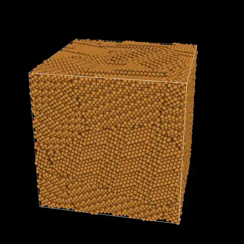

<p align="center">
  <picture>
    <source media="(prefers-color-scheme: dark)" srcset="https://raw.githubusercontent.com/mushroomfire/mdapy/v2/docs/assets/mdapy-logo-dark.png">
    
  </picture>
</p>

<p align="center">
  <b>Fast building, analysis, simulation and visualization of atomistic systems, in Python.</b>
</p>

<p align="center">
  <a href="https://github.com/mushroomfire/mdapy/actions/workflows/tests.yml"></a>
  
  
  <a href="https://github.com/mushroomfire/mdapy/blob/v2/LICENSE"></a>
  <a href="https://doi.org/10.1016/j.cpc.2023.108764"></a>
</p>

<p align="center">
  <a href="https://github.com/mushroomfire/mdapy/blob/v2/docs/index.md">Documentation</a> ·
  <a href="https://github.com/mushroomfire/mdapy/blob/v2/docs/getting-started/quick-tour.md">Quick tour</a> ·
  <a href="https://github.com/mushroomfire/mdapy/blob/v2/docs/getting-started/learn/table.md">Lessons</a> ·
  <a href="#examples">Examples</a> ·
  <a href="#install">Install</a> ·
  <a href="#tests">Tests</a> ·
  <a href="#citing-mdapy">Cite</a>
</p>

> **MDAPY 2.0 is a complete rewrite and is not compatible with MDAPY 1.x.** It is
> under development, and a first preview, 2.0.0a1, comes next. The stable release
> is `pip install mdapy==1.0.10`, with its
> [documentation](https://mdapy.readthedocs.io).

## Why MDAPY

- **Light.** [NumPy](https://numpy.org) and [polars](https://pola.rs) are its only
  requirements. Packages such as [matplotlib](https://matplotlib.org) or
  [ASE](https://wiki.fysik.dtu.dk/ase/) are optional, and it carries no other
  third-party code.
- **Robust.** More than 2,800 tests compare each feature with analytic results and with
  mature software. Results are the same for any number of threads, and damaged files or
  impossible inputs give a clear error, not a crash.
- **Fast.** The heavy parts run in C++, on a parallel engine of MDAPY's own. See the
  [benchmarks](https://github.com/mushroomfire/mdapy/blob/v2/docs/performance/comparison.md).
- **Predictable.** The code reads the same everywhere: a `System` never changes in place,
  every analysis has the form `compute(system)` and returns NumPy arrays, each concept
  has one name, and one unit system, Å, eV and ps, runs through everything.
- **Integrated.** One package and one `System`, from the first structure to the last
  picture. It converts systems to and from [ASE](https://wiki.fysik.dtu.dk/ase/),
  [OVITO](https://www.ovito.org), [pymatgen](https://pymatgen.org) and
  [freud](https://freud.readthedocs.io), takes any ASE calculator or
  [LAMMPS](https://www.lammps.org) interaction, shares a process with
  [PyTorch](https://pytorch.org), and works as one step of
  [high-throughput calculations](https://github.com/mushroomfire/mdapy/blob/v2/docs/getting-started/tutorials/high-throughput.md).

## What it does

| Area | What is in it |
|---|---|
| [**Build**](https://github.com/mushroomfire/mdapy/blob/v2/docs/build/crystals.md) | Crystals, polycrystals, alloys, defects and dislocations |
| [**Analyze**](https://github.com/mushroomfire/mdapy/blob/v2/docs/analysis/overview.md) | More than 40 analyses of structure, local order, defects and dynamics |
| [**Simulate**](https://github.com/mushroomfire/mdapy/blob/v2/docs/simulation/calculators.md) | EAM, NEP, [LAMMPS](https://www.lammps.org) and [ASE](https://wiki.fysik.dtu.dk/ase/) calculators; relaxation and dynamics; elastic constants and phonons, also of sheets such as graphene and at finite temperature; free energies of solids and liquids, melting points by the two-phase method, binary and pressure-temperature phase diagrams, and stacking faults at finite temperature |
| [**MLIP**](https://github.com/mushroomfire/mdapy/blob/v2/docs/mlip/checks.md) | Training sets from [VASP](https://www.vasp.at), descriptors, errors of a model, the frames worth computing |
| [**Visualize**](https://github.com/mushroomfire/mdapy/blob/v2/docs/visualization/rendering.md) | Ray-traced pictures on the processor or the graphics card, movies and plots |
| [**Exchange**](https://github.com/mushroomfire/mdapy/blob/v2/docs/getting-started/io.md) | Eight file formats, and systems shared with [ASE](https://wiki.fysik.dtu.dk/ase/), [OVITO](https://www.ovito.org), [pymatgen](https://pymatgen.org) and [freud](https://freud.readthedocs.io) |

## Examples

One copper polycrystal, from nothing to a movie.

<table>
<tr><th width="58%">Build</th><th>Grains, 81,734 atoms</th></tr>
<tr><td>

```python
import mdapy as mp
from mdapy.build import build_crystal, build_polycrystal
from mdapy.visualization import render

copper = build_crystal("fcc", 3.615, elements="Cu")
grains = build_polycrystal(copper, mp.Box(100.0), 8, seed=1)
render(grains, "grains.png", color="grain")
```

</td><td></td></tr>
<tr><th>Analyze</th><th>The atoms that are not fcc</th></tr>
<tr><td>

```python
from mdapy.identify import CommonNeighborAnalysis

structures = CommonNeighborAnalysis().compute(grains)
structures.counts()  # {'other': 21043, 'fcc': 60682, ...}
boundaries = structures.structure != 1  # not fcc
render(grains, "boundaries.png", atoms=boundaries, color=structures)
```

</td><td></td></tr>
<tr><th>Simulate</th><th>Phonons of copper</th></tr>
<tr><td>

```python
from mdapy.calculators import EAM
from mdapy.lattice_dynamics import phonons, primitive_cell
from mdapy.simulation import minimize
from mdapy.visualization import plot

eam = EAM.zhou(["Cu"])
relaxed = minimize(copper, eam, cell="full", max_stress=1e-4)
cell = primitive_cell(relaxed.system)
bands = phonons(cell, eam).band_structure("fcc")
with plot.style():
    fig, ax = plot.figure()
    plot.band_structure(bands, ax=ax)
    plot.save(fig, "phonons", formats=("png",))
```

</td><td></td></tr>
<tr><th>MLIP</th><th>The 20 frames most worth a DFT calculation</th></tr>
<tr><td>

```python
from mdapy import mlip

crystal = build_crystal("fcc", 3.615, elements="Cu", repeat=(3, 3, 3))
frames = mlip.perturb(crystal, 200, displacement=0.1, seed=1)
points = mlip.structure_descriptors(frames, mlip.SOAP(["Cu"]))
chosen = mlip.farthest_point_sampling(points, 20)

xy = mlip.principal_components(points).transform(points)
with plot.style():
    fig, ax = plot.figure()
    ax.scatter(*xy.T, s=4, color="0.7", label="all frames")
    ax.scatter(*xy[chosen].T, s=12, label="chosen")
    ax.set_xlabel("principal component 1")
    ax.set_ylabel("principal component 2")
    ax.legend()
    plot.save(fig, "frames", formats=("png",))
```

</td><td></td></tr>
</table>

### Make a movie

<p align="center">
  <a href="https://github.com/mushroomfire/mdapy/blob/v2/docs/getting-started/tutorials/movie.md"></a>
</p>

Give `render` a camera for each frame, and hand the pictures to `write_movie` one at a
time, which needs [FFmpeg](https://ffmpeg.org). This turns around the polycrystal:

```python
import numpy as np

from mdapy.visualization import write_movie

look = dict(style="matte", focus=(50, 50, 50), span=170, width=1080, height=1080)
pictures = (
    render(grains, color=structures, view=[np.cos(t), np.sin(t), -0.5], **look)
    for t in np.linspace(0, 2 * np.pi, 300)
)
write_movie("turn.mp4", pictures, fps=30)
```

The movie above uses the same pieces, with a camera that flies between two twin planes:
[A movie that flies through a crystal](https://github.com/mushroomfire/mdapy/blob/v2/docs/getting-started/tutorials/movie.md)
gives the whole script.

## Install

```bash
pip install mdapy
```

MDAPY needs Python 3.11 or newer. [Installation](https://github.com/mushroomfire/mdapy/blob/v2/docs/getting-started/installation.md)
describes the other ways to install it, from a source archive or from git, what those need,
and the optional packages.

## Documentation

[The documentation](https://github.com/mushroomfire/mdapy/blob/v2/docs/index.md) has a [quick tour](https://github.com/mushroomfire/mdapy/blob/v2/docs/getting-started/quick-tour.md),
[lessons](https://github.com/mushroomfire/mdapy/blob/v2/docs/getting-started/learn/table.md), a page for each feature with its parameters,
results and references, and the [API](https://github.com/mushroomfire/mdapy/blob/v2/docs/reference/api.md). To build it yourself, see
[Installation](https://github.com/mushroomfire/mdapy/blob/v2/docs/getting-started/installation.md#tests-and-documentation).

## Tests

```bash
git clone -b v2 https://github.com/mushroomfire/mdapy.git
cd mdapy
pip install -e ".[dev]"
pytest
```

Tests that need another program are skipped where it is missing.
[Contributing](https://github.com/mushroomfire/mdapy/blob/v2/docs/development/contributing.md#what-a-complete-run-needs) lists what a
complete run needs.

## Reporting a problem

Please [open an issue](https://github.com/mushroomfire/mdapy/issues) with the shortest
code that shows the problem and the output of `mdapy.show_versions()`. See
[Reporting a problem](https://github.com/mushroomfire/mdapy/blob/v2/docs/getting-started/reporting.md).

## Citing MDAPY

If MDAPY contributes to a publication, please cite:

> Yong-Chao Wu and Jian-Li Shao, *mdapy: A flexible and efficient analysis software
> for molecular dynamics simulations*, Computer Physics Communications **290**, 108764
> (2023). [doi:10.1016/j.cpc.2023.108764](https://doi.org/10.1016/j.cpc.2023.108764)

## License

Mozilla Public License 2.0, see [LICENSE](https://github.com/mushroomfire/mdapy/blob/v2/LICENSE):
MDAPY may be used in any software, open or closed, and changes to its own files are
shared under the same license.

## Code history

MDAPY has been written three times.

| Series | Years | How it was built | Code |
|---|---|---|---|
| 0.x | 2022–2025 | Python, with [Taichi](https://github.com/taichi-dev/taichi) for the kernels | Branch [`mdapy_old`](https://github.com/mushroomfire/mdapy/tree/mdapy_old), last release 0.11.5 |
| 1.x | 2025–2026 | Rewritten with every kernel in C++, for speed | Tag [`v1.0.10`](https://github.com/mushroomfire/mdapy/tree/v1.0.10), [documentation](https://mdapy.readthedocs.io) |
| 2.x | 2026– | Rewritten again from scratch, for the reasons below | This branch |

1.x was fast, but other programs found it hard to live with. 2.x was rewritten to solve that:

- **OpenMP.** The [OpenMP](https://www.openmp.org) runtime of 1.x could clash with those
  of other packages: on macOS its wheel crashed next to the one in a
  [conda](https://docs.conda.io) environment. 2.x runs a thread pool of its own and needs
  no OpenMP, so it shares a process with [PyTorch](https://pytorch.org) and
  [LAMMPS](https://www.lammps.org).
- **Third-party code.** 1.x carried ten third-party codes, from
  [Voro++](https://math.lbl.gov/voro++/) to
  [OptiX](https://developer.nvidia.com/rtx/ray-tracing/optix), each to build and keep
  working. 2.x carries none, and its license allows use in any software.
- **The API.** In 1.x an analysis was a method that changed the system,
  `system.cal_centro_symmetry_parameter(N=12)`. In 2.x a `System` never changes, every
  analysis is a class with one form, and the names come from one glossary.
- **Many small calculations.** The threads follow the CPUs a process may use and can be
  limited for each process, so thousands of small calculations side by side do not
  fight for cores.
- **Programs built on it.** Long computations report their progress, can be cancelled
  and leave Python running, so a graphical program stays responsive while it calls
  MDAPY.
