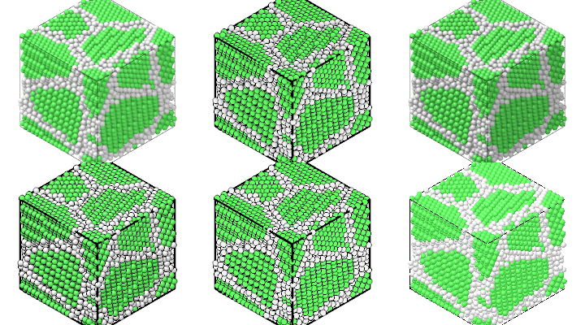
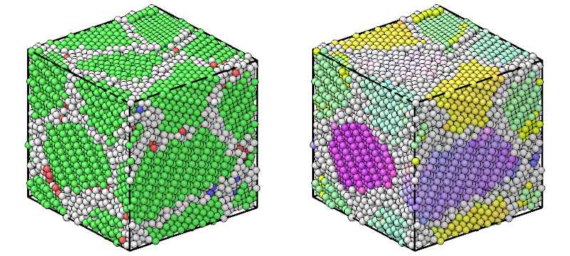
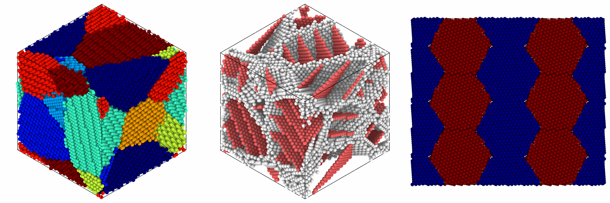
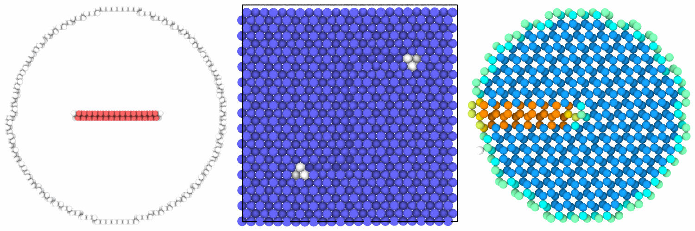
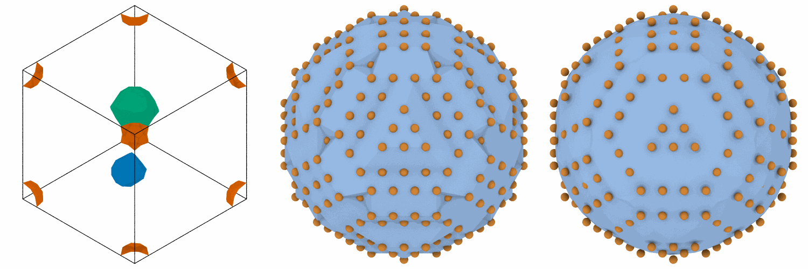
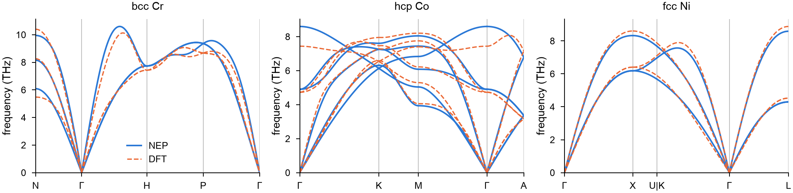

<p align="center">
  <picture>
    <source media="(prefers-color-scheme: dark)" srcset="https://raw.githubusercontent.com/mushroomfire/mdapy/v2/docs/assets/mdapy-logo-dark.png">
    
  </picture>
</p>

<p align="center">
  <b>Fast analysis, building and simulation of atomistic systems, in Python.</b>
</p>

<p align="center">
  <a href="https://github.com/mushroomfire/mdapy/actions/workflows/tests.yml"></a>
  
  
  <a href="https://github.com/mushroomfire/mdapy/blob/v2/LICENSE"></a>
  <a href="https://doi.org/10.1016/j.cpc.2023.108764"></a>
</p>

<p align="center">
  <a href="https://github.com/mushroomfire/mdapy/blob/v2/docs/index.md">Documentation</a> ·
  <a href="https://github.com/mushroomfire/mdapy/blob/v2/docs/getting-started/quick-tour.md">Quick tour</a> ·
  <a href="https://github.com/mushroomfire/mdapy/blob/v2/docs/getting-started/learn/table.md">Lessons</a> ·
  <a href="https://github.com/mushroomfire/mdapy/blob/v2/docs/performance/comparison.md">Performance</a> ·
  <a href="#install">Install</a> ·
  <a href="#citing-mdapy">Cite</a>
</p>

<a href="https://github.com/mushroomfire/mdapy/blob/v2/docs/getting-started/tutorials/movie.md"></a>

<p align="center"><sub>Frames of <a href="https://github.com/mushroomfire/mdapy/blob/v2/docs/getting-started/tutorials/images/movie.mp4">a movie</a> made with a Python script: a copper polycrystal, its grains, a slice, the flight between two twin planes, and the defects alone. <a href="https://github.com/mushroomfire/mdapy/blob/v2/docs/getting-started/tutorials/movie.md">See how</a>.</sub></p>

> **MDAPY 2.0 is a complete rewrite and is not compatible with MDAPY 1.x.** It is
> under development, and a first preview, 2.0.0a1, comes next. The stable release
> is `pip install mdapy==1.0.10`, with its
> [documentation](https://mdapy.readthedocs.io).

## A polycrystal, its structures and a picture, in five lines

```python
import mdapy as mp
from mdapy.build import build_crystal, build_polycrystal
from mdapy.identify import CommonNeighborAnalysis
from mdapy.visualization import render

copper = build_crystal("fcc", 3.615, elements="Cu")
grains = build_polycrystal(copper, mp.Box(60.0), 6, seed=1)
structures = CommonNeighborAnalysis().compute(grains)
structures.counts()  # {'other': 6529, 'fcc': 10796, 'hcp': 8, 'bcc': 0, 'ico': 0}
render(grains, "grains.png", color=structures, style="matte")
```



<p align="center"><sub>The same picture in the four <a href="https://github.com/mushroomfire/mdapy/blob/v2/docs/visualization/rendering.md">styles</a> of <code>render</code>: fast, matte, shiny and flat. No window and no display are needed.</sub></p>

## Why MDAPY

**It is fast.** The heavy work runs in compiled C++ on every core. From 256,000 atoms
on, MDAPY is faster than OVITO in every analysis they share, and from 32,000 atoms on
faster than freud in every one. Its neighbor lists also take a quarter of the memory
of OVITO's and a seventh of freud's.

| 2,048,000 atoms, 40 threads | MDAPY | OVITO 3.17 | freud 3.6 |
|---|---:|---:|---:|
| Neighbor list, 5 Å | **0.18 s** | 1.39 s | 4.98 s |
| Voronoi volumes and coordination | **0.95 s** | 23.0 s | 38.8 s |
| Common neighbor analysis | **0.067 s** | 0.155 s | |
| Dislocation analysis | **5.8 s** | 28.6 s | |

<sub>Two Intel Xeon Gold 6248, 40 cores. A program is timed only where it gives the result of MDAPY, atom by atom. Below those sizes the others win a few cases, such as atomic strain in OVITO under some 250,000 atoms. <a href="https://github.com/mushroomfire/mdapy/blob/v2/docs/performance/comparison.md">Every case at every size, with memory.</a></sub>

Files of 2 million atoms are [read in 0.08 to 0.17 s](https://github.com/mushroomfire/mdapy/blob/v2/docs/performance/files.md),
3.8 to 5.3 times faster than OVITO and 25 to 53 times faster than ASE.

**It is light.** NumPy and polars are the only requirements. Ray-traced pictures
need nothing more: on the processor anywhere, and on the graphics card with Metal,
Vulkan or Direct3D 12.

**It covers the whole job.** Read or build a structure, analyze it, compute energies
and forces, relax it, run dynamics, get elastic constants and phonons, check a
training set for a machine-learned potential, and make the figures and the movie:
one package and one `System`, so the steps connect without conversions.

**It is checked.** More than 2,800 tests compare each feature with analytic results,
independent implementations and live runs of LAMMPS, OVITO, freud and phonopy, at
99% coverage. Results are the same for any number of threads.

**It is predictable.** A `System` never changes in place. Every analysis has the same
form, `compute(system)`, and returns plain NumPy arrays. One unit system, Å, eV and ps,
runs through everything.

**It works with what you already use.** MDAPY runs its own thread pool instead of
OpenMP, so it shares a process with PyTorch and LAMMPS. It converts systems to and
from ASE, OVITO, pymatgen and freud, and takes any ASE calculator or LAMMPS
interaction as a calculator. It also works as one step of a large screening: see
[high-throughput calculations](https://github.com/mushroomfire/mdapy/blob/v2/docs/getting-started/tutorials/high-throughput.md).

## What it does

| Area | What is in it |
|---|---|
| [**Analysis**](https://github.com/mushroomfire/mdapy/blob/v2/docs/analysis/overview.md) | More than 40 analyses: common neighbor analysis, polyhedral template matching, dislocations, grain segmentation, surface mesh, Voronoi, Steinhardt, radial distribution, structure factor, Wigner–Seitz, atomic strain, mean squared displacement |
| [**Structure builder**](https://github.com/mushroomfire/mdapy/blob/v2/docs/build/crystals.md) | 15 crystal structures, polycrystals, twins, random and special quasirandom alloys, point defects, surfaces, dislocations, graphene on grain boundaries |
| [**Simulation**](https://github.com/mushroomfire/mdapy/blob/v2/docs/simulation/calculators.md) | EAM and NEP potentials, LAMMPS and ASE calculators, minimization, molecular dynamics, elastic constants, phonons, the quasi-harmonic approximation |
| [**MLIP**](https://github.com/mushroomfire/mdapy/blob/v2/docs/mlip/checks.md) | Training sets from VASP, SOAP descriptors, checking frames, errors of a model, novelty and committee uncertainty, choosing frames, perturbed structures |
| [**Visualization**](https://github.com/mushroomfire/mdapy/blob/v2/docs/visualization/rendering.md) | Ray-traced pictures with shadows, ambient occlusion and depth of field, movies, coordination polyhedra, plots ready for a paper |
| [**Files**](https://github.com/mushroomfire/mdapy/blob/v2/docs/getting-started/io.md) | Extended XYZ, LAMMPS data and dump, POSCAR, OUTCAR, CIF, PDB and a fast binary format of its own |

<table>
  <tr>
    <td width="50%"><a href="https://github.com/mushroomfire/mdapy/blob/v2/docs/analysis/ptm.md"></a><br><sub>Polyhedral template matching</sub></td>
    <td width="50%"><a href="https://github.com/mushroomfire/mdapy/blob/v2/docs/build/polycrystals.md"></a><br><sub>Polycrystals and twins</sub></td>
  </tr>
  <tr>
    <td><a href="https://github.com/mushroomfire/mdapy/blob/v2/docs/analysis/voronoi.md"></a><br><sub>Voronoi cells</sub></td>
    <td><a href="https://github.com/mushroomfire/mdapy/blob/v2/docs/build/dislocations.md"></a><br><sub>Dislocation models</sub></td>
  </tr>
  <tr>
    <td><a href="https://github.com/mushroomfire/mdapy/blob/v2/docs/analysis/surface-mesh.md"></a><br><sub>Surface mesh</sub></td>
    <td><a href="https://github.com/mushroomfire/mdapy/blob/v2/docs/getting-started/tutorials/crconi.md"></a><br><sub>Phonons, against DFT</sub></td>
  </tr>
</table>

## Install

```bash
git clone -b v2 https://github.com/mushroomfire/mdapy.git
cd mdapy
pip install .
```

MDAPY needs Python 3.11 or newer and, to build, a C++17 compiler and CMake 3.18 or
newer. It will be on PyPI from the first preview on. See
[Installation](https://github.com/mushroomfire/mdapy/blob/v2/docs/getting-started/installation.md)
for the optional packages.

## Reporting a problem

Please [open an issue](https://github.com/mushroomfire/mdapy/issues) with the shortest
code that shows the problem and the output of `mdapy.show_versions()`. See
[Reporting a problem](https://github.com/mushroomfire/mdapy/blob/v2/docs/getting-started/reporting.md).

## Citing MDAPY

If MDAPY contributes to a publication, please cite:

> Yong-Chao Wu and Jian-Li Shao, *mdapy: A flexible and efficient analysis software
> for molecular dynamics simulations*, Computer Physics Communications **290**, 108764
> (2023). [doi:10.1016/j.cpc.2023.108764](https://doi.org/10.1016/j.cpc.2023.108764)

## License

Mozilla Public License 2.0, see [LICENSE](https://github.com/mushroomfire/mdapy/blob/v2/LICENSE):
MDAPY may be used in any software, open or closed, and changes to its own files are
shared under the same license.

## Code history

MDAPY has been written three times, each time to go faster and to do more.

| Series | Years | How it was built | Code |
|---|---|---|---|
| 0.x | 2022–2025 | Python with [Taichi](https://github.com/taichi-dev/taichi) for the kernels | Branch [`mdapy_old`](https://github.com/mushroomfire/mdapy/tree/mdapy_old), last release 0.11.5 |
| 1.x | 2025–2026 | Rewritten with every kernel in C++ | Tag [`v1.0.10`](https://github.com/mushroomfire/mdapy/tree/v1.0.10), [documentation](https://mdapy.readthedocs.io) |
| 2.x | 2026– | Rewritten again from scratch: C++ kernels on a thread pool of their own instead of OpenMP, immutable systems on polars tables, and each feature checked against other programs | This branch |
