<p align="center">
  <picture>
    <source media="(prefers-color-scheme: dark)" srcset="https://raw.githubusercontent.com/mushroomfire/mdapy/master/docs/assets/mdapy-logo-dark.png">
    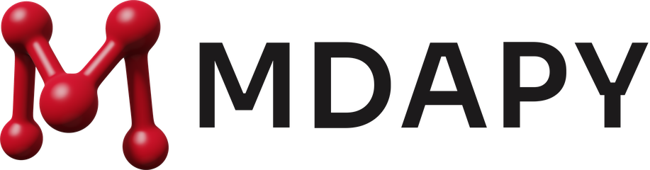
  </picture>
</p>

<p align="center">
  <b>Fast building, analysis, simulation and visualization of atomistic systems, in Python.</b>
</p>

<p align="center">
  <a href="https://github.com/mushroomfire/mdapy/actions/workflows/tests.yml"></a>
  <a href="https://codecov.io/gh/mushroomfire/mdapy"></a>
  
  
  <a href="https://github.com/mushroomfire/mdapy/blob/master/LICENSE"></a>
  <a href="https://doi.org/10.1016/j.cpc.2023.108764"></a>
</p>

<p align="center">
  <a href="https://mushroomfire.github.io/mdapy/">Documentation</a> ·
  <a href="https://mushroomfire.github.io/mdapy/getting-started/quick-tour/">Quick tour</a> ·
  <a href="https://mushroomfire.github.io/mdapy/getting-started/learn/table/">Lessons</a> ·
  <a href="#-examples">Examples</a> ·
  <a href="#-install">Install</a> ·
  <a href="#-tests">Tests</a> ·
  <a href="#-citing-mdapy">Cite</a>
</p>

> **MDAPY 2.0 is a complete rewrite and is not compatible with MDAPY 1.x.** It brings many
> more features, and we recommend upgrading. The code of 1.x stays on the branch
> [`1.x`](https://github.com/mushroomfire/mdapy/tree/1.x).

If you like MDAPY, please give it a ⭐ [star](https://github.com/mushroomfire/mdapy).

## 💡 Why MDAPY

- **Light.** [NumPy](https://numpy.org) and [polars](https://pola.rs) are its only
  requirements. Packages such as [matplotlib](https://matplotlib.org) or
  [ASE](https://wiki.fysik.dtu.dk/ase/) are optional, and it carries no other
  third-party code.
- **Robust.** Tests cover more than 99 % of the code and compare each feature with analytic
  results and with mature software. All of them run automatically on Linux, macOS and
  Windows. Results are the same for any number of threads, and damaged files or impossible
  inputs give a clear error, not a crash.
- **Fast.** The heavy parts run in C++, on a parallel engine of MDAPY's own. See the
  [benchmarks](https://mushroomfire.github.io/mdapy/performance/comparison/).
- **Predictable.** Names say what the code does: `minimize`, `elastic_constants`,
  `CommonNeighborAnalysis`. A `System` never changes in place, every analysis has the form
  `compute(system)` and returns NumPy arrays, and one unit system, Å, eV and ps, runs
  through everything.
- **Integrated.** One package and one `System`, from the first structure to the last
  picture. It converts systems to and from [ASE](https://wiki.fysik.dtu.dk/ase/),
  [OVITO](https://www.ovito.org), [pymatgen](https://pymatgen.org) and
  [freud](https://freud.readthedocs.io), takes any ASE calculator or
  [LAMMPS](https://www.lammps.org) interaction, shares a process with
  [PyTorch](https://pytorch.org), and works as one step of
  [high-throughput calculations](https://mushroomfire.github.io/mdapy/examples/high-throughput/).
- **Documented.** Every feature has its own page, with an example, its parameters, its
  results and its references, and [lessons](https://mushroomfire.github.io/mdapy/getting-started/learn/table/) lead
  from the first structure on.

## 🧰 What it does

| Area | What is in it |
|---|---|
| [**Build**](https://mushroomfire.github.io/mdapy/user-guide/build/crystals/) | Crystals, polycrystals, alloys, defects and dislocations |
| [**Analyze**](https://mushroomfire.github.io/mdapy/user-guide/analysis/overview/) | More than 40 analyses of structure, local order, defects and dynamics |
| [**Simulate**](https://mushroomfire.github.io/mdapy/user-guide/simulation/calculators/) | Native EAM and NEP, interfaces to [LAMMPS](https://www.lammps.org) and [ASE](https://wiki.fysik.dtu.dk/ase/); relaxation and dynamics; elastic constants, phonons, free energies, melting points and phase diagrams |
| [**MLIP**](https://mushroomfire.github.io/mdapy/user-guide/mlip/checks/) | Training sets from [VASP](https://www.vasp.at), descriptors, errors of a model, the frames worth computing |
| [**Visualize**](https://mushroomfire.github.io/mdapy/user-guide/visualization/rendering/) | Ray-traced pictures on the processor or the graphics card, movies and plots |
| [**Exchange**](https://mushroomfire.github.io/mdapy/basics/io/) | Eight file formats, and systems shared with [ASE](https://wiki.fysik.dtu.dk/ase/), [OVITO](https://www.ovito.org), [pymatgen](https://pymatgen.org) and [freud](https://freud.readthedocs.io) |

## 🎨 Examples

Click a picture for its example, with the whole code.

<p align="center">
  <a href="https://mushroomfire.github.io/mdapy/examples/movie/"></a><br>
  <a href="https://mushroomfire.github.io/mdapy/examples/movie/"><b>Fly through a crystal</b></a>
</p>

<table>
<tr>
<td align="center" width="33%"><a href="https://mushroomfire.github.io/mdapy/user-guide/build/polycrystals/">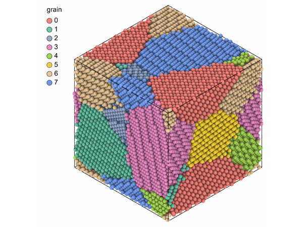</a><br><a href="https://mushroomfire.github.io/mdapy/user-guide/build/polycrystals/"><b>Polycrystals</b></a></td>
<td align="center" width="33%"><a href="https://mushroomfire.github.io/mdapy/examples/gradient-polycrystals/">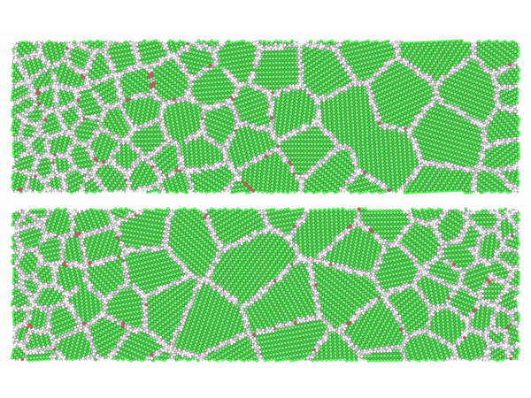</a><br><a href="https://mushroomfire.github.io/mdapy/examples/gradient-polycrystals/"><b>Gradient grains</b></a></td>
<td align="center" width="33%"><a href="https://mushroomfire.github.io/mdapy/examples/graphene-polycrystal/">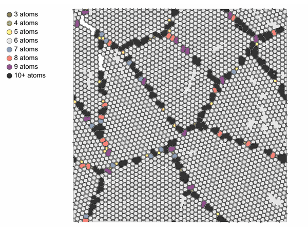</a><br><a href="https://mushroomfire.github.io/mdapy/examples/graphene-polycrystal/"><b>Graphene grains</b></a></td>
</tr>
<tr>
<td align="center" width="33%"><a href="https://mushroomfire.github.io/mdapy/examples/molecular-polycrystal/">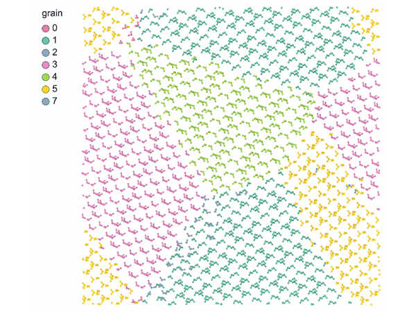</a><br><a href="https://mushroomfire.github.io/mdapy/examples/molecular-polycrystal/"><b>Ice polycrystal</b></a></td>
<td align="center" width="33%"><a href="https://mushroomfire.github.io/mdapy/user-guide/analysis/dislocations/">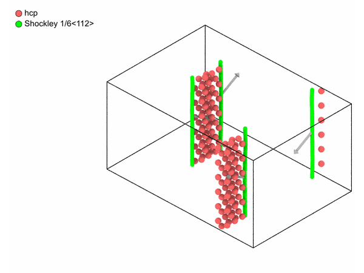</a><br><a href="https://mushroomfire.github.io/mdapy/user-guide/analysis/dislocations/"><b>Dislocations</b></a></td>
<td align="center" width="33%"><a href="https://mushroomfire.github.io/mdapy/user-guide/analysis/ptm/">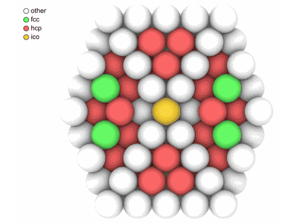</a><br><a href="https://mushroomfire.github.io/mdapy/user-guide/analysis/ptm/"><b>Structure types</b></a></td>
</tr>
<tr>
<td align="center" width="33%"><a href="https://mushroomfire.github.io/mdapy/user-guide/analysis/voronoi/">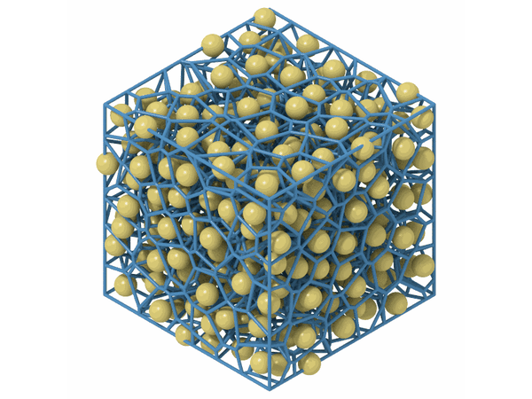</a><br><a href="https://mushroomfire.github.io/mdapy/user-guide/analysis/voronoi/"><b>Voronoi cells</b></a></td>
<td align="center" width="33%"><a href="https://mushroomfire.github.io/mdapy/user-guide/analysis/space-group/">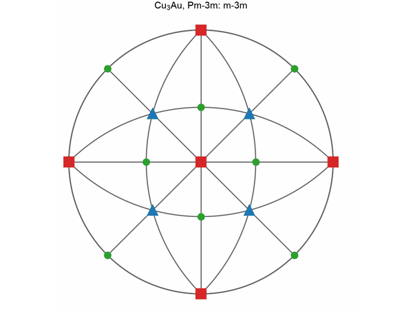</a><br><a href="https://mushroomfire.github.io/mdapy/user-guide/analysis/space-group/"><b>Point groups</b></a></td>
<td align="center" width="33%"><a href="https://mushroomfire.github.io/mdapy/user-guide/analysis/atomic-strain/">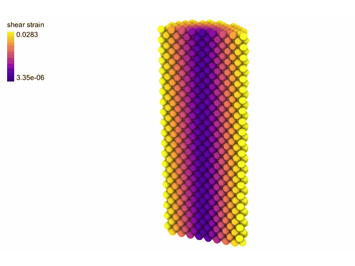</a><br><a href="https://mushroomfire.github.io/mdapy/user-guide/analysis/atomic-strain/"><b>Atomic strain</b></a></td>
</tr>
<tr>
<td align="center" width="33%"><a href="https://mushroomfire.github.io/mdapy/user-guide/analysis/rings/">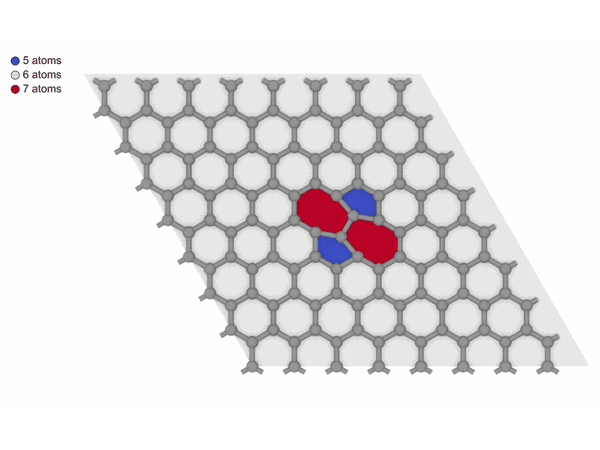</a><br><a href="https://mushroomfire.github.io/mdapy/user-guide/analysis/rings/"><b>Rings</b></a></td>
<td align="center" width="33%"><a href="https://mushroomfire.github.io/mdapy/user-guide/analysis/clusters/">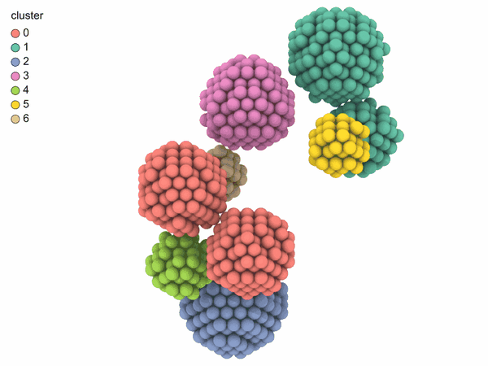</a><br><a href="https://mushroomfire.github.io/mdapy/user-guide/analysis/clusters/"><b>Clusters</b></a></td>
<td align="center" width="33%"><a href="https://mushroomfire.github.io/mdapy/user-guide/analysis/chill-plus/">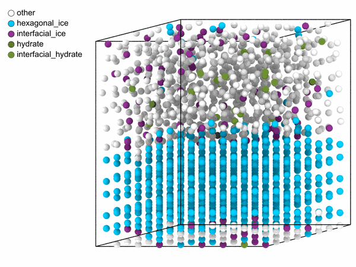</a><br><a href="https://mushroomfire.github.io/mdapy/user-guide/analysis/chill-plus/"><b>Ice and water</b></a></td>
</tr>
<tr>
<td align="center" width="33%"><a href="https://mushroomfire.github.io/mdapy/user-guide/analysis/trajectory-lines/">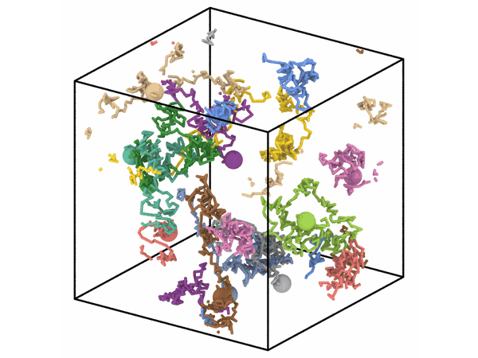</a><br><a href="https://mushroomfire.github.io/mdapy/user-guide/analysis/trajectory-lines/"><b>Atom paths</b></a></td>
<td align="center" width="33%"><a href="https://mushroomfire.github.io/mdapy/user-guide/visualization/polyhedra/">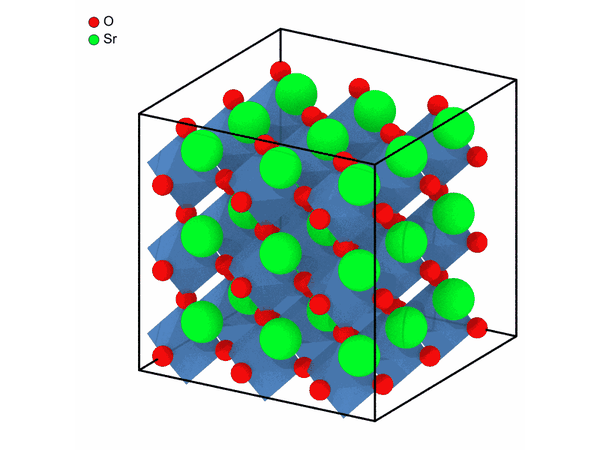</a><br><a href="https://mushroomfire.github.io/mdapy/user-guide/visualization/polyhedra/"><b>Polyhedra</b></a></td>
<td align="center" width="33%"><a href="https://mushroomfire.github.io/mdapy/examples/gamma-surface/">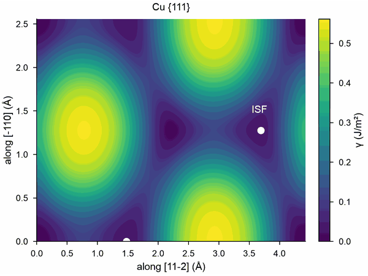</a><br><a href="https://mushroomfire.github.io/mdapy/examples/gamma-surface/"><b>Gamma surfaces</b></a></td>
</tr>
<tr>
<td align="center" width="33%"><a href="https://mushroomfire.github.io/mdapy/examples/crconi/">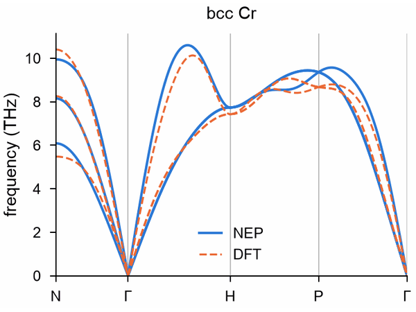</a><br><a href="https://mushroomfire.github.io/mdapy/examples/crconi/"><b>NEP against DFT</b></a></td>
<td align="center" width="33%"><a href="https://mushroomfire.github.io/mdapy/user-guide/simulation/phase-diagram/">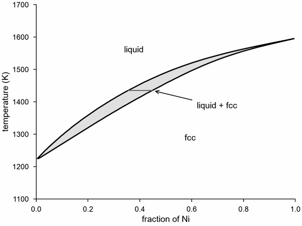</a><br><a href="https://mushroomfire.github.io/mdapy/user-guide/simulation/phase-diagram/"><b>Phase diagrams</b></a></td>
<td align="center" width="33%"><a href="https://mushroomfire.github.io/mdapy/user-guide/build/sqs/">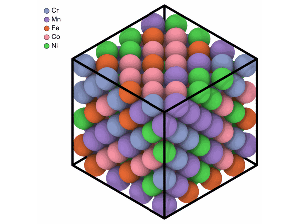</a><br><a href="https://mushroomfire.github.io/mdapy/user-guide/build/sqs/"><b>Quasirandom alloys</b></a></td>
</tr>
<tr>
<td align="center" width="33%"><a href="https://mushroomfire.github.io/mdapy/user-guide/analysis/surface-mesh/">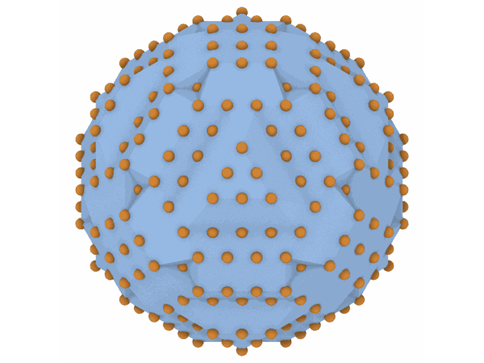</a><br><a href="https://mushroomfire.github.io/mdapy/user-guide/analysis/surface-mesh/"><b>Surface meshes</b></a></td>
<td align="center" width="33%"><a href="https://mushroomfire.github.io/mdapy/user-guide/mlip/uncertainty/">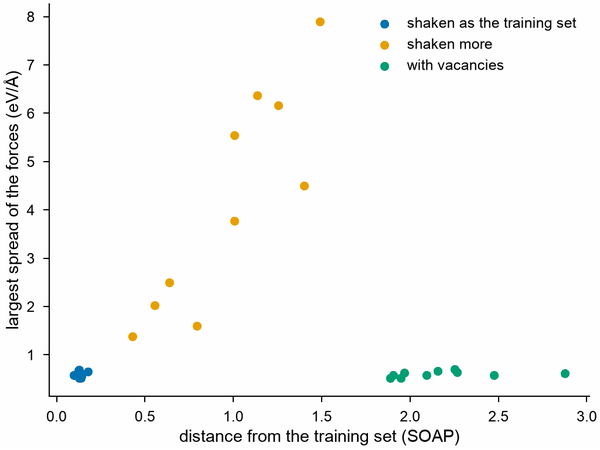</a><br><a href="https://mushroomfire.github.io/mdapy/user-guide/mlip/uncertainty/"><b>Model uncertainty</b></a></td>
<td align="center" width="33%"><a href="https://mushroomfire.github.io/mdapy/examples/high-throughput/">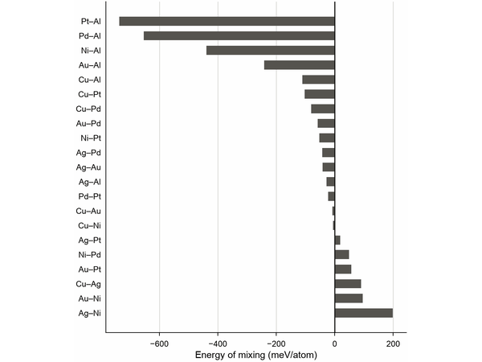</a><br><a href="https://mushroomfire.github.io/mdapy/examples/high-throughput/"><b>High throughput</b></a></td>
</tr>
</table>

More in the [documentation](https://mushroomfire.github.io/mdapy/), from the
[quick tour](https://mushroomfire.github.io/mdapy/getting-started/quick-tour/) on.

## 📦 Install

```bash
pip install --pre mdapy
```

The first release of 2.0 is a preview, and `--pre` asks `pip` for it: without it, `pip`
installs 1.x. MDAPY needs Python 3.11 or newer. [Installation](https://mushroomfire.github.io/mdapy/getting-started/installation/)
describes the other ways to install it, from a source archive or from git, what those need,
and the optional packages.

## 🧪 Tests

```bash
git clone https://github.com/mushroomfire/mdapy.git
cd mdapy
pip install -e ".[dev]"
pytest
```

Tests that need another program are skipped where it is missing.
[Contributing](https://mushroomfire.github.io/mdapy/about/contributing/#what-a-complete-run-needs) lists what a
complete run needs.

## 📖 Citing MDAPY

If MDAPY contributes to a publication, please cite:

> Yong-Chao Wu and Jian-Li Shao, *mdapy: A flexible and efficient analysis software
> for molecular dynamics simulations*, Computer Physics Communications **290**, 108764
> (2023). [doi:10.1016/j.cpc.2023.108764](https://doi.org/10.1016/j.cpc.2023.108764)

## 📄 License

Mozilla Public License 2.0, see [LICENSE](https://github.com/mushroomfire/mdapy/blob/master/LICENSE):
MDAPY may be used in any software, open or closed, and changes to its own files are
shared under the same license.

## 📜 Code history

MDAPY has been written three times.

| Series | Years | How it was built | Code |
|---|---|---|---|
| 0.x | 2022–2025 | Python, with [Taichi](https://github.com/taichi-dev/taichi) for the kernels | Branch [`mdapy_old`](https://github.com/mushroomfire/mdapy/tree/mdapy_old), last release 0.11.5 |
| 1.x | 2025–2026 | Rewritten with every kernel in C++, and with NumPy and polars as its only requirements | Branch [`1.x`](https://github.com/mushroomfire/mdapy/tree/1.x), last release 1.0.10, [documentation](https://mdapy.readthedocs.io) |
| 2.x | 2026– | Rewritten again from scratch, for the reasons below | This branch |

Taichi was no longer updated, which also limited the versions of Python that 0.x could run
on. 1.x was rewritten to be easy to update and maintain, and it needs only NumPy and polars,
no longer SciPy and Taichi.

2.x goes further: it is easier to maintain, more stable and more consistent, lighter without
external code, with many more features and a clearer organization. In particular:

- **OpenMP.** The [OpenMP](https://www.openmp.org) runtime of 1.x could clash with those of
  other packages. 2.x runs a thread pool of its own, so it shares a process with
  [PyTorch](https://pytorch.org) and [LAMMPS](https://www.lammps.org).
- **Third-party code.** 1.x carried ten third-party codes to build and keep working. 2.x
  carries none.
- **The API.** In 1.x an analysis was a method that changed the system. In 2.x a `System`
  never changes and every analysis is a class with one form.
- **Tests.** Tests cover more than 99 % of the code and compare each feature with analytic
  results and with mature software, which makes 2.x more stable.
- **Many small calculations.** The threads can be limited for each process, so thousands of
  small calculations side by side do not fight for cores.
- **Graphical interfaces.** Long computations report their progress, can be cancelled and
  leave Python running, so a graphical interface is easy to build on 2.x.
