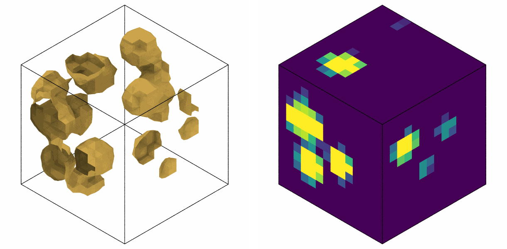
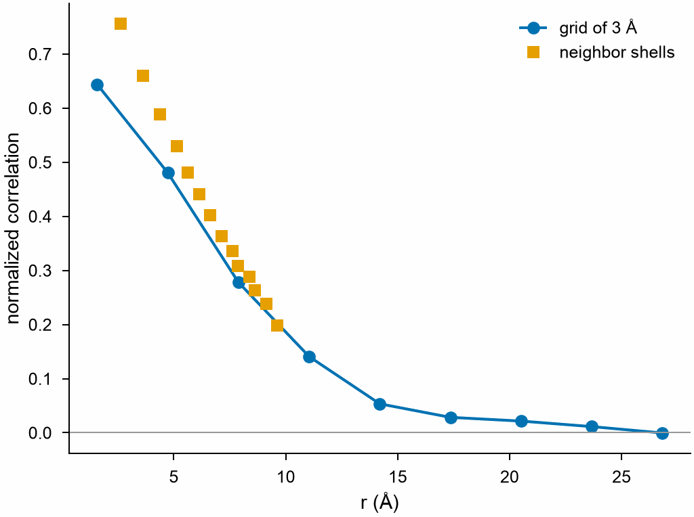
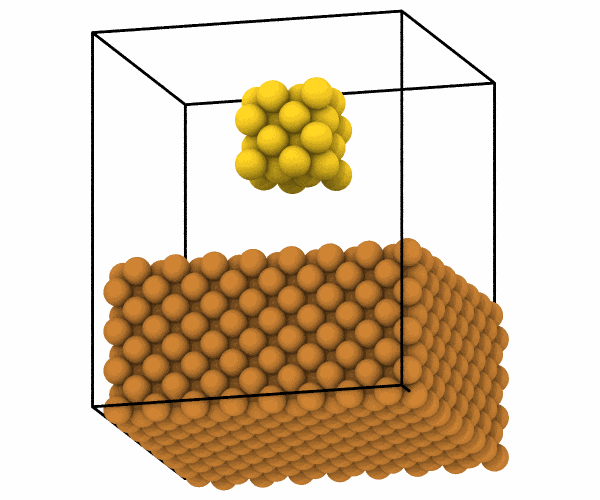
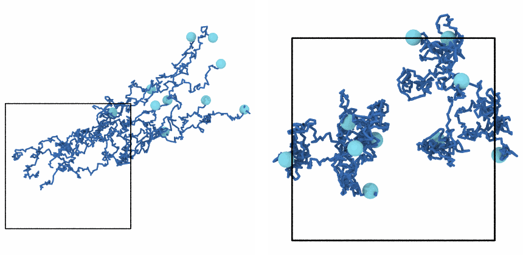
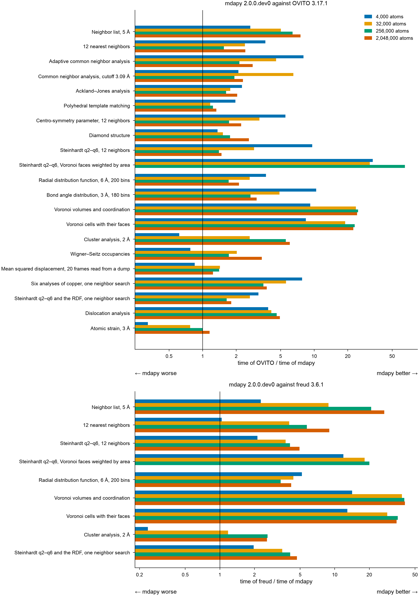

# mdapy 2.0 夜间进展报告（2026-10-28 夜 → 29）

你下班前的安排里和 mdapy 本体有关的部分：

1. 以 OVITO 3.17.1 为准重新对比，补上 MSD、RDF（含分量）、结构因子等还没对比过的分析；速度也对比（在 Triton 上跑）。
2. 第四步还剩的功能：Load trajectory（dump 套用 data 的拓扑）、读取 CIF / PDB、时间平均、轨迹线、配位多面体、任意矢量列的箭头。
3. 你说今晚测试全过的直接合进 v2，合并后的分支删掉。

本地工作单独汇报。

## 早上先看这里

**需要你决定的几件事（10-29 00:15 更新）：**

1. **线程数要不要按工作量限制**（Triton 数据见 10-28 23:25）：40 线程跨两个 CPU 插槽，4 000 原子的小体系比 20 线程慢 2–5 倍；3.2 万原子时 CNA、RDF、团簇用满 40 线程最快。
2. **合并体系里分子号 0**：OVITO 连 0 也加偏移，mdapy 让 0 保持 0（同 `replicate`），文档写明了。可以吗？
3. **明天**：接上办公室的 Linux 工作站，开始 Linux 版图形界面。

已经定了的（10-28 23:00 和 10-29 00:00 你说的）：今晚测试好的直接合并；找环和等值面按我们自己的规则做，不对照 OVITO；OVITO 缺的功能只做 1–6；弹性应变只有和 OVITO 一致才做；合并体系照 OVITO；MLIP 进图形界面以后再说；OUTCAR 全部读出、标明是否收敛。明天教你把办公室的 Linux 工作站接上，用来开发 Linux 版图形界面。

- 今天已合入 v2 的：弹性常数对称性提速（15 s → 0.03 s）、`transform.affine`、`neighbor.expand_selection`、OVITO 3.17.1 作参考。
- 已合并的远程分支 dislocations、gui-superset、slip-systems、solid-liquid、surface-mesh 已删除；保留 master、night-report、mdapy_old。

## 今晚合入 v2 的提交

| 提交 | 内容 |
|---|---|
| `761ffde` | 弹性常数只取对称旋转，不再逐原子映射：4×4×4 fcc 胞 15 s → 0.03 s |
| `36bf1bc` | `transform.affine`：仿射变换，和 OVITO 的 AffineTransformationModifier 逐项一致 |
| `2c18e1e` | `neighbor.expand_selection`：按截断、最近邻、成键扩展选择，三种模式和 OVITO 一致 |
| `997d6e4` | OVITO 3.17.1 作参考：全部对比测试照样通过，CI 改装 3.17.1 |
| `7f5aa45` | MSD 和结构因子对比 OVITO 3.17.1 的测试，结构因子页写明和 OVITO 的差别 |
| `511ee82` | 性能对比加上 MSD（20 帧 dump 读入 + MSD，对比 OVITO 的 DiffusionModifier） |
| `07c337c` | `render(vectors=...)`：任意矢量列（位移、速度、力……）画箭头，和 OVITO 的 Vector display 一致 |
| `2ac7391` | `read_trajectory`：多文件（`dump.*.lammpstrj` 模式或列表）、`topology=` 让 dump 帧带上 data 文件的键、电荷、分子号（OVITO 的 Load trajectory） |
| `06f48b3` | 读取 CIF（按对称操作展开）和 PDB（原子名、残基、MODEL 多帧、CONECT 键） |
| `3ef6e94` | `analysis.TimeAverage`：任意列、盒子或函数结果的时间平均（OVITO 的 Time averaging） |
| `f9e7bde` | `analysis.trajectory_lines` + `render(lines=...)`：轨迹线 |
| `fb40c6c` | `analysis.CoordinationPolyhedra`：配位多面体（凸包）和体积 |
| `83736f7` | VASP OUTCAR 改为只读文件格式，取代 `mlip.read_outcar` / `outcar_to_xyz` |
| `8560f15` | MSD 按原子分块做 FFT（省内存）；性能页换成 OVITO 3.17.1 的结果，加了 DXA 和 MSD |
| `0ba442b` | `Box` 的行列式改用三重积，避开 macOS Accelerate 偶发的伪浮点警告 |

## 进展

### 10-29 00:15
- **今晚的四个功能已合入 v2**（质心修正、合并体系、弹性应变、空间关联函数）：合并后全量 2558 过、文档严格构建通过，已推送，分支已删。
- **第 2 项等值面和体素显示做完并合入 v2**（规则我定的，写进文档）：`mdapy.analysis.isosurface(values, box, level)` 用 marching tetrahedra——每个格子沿主对角线切成 6 个四面体，没有 marching cubes 的歧义情形，网格连续无缝；周期方向跨边界接起来，非周期方向停在最外层格心；法向从高值指向低值。`mdapy.visualization.voxel_faces(values, box)` 把盒子六个外表面按格子切块、按格子的值着色（OVITO 体素显示的样子）。测试用解析解：球面（盒中心和跨角落的周期情形）半径误差 < 0.02 Å、面积差 < 1%、法向朝外、每条边恰好两个三角形；平面精确；左手盒法向仍正确。图形界面加了 “Create isosurface” 步骤（性质、格子数、统计方式、等值、表面颜色、体素色标）。全量 2567 过。

  

- **第 4 项找环做完了**（分支 `rings`，全量测试在跑，过了就合并）：`mdapy.analysis.RingStatistics(max_size=8, *, min_size=3, cutoff=None, cutoffs=None)`，规则是 Franzblau 的最短路径环（环上任意两原子沿键网络的最短距离等于沿环的距离）；周期像在搜索里区分，所以小盒子里也不会把绕盒子一圈的路径当成环；键来自截断、元素对截断或 topology。和 networkx 穷举所有回路再筛选的结果逐个一致（无序团簇，3–9 元环）；金刚石每个原子 12 个六元环、石墨烯 3 个，2×2×2 到 4×4×4 的周期盒都一样；平移、复制 8 倍计数乘 8；线程数无关。简并情形的规则写进文档：立方体给 6 个四元环和 4 个绕体对角线的六元环，θ 图三个 6 元环都给（OVITO 只给一部分）。`polygons()` 把环画成多边形；文档例子是石墨烯的 Stone–Wales 缺陷（2 个五元环、2 个七元环），参考文献加了 Franzblau 1991。图形界面加了 “Ring statistics” 步骤（按大小着色的多边形、直方图、表格）。

  

- OVITO 缺的 6 项至此全部做完。

### 10-28 23:50
- **第 3 项空间关联函数做完了**（分支 `correlation`，从 `elastic-strain` 往下长，已推送）：`mdapy.analysis.SpatialCorrelation(first, second=None, *, grid_spacing=3.0, window=True, direct=False, cutoff=5.0, bins=50)`，照 OVITO 公开源码的步骤自己写（最近格点分配、非周期方向 Hann 窗、FFT、倒空间和实空间径向平均、近程直接求和）。和 OVITO 现场对比（周期三斜盒、一个方向非周期开/关窗、全非周期）：五张表（实空间 C(r) 和 g(r)、倒空间 C(q)、近邻 C(r) 和 g(r)）和五个矩全部一致到 1e-9 以内（实测 1e-15）。OVITO 图里的三种归一化（除 RDF、除协方差、差值关联）文档里各给一行 NumPy。文档页 analysis/spatial-correlation.md，图形界面加了 “Spatial correlation function” 步骤（实空间/倒空间/近邻三种图）。全量测试 2558 过。

  

- **第 4 项找环先停下来等你定**（上面第 4 条）。实测过程：立方体团簇 OVITO 只给 6 个四元环（不算 6 元“腰带”）；θ(2,3,3) 给两个 5 元环、排除有捷径的 6 元环，符合它手册的定义；θ(3,3,3) 三个对称 6 元环只给两个，是它内部搜索顺序的取舍；石墨烯、金刚石的 6 元环数目都对，小盒子里的大环全部绕周期边界。
- **第 2 项等值面也先停下来等你定**（上面第 5 条）。
- 本地图形界面：合并数据集、弹性应变、空间关联函数三个步骤都接好了，内核测试 217 过。

### 10-28 23:35
- **第 5 项合并数据集做完了**（分支 `combine`，从 `drift` 往下长，已推送）：`mdapy.transform.combine(system, other)`，规则逐条在 OVITO 3.17.1 上实测过再照做——盒子和 info 用 system 的（去掉 energy、virial）；列取并集，缺的填 0（元素填 X，文本填空串，布尔填 False）；system 有 id 时，并进来的原子从最大 id+1 依次编号（OVITO 就是这样，不看它们自己的 id）；system 没 id 时它的原子 id 为 0、对方保留自己的；分子号加上 system 的最大分子号；键、角等拓扑项顺移。和 OVITO 的 CombineDatasetsModifier 现场对比（两个 LAMMPS data 文件）：位置、id、分子号、电荷、速度、元素、键、角全部一致。**唯一不同：分子号 0**（见上面“需要你决定”第 3 条）。文档页 build/combine.md，图形界面加了 “Combine datasets” 步骤（选文件；多帧文件取同号帧，不够取最后一帧）。

  

- **第 1 项弹性应变做完了**（分支 `elastic-strain`，从 `combine` 往下长）：`mdapy.analysis.ElasticStrain(crystal, a, c=None)`，C++ 内核复用 DXA 的结构识别和近邻排序，最小二乘求 F，给空间坐标系的应变张量和体应变。和 OVITO 现场对比 20 种体系（7 个位错四极子含扩展位错、3 个位错环、交叉位错环、hcp 和六方金刚石的螺/刃位错、5 种晶体在变形三斜盒里加噪声、hcp c/a 1.58 和 1.86）：结构类型全同，立方晶系差 ≤ 1e-12，六方晶系 ≤ 2e-7（OVITO 单精度）。另有解析解测试（均匀变形、改晶格常数）、旋转/平移/换序不变、线程数无关。太薄的盒子（原子在近邻里碰到自己的周期像）会报错：实测 bcc 螺位错沿线只有一个周期时 OVITO 也报错，两个周期时 OVITO 不报错但体应变算到 −0.27（三个周期时只有 ±0.003），mdapy 两种都报错、让人先复制体系。文档页 analysis/elastic-strain.md，参考文献加了 Stukowski & Arsenlis 2012；图形界面加了 “Elastic strain” 步骤。

  

- 顺便把 DXA 测试里的位错模型（四极子、位错环、六方位错）挪到共享的 `tests/dislocation_models.py`，两个测试文件共用。
- 接下来：第 2 项等值面 + 体素显示。

### 10-28 23:25
- **弹性应变查清楚了，能和 OVITO 一致**：写了原型，和 OVITO 3.17.1 的 ElasticStrainModifier 逐原子比——fcc/bcc/金刚石的位错四极子（含扩展位错）、位错环、均匀应变加噪声、各种取向、三斜旋转盒子，hcp（c/a 1.58–1.86）和六方金刚石的基面位错：结构类型全同，空间坐标系的应变张量和体应变差 ≤ 2e-15。唯一的小差别：OVITO 把跨层错合并的晶团之间的变换矩阵存成单精度（源码里 `Matrix3F`），这些原子上它有 ~6e-8 的舍入误差。材料坐标系的 Green 应变和形变梯度（OVITO 默认也不输出）取决于晶团选哪个对称等价坐标系，六方晶系和 OVITO 差一个晶格旋转，按你的原则不做。只用到 DXA 的“结构识别 + 近邻排序”（已与 OVITO 逐原子一致），所以作为正式功能，不标实验性。
- **第 6 项质心修正做完了**（分支 `drift`）：`mdapy.transform.remove_drift(frames, reference=0, *, atoms=None, unwrap=True)`，返回按需读取的帧序列（像 `Trajectory` 一样能索引、切片、迭代），`shifts` 是每帧的平移量。和 OVITO 的 CenterOfMassCorrectionModifier 现场对比（直接比，以及 OVITO 先展开轨迹再比）一致到 1e-9；单元测试覆盖 100%；文档页 analysis/drift.md 带图；图形界面加了 “Center of mass correction” 步骤（参考帧、只用选中原子、展开）。

  

- 顺手修了一个测试问题：文档测试每页结束不关 matplotlib 图，结构因子页新加了一张图后累计超过 20 张，`test_plot` 报警失败；现在每页结束关掉。
- **Triton 结果**：MSD（20 帧 dump 读入 + MSD）3.2 万原子起比 OVITO 快 1.4 倍，4 000 原子时慢一点（×0.87）。线程测试（毫秒，越小越好）：

  | 分析 | 原子 | 1 | 4 | 10 | 20 | 40 线程 | OVITO 40 |
  |---|---:|---:|---:|---:|---:|---:|---:|
  | 原子应变 | 4 000 | 3.70 | 1.15 | 0.66 | **0.65** | 3.46 | 1.37 |
  | 原子应变 | 32 000 | 23.5 | 6.46 | 2.91 | **1.84** | 4.24 | 3.14 |
  | 团簇 | 4 000 | 2.95 | 1.45 | 1.02 | **0.84** | 3.55 | 2.34 |
  | 团簇 | 32 000 | 23.6 | 10.1 | 6.25 | 4.24 | **3.88** | 18.9 |
  | Wigner–Seitz | 4 000 | 1.97 | 0.96 | 0.72 | **0.68** | 1.43 | 1.17 |
  | Wigner–Seitz | 32 000 | 16.1 | 5.10 | 2.75 | **2.16** | 2.64 | 5.52 |
  | CNA | 4 000 | 10.4 | 3.27 | 1.68 | 1.18 | **1.05** | 14.9 |
  | CNA | 32 000 | 82.2 | 22.9 | 10.2 | 6.19 | **4.13** | 20.8 |
  | RDF | 4 000 | 10.2 | 3.39 | 2.05 | **1.68** | 1.74 | 6.42 |
  | RDF | 32 000 | 74.4 | 20.2 | 9.00 | 5.50 | **3.83** | 9.04 |

  计算量小的分析（原子应变、团簇、Wigner–Seitz）在 4 000 原子时，40 线程反而比 20 线程慢 2–5 倍：40 线程跨两个插槽，唤醒和跨插槽访存的开销盖过了计算。可以按工作量少开线程（例如每个线程至少分到若干原子；结果按块计算，和线程数无关，确定性不受影响）。要不要做、阈值怎么定，等你决定。

### 10-28 21:00
- **Python 3.11 + 最低版本 NumPy 2.3.1 / polars 2.0.0** 全量测试通过（1991 个，113 个因缺 OVITO 等跳过），今晚的新代码在最低依赖上也能用。
- **偶发失败的原因找到了**：`np.linalg.det` 走 macOS Accelerate 的 LAPACK，偶尔对有限的 3×3 矩阵报 “invalid value”（CI 里也有 macOS）。`Box` 里的行列式改成三重积 a·(b×c)，不经 LAPACK；全量 2495 通过，已合入 v2。
- **原子应变小体系为什么比 OVITO 慢**（outline 里你 10-23 说过全部合并后研究）：本机 4 线程时 4 000 原子只要 0.37 ms，Triton 40 线程却要 3 ms（OVITO 1 ms）——时间几乎全花在唤醒 40 个线程上（4 000 原子分成 500 块，全部线程都被叫醒，还跨两个 NUMA 节点）。考虑按工作量少开线程（结果按块计算，和线程数无关，不影响确定性），但先要数据：已在 Triton 提交 1/4/10/20/40 线程的对比作业（原子应变、团簇、Wigner–Seitz、CNA、RDF，4 000 和 3.2 万原子），排队中。有数据后再和你讨论要不要改。
- Triton 上 MSD 重跑也还在等节点。

### 10-28 20:50
- **性能页已换成 OVITO 3.17.1 的结果**（已合入 v2）：分析和文件读写两页的表、图、结论全部更新；新加了位错分析（DXA，mdapy 快 3.9–4.9 倍）和 MSD 两项。只有 MSD 那四行还是改内存之前的数，Triton 上重跑 MSD 的作业还在等节点，跑完我直接换（只改文档）。

  

- 文件读写（OVITO 3.17.1）：从 3.2 万原子起读三种格式快 2.7–5.3 倍，写快 3.9–10.4 倍；对 ASE 读快 3.8–53 倍、写快 5.4–58 倍。
- 正在用 Python 3.11 + 最低版本 NumPy 2.3.1 / polars 2.0.0 跑一遍全量测试，检查今晚新代码。

### 10-28 20:40
- **第 4 步全部完成**（mdapy 本体部分都已合入 v2，每项都和 OVITO 3.17.1 现场对比、有文档页和图）：任意矢量箭头、Load trajectory、CIF/PDB、时间平均、轨迹线、配位多面体；另外 OUTCAR 改成了文件格式。
- **配位多面体**：`CoordinationPolyhedra(cutoff | num_neighbors | bonds=True).compute(system, atoms)`，给出三角网格（`render(mesh=...)` 直接画）、每个三角形属于哪个多面体、各多面体体积。凸包自己写（邻居点很少，枚举三点平面，共面的点合成一个多边形再扇形三角化）。和 OVITO 的 CoordinationPolyhedraModifier 逐个三角形对比一致；立方八面体、立方体、菱形十二面体、八面体的体积和解析值一致到 1e-10。

  

- **OUTCAR 格式**：`mdapy.read_trajectory("OUTCAR")`，每个离子步一帧：`forces` 列、`info["energy"]`（TOTEN）、`info["virial"]`（FORCE on cell 的 Total 行）、`info["converged"]`；VASP 粘在一起的数字（`-10293.69148-10013.02274`）能分开；VASP 6 机器学习力场的 “ML FREE ENERGIE …” 行不算离子步。和 ASE 读同一文件对比一致；本地另用 4 个真实 OUTCAR（MD、弛豫、单点、BEC，来自 GPUMD 的工具目录，没有放进仓库）核对过，元素、坐标、力、晶胞、能量与 ASE 完全一致。`mlip.read_outcar`/`outcar_to_xyz` 删掉，MLIP 的 VASP 页改成用 io 读写的几行代码，VASP 计算器也改走这个格式。
- **Triton 上 OVITO 3.17.1 的速度重测已完成**（分析全组 4 000–200 万原子含 DXA 和 MSD、文件读写全组）。结论和之前基本一致：25.6 万原子以上所有分析都比 OVITO 快，邻居表 6.4–7.6 倍、Voronoi 22–25 倍、DXA 4.6–4.9 倍。
- **发现 MSD 内存问题**：200 万原子 20 帧时 mdapy 用了 9.5 GB（OVITO 1 GB）。原因是基准把 20 帧 System 都放进列表、FFT 一次处理所有原子。已改：基准直接传轨迹（逐帧读）、MSD 的 FFT 按原子分块；本地 25.6 万原子从 1172 MB 降到 645 MB（余下主要是 mmap 读文件的页）。分支 msd-memory，Triton 上只重跑 MSD 的作业在排队，跑完一起更新性能页。

### OVITO 3.17.1 有、我们还没有的（按工作量）
- **小**（可以直接做）：Freeze property（某帧的属性跟着原子走）、Center of mass correction（扣质心漂移）、Hide selected（只隐藏不删）、Find/Select overlapping particles、Color by type（按任意类型属性着色，如分子号）、Remove property、Reduce property（属性汇总成全局量）、Edit simulation cell（改盒子和周期性）、Bond length distribution。
- **中**：Smooth / Interpolate trajectory（时间窗平滑、插帧）、Combine datasets（并入另一个文件的原子）、Difference between frames、Text labels（原子上的文字）、Spatial correlation function、Find rings（环统计）、Bond order。
- **大**（需要你决定）：Elastic strain（基于 PTM/CNA 取向的晶格弹性应变）、Create isosurface 加体素网格显示（3D 分箱后的等值面）、VoroTop、Bader 电荷积分（要 CHGCAR）、蛋白质 Cartoon、Cycles/VisRTX/ANARI 渲染器（我们已有自己的光线追踪）。

### 第 5 步方案（MLIP 工具进图形界面，待讨论）
mdapy.mlip 现有：NEP 描述符、最远点采样、主成分、扰动结构。图形界面的想法：
1. “选帧”对话框：选 NEP 势文件，对当前轨迹（可再加已有训练集）算描述符，最远点采样选 N 帧，Tables 里画主成分散点（训练集/候选/选中三种颜色），导出 extxyz。
2. “扰动”建模步骤：对当前结构做 N 次随机位移加应变，导出为训练候选。
3. OUTCAR 已能直接打开，导出 extxyz 已有。
要你定：做成对话框还是修改器；描述符需要用户给 NEP 势文件。

### 10-28 20:25
- **CIF / PDB 读取**（已合入 v2，只读）：
  - CIF：自己写的解析器（引号、`;` 文本块、注释、`5.4307(2)` 这种带不确定度的数、CIF2 的点号标签都支持），晶胞参数转成 a 沿 x、b 在 xy 面的矩阵，对称操作（如 `-x+1/2,y,z+1/2`）自己解析、不用 eval，每个位点的像折回晶胞、0.01 Å 内去重。和 pymatgen、ASE、OVITO 读同一批文件对比 6 种晶体（NaCl、金红石、石英、刚玉、单斜 ZrO2、三斜）：原子和晶胞一致，位置和顺序与 ASE 一致。
  - PDB：CRYST1、ATOM/HETATM（id、元素、原子名、残基名和编号）、MODEL 多帧、CONECT 成键。和 ASE、OVITO 对比一致；唯一差别：OVITO 还会按距离补键，我们只取 CONECT（文档里写了 `covalent_bonds` 可以补）。
  - 两个格式页各一张图：读进来的金红石（3×3×4）、PDB 文本里的乙醇。

  

- **时间平均**（已合入 v2）：`TimeAverage("positions").compute(trajectory)`，也可以平均任意列、`"box"`，或者一个函数（比如每帧的 g(r)）。按 id 对应原子、位置自动 unwrap（OVITO 要求先手动 unwrap、按下标对应）。和 OVITO 的 TimeAveragingModifier 现场对比：平均位置 1e-9、RDF 表 1e-10、时间步属性一致。文档例子：热振动的铜，单帧 CNA 只认出一半 fcc，平均 20 帧后全部 fcc：

  

- **轨迹线**（分支 trajectory-lines，全量测试在跑）：`analysis.trajectory_lines(frames, atoms)` 给 (M, T, 3) 路径，`render(lines=..., wrap_lines=True)` 画出来。OVITO 的线宽 0.2 实测是直径（我们默认半径 0.1）。对比时发现 **OVITO 生成轨迹线不用 image 标志，只按最近像跟踪**，原子一帧跳超过半个盒子时它的线是错的；我们用 image 标志，和真实路径一致到 1e-15。

  

- 全量测试里遇到一次偶发失败：读 mdapy 文件时 `np.linalg.det` 对一个有限矩阵报了 “invalid value” 警告（单独跑通过），像是 macOS Accelerate 的伪浮点异常。重跑确认中，如果复现我再查。
- Triton 上 OVITO 3.17.1 的速度重测已经开始跑（作业 21268016，运行 14 分钟）。
### 10-28 20:00
- **任意矢量箭头**（第四步第一项，已合入 v2）：`render(system, vectors="displacement" 或 (N,3) 数组, vector_scale, vector_radius, vector_color（一种颜色或 "atom"）, vector_alignment（base/center/head）)`。
  - 和 OVITO 3.17.1 的 VectorVis 现场对比（同一相机、OpenGL 渲染器、Normal 着色）：三种对齐、反向、不同宽度，箭头轮廓像素重合 99%。
  - 量出来 OVITO 的 `width` 其实是箭杆**半径**（不是直径）：箭头半径 2.5w、长 4.5w，比箭头短的箭只画按比例缩小的圆锥。我们的默认值照搬（半径 0.5 Å）。OVITO 默认是 Flat 着色（总朝向观察者的扁平箭头），我们画立体箭头，对应它的 Normal 着色，文档写明。
  - 文档 Rendering 页加了 Vectors 一节，例子是刃位错周围的位移场：

  

- **Load trajectory**（已合入 v2）：`mdapy.read_trajectory(path, topology=data)`。
  - `path` 可以是 `dump.*.lammpstrj` 这样的模式（按文件名里的数字排序，dump.10 在 dump.9 后面）或文件列表；一个文件里多帧也行；最多同时打开两个文件，几千个文件也没问题。
  - 给了 `topology`：每帧按 id 排成 data 文件的原子顺序，带上它的键、角、电荷、分子号等 dump 里没有的列；dump 缺的原子连同它们的键、角一起去掉并重编号；盒子用帧的、周期性用 data 的；帧里原子齐全时共用同一个 Topology 对象（不复制）。
  - 和 OVITO 的 LoadTrajectoryModifier 现场逐帧对比（打乱顺序、缺一个原子、盒子变化）：id 顺序、坐标、电荷、分子号、键完全一致。唯一差别：帧里有 data 没有的原子时 OVITO 追加，我们报错（写进文档）。
- 全量测试每次合并前都跑：2432 通过，覆盖率达标。
- Triton 上 OVITO 3.17.1 的速度重测作业还在排队（Priority）。

### 10-28 19:30
- **MSD**：和 OVITO 的 `DiffusionModifier` 完全一致（逐个时间窗、x/y/z 分量、有无周期翻越都比了）。本地小规模速度：4 000 原子 20 帧 mdapy 0.019 s，OVITO 0.022 s；32 000 原子 0.089 s 对 0.111 s（含读文件）。
- **结构因子**：OVITO 的两种模式和我们定义不同，测试里按它的定义比对，结果一致：
  - 直接法只对 h,k,l ≥ 0 的八分之一倒空间取平均，我们对全部 k 取平均；
  - Debye 法多了均匀密度项 1 + (4πρ/k)∫ r sin(kr) g(r) dr，我们给的是去掉这一项的结果（和定义一致），差在 1e-3 以内。
  - 这两点写进了结构因子文档的 Definition。
- 全量 2423 个测试通过，覆盖率达标，已合入 v2 并删除分支 ovito-msd、bench-msd。
- Triton 上已提交 OVITO 3.17.1 的速度重测（作业 21268016，在排队）：分析全组 4 000 到 200 万原子（含 MSD），文件读写全组。跑完后更新性能页的表和图。

### 10-28 19:20
- OVITO 升级到 3.17.1，全量 2416 个测试通过（所有 OVITO 对比都一致），CI 改装 3.17.1，已合入 v2。
- 3.17.1 里有、我们还没对比的：`DiffusionModifier`（MSD）、`RadialDistributionFunctionModifier`（RDF 及分量）、`StructureFactorModifier`、`WrapPeriodicImagesModifier`、`ReplicateModifier`。接下来补这些对比。
- 性能页里的 OVITO 计时还是 3.17.0 的，之后在 Triton 上用 3.17.1 重测。
