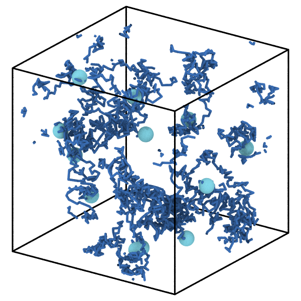
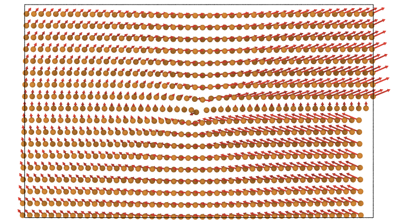

# mdapy 2.0 夜间进展报告（2026-10-28 夜 → 29）

你下班前的安排里和 mdapy 本体有关的部分：

1. 以 OVITO 3.17.1 为准重新对比，补上 MSD、RDF（含分量）、结构因子等还没对比过的分析；速度也对比（在 Triton 上跑）。
2. 第四步还剩的功能：Load trajectory（dump 套用 data 的拓扑）、读取 CIF / PDB、时间平均、轨迹线、配位多面体、任意矢量列的箭头。
3. 你说今晚测试全过的直接合进 v2，合并后的分支删掉。

本地工作单独汇报。

## 早上先看这里（10-28 19:20）

- 今天已合入 v2 的：弹性常数对称性提速（15 s → 0.03 s）、`transform.affine`、`neighbor.expand_selection`、OVITO 3.17.1 作参考。
- 已合并的远程分支 dislocations、gui-superset、slip-systems、solid-liquid、surface-mesh 已删除；保留 master、night-report、mdapy_old。

## 今晚合入 v2 的提交

| 提交 | 内容 |
|---|---|
| `761ffde` | 弹性常数只取对称旋转，不再逐原子映射：4×4×4 fcc 胞 15 s → 0.03 s |
| `36bf1bc` | `transform.affine`：仿射变换，和 OVITO 的 AffineTransformationModifier 逐项一致 |
| `2c18e1e` | `neighbor.expand_selection`：按截断、最近邻、成键扩展选择，三种模式和 OVITO 一致 |
| `997d6e4` | OVITO 3.17.1 作参考：全部对比测试照样通过，CI 改装 3.17.1 |
| `7f5aa45` | MSD 和结构因子对比 OVITO 3.17.1 的测试，结构因子页写明和 OVITO 的差别 |
| `511ee82` | 性能对比加上 MSD（20 帧 dump 读入 + MSD，对比 OVITO 的 DiffusionModifier） |
| `07c337c` | `render(vectors=...)`：任意矢量列（位移、速度、力……）画箭头，和 OVITO 的 Vector display 一致 |
| `2ac7391` | `read_trajectory`：多文件（`dump.*.lammpstrj` 模式或列表）、`topology=` 让 dump 帧带上 data 文件的键、电荷、分子号（OVITO 的 Load trajectory） |
| `06f48b3` | 读取 CIF（按对称操作展开）和 PDB（原子名、残基、MODEL 多帧、CONECT 键） |
| `3ef6e94` | `analysis.TimeAverage`：任意列、盒子或函数结果的时间平均（OVITO 的 Time averaging） |

## 进展

### 10-28 20:25
- **CIF / PDB 读取**（已合入 v2，只读）：
  - CIF：自己写的解析器（引号、`;` 文本块、注释、`5.4307(2)` 这种带不确定度的数、CIF2 的点号标签都支持），晶胞参数转成 a 沿 x、b 在 xy 面的矩阵，对称操作（如 `-x+1/2,y,z+1/2`）自己解析、不用 eval，每个位点的像折回晶胞、0.01 Å 内去重。和 pymatgen、ASE、OVITO 读同一批文件对比 6 种晶体（NaCl、金红石、石英、刚玉、单斜 ZrO2、三斜）：原子和晶胞一致，位置和顺序与 ASE 一致。
  - PDB：CRYST1、ATOM/HETATM（id、元素、原子名、残基名和编号）、MODEL 多帧、CONECT 成键。和 ASE、OVITO 对比一致；唯一差别：OVITO 还会按距离补键，我们只取 CONECT（文档里写了 `covalent_bonds` 可以补）。
  - 两个格式页各一张图：读进来的金红石（3×3×4）、PDB 文本里的乙醇。

  

- **时间平均**（已合入 v2）：`TimeAverage("positions").compute(trajectory)`，也可以平均任意列、`"box"`，或者一个函数（比如每帧的 g(r)）。按 id 对应原子、位置自动 unwrap（OVITO 要求先手动 unwrap、按下标对应）。和 OVITO 的 TimeAveragingModifier 现场对比：平均位置 1e-9、RDF 表 1e-10、时间步属性一致。文档例子：热振动的铜，单帧 CNA 只认出一半 fcc，平均 20 帧后全部 fcc：

  

- **轨迹线**（分支 trajectory-lines，全量测试在跑）：`analysis.trajectory_lines(frames, atoms)` 给 (M, T, 3) 路径，`render(lines=..., wrap_lines=True)` 画出来。OVITO 的线宽 0.2 实测是直径（我们默认半径 0.1）。对比时发现 **OVITO 生成轨迹线不用 image 标志，只按最近像跟踪**，原子一帧跳超过半个盒子时它的线是错的；我们用 image 标志，和真实路径一致到 1e-15。

  

- 全量测试里遇到一次偶发失败：读 mdapy 文件时 `np.linalg.det` 对一个有限矩阵报了 “invalid value” 警告（单独跑通过），像是 macOS Accelerate 的伪浮点异常。重跑确认中，如果复现我再查。
- Triton 上 OVITO 3.17.1 的速度重测已经开始跑（作业 21268016，运行 14 分钟）。
### 10-28 20:00
- **任意矢量箭头**（第四步第一项，已合入 v2）：`render(system, vectors="displacement" 或 (N,3) 数组, vector_scale, vector_radius, vector_color（一种颜色或 "atom"）, vector_alignment（base/center/head）)`。
  - 和 OVITO 3.17.1 的 VectorVis 现场对比（同一相机、OpenGL 渲染器、Normal 着色）：三种对齐、反向、不同宽度，箭头轮廓像素重合 99%。
  - 量出来 OVITO 的 `width` 其实是箭杆**半径**（不是直径）：箭头半径 2.5w、长 4.5w，比箭头短的箭只画按比例缩小的圆锥。我们的默认值照搬（半径 0.5 Å）。OVITO 默认是 Flat 着色（总朝向观察者的扁平箭头），我们画立体箭头，对应它的 Normal 着色，文档写明。
  - 文档 Rendering 页加了 Vectors 一节，例子是刃位错周围的位移场：

  

- **Load trajectory**（已合入 v2）：`mdapy.read_trajectory(path, topology=data)`。
  - `path` 可以是 `dump.*.lammpstrj` 这样的模式（按文件名里的数字排序，dump.10 在 dump.9 后面）或文件列表；一个文件里多帧也行；最多同时打开两个文件，几千个文件也没问题。
  - 给了 `topology`：每帧按 id 排成 data 文件的原子顺序，带上它的键、角、电荷、分子号等 dump 里没有的列；dump 缺的原子连同它们的键、角一起去掉并重编号；盒子用帧的、周期性用 data 的；帧里原子齐全时共用同一个 Topology 对象（不复制）。
  - 和 OVITO 的 LoadTrajectoryModifier 现场逐帧对比（打乱顺序、缺一个原子、盒子变化）：id 顺序、坐标、电荷、分子号、键完全一致。唯一差别：帧里有 data 没有的原子时 OVITO 追加，我们报错（写进文档）。
- 全量测试每次合并前都跑：2432 通过，覆盖率达标。
- Triton 上 OVITO 3.17.1 的速度重测作业还在排队（Priority）。

### 10-28 19:30
- **MSD**：和 OVITO 的 `DiffusionModifier` 完全一致（逐个时间窗、x/y/z 分量、有无周期翻越都比了）。本地小规模速度：4 000 原子 20 帧 mdapy 0.019 s，OVITO 0.022 s；32 000 原子 0.089 s 对 0.111 s（含读文件）。
- **结构因子**：OVITO 的两种模式和我们定义不同，测试里按它的定义比对，结果一致：
  - 直接法只对 h,k,l ≥ 0 的八分之一倒空间取平均，我们对全部 k 取平均；
  - Debye 法多了均匀密度项 1 + (4πρ/k)∫ r sin(kr) g(r) dr，我们给的是去掉这一项的结果（和定义一致），差在 1e-3 以内。
  - 这两点写进了结构因子文档的 Definition。
- 全量 2423 个测试通过，覆盖率达标，已合入 v2 并删除分支 ovito-msd、bench-msd。
- Triton 上已提交 OVITO 3.17.1 的速度重测（作业 21268016，在排队）：分析全组 4 000 到 200 万原子（含 MSD），文件读写全组。跑完后更新性能页的表和图。

### 10-28 19:20
- OVITO 升级到 3.17.1，全量 2416 个测试通过（所有 OVITO 对比都一致），CI 改装 3.17.1，已合入 v2。
- 3.17.1 里有、我们还没对比的：`DiffusionModifier`（MSD）、`RadialDistributionFunctionModifier`（RDF 及分量）、`StructureFactorModifier`、`WrapPeriodicImagesModifier`、`ReplicateModifier`。接下来补这些对比。
- 性能页里的 OVITO 计时还是 3.17.0 的，之后在 Triton 上用 3.17.1 重测。
