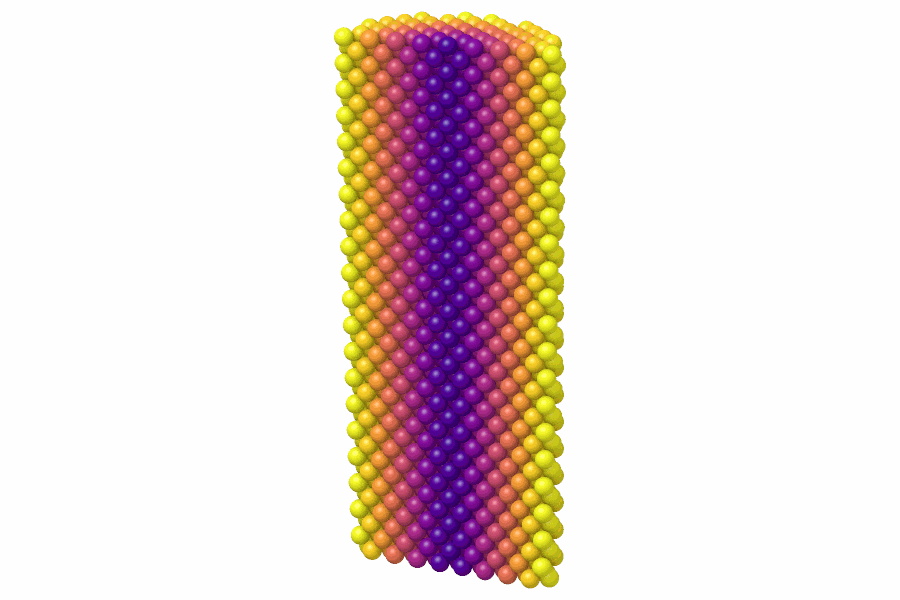

# Atomic strain

`AtomicStrain` measures the local deformation of each atom between a
reference configuration and the current one: the von Mises shear and
volumetric strains and, when asked for, the strain tensor and the
non-affine displacement $D^2_\text{min}$.

```python
import numpy as np

import mdapy as mp
from mdapy.analysis import AtomicStrain

# fcc copper of 4 x 4 x 4 cubic cells as the reference
a = 3.615
basis = np.array([[0, 0, 0], [0.5, 0.5, 0], [0.5, 0, 0.5], [0, 0.5, 0.5]])
cells = np.stack(np.meshgrid(*[np.arange(4)] * 3, indexing="ij"), -1).reshape(-1, 1, 3)
positions = ((cells + basis) * a).reshape(-1, 3)
reference = mp.System(positions, mp.Box(4 * a), elements="Cu")

# the crystal sheared by 2 % with its box
shear = np.array([[1, 0.02, 0], [0, 1, 0], [0, 0, 1]])
current = mp.System(
    positions @ shear.T, mp.Box(reference.box.matrix @ shear.T), elements="Cu"
)

strain = AtomicStrain(reference, cutoff=3.0)
result = strain.compute(current)
result.shear  # von Mises shear strain, the same for every atom here
current = current.with_columns(result)  # shear_strain, volumetric_strain

# also the strain tensor and the non-affine displacement
result = AtomicStrain(reference, 3.0, strain_tensor=True, d2min=True).compute(current)
result.strain_tensor[0]  # (3, 3) of the first atom

# many frames against one reference: find its neighbors once
neighbors = mp.NeighborList.build(reference, 3.0)
strain = AtomicStrain(reference, cutoff=3.0, neighbors=neighbors)
```

A rod of copper twisted about its axis shears more the farther from the axis:

```python
from mdapy.build import build_crystal
from mdapy.visualization import render

crystal = build_crystal("fcc", a, elements="Cu", repeat=(10, 10, 20))
center = crystal.box.matrix.diagonal() / 2
p = crystal["positions"] - center
rod = crystal.filter(np.hypot(p[:, 0], p[:, 1]) < 15)
rod = rod.with_box(mp.Box(crystal.box.matrix, pbc=False))

p = rod["positions"] - center
angle = 0.004 * p[:, 2]  # radians, growing along the axis
twisted = rod.with_columns(positions=center + np.column_stack([
    p[:, 0] * np.cos(angle) - p[:, 1] * np.sin(angle),
    p[:, 0] * np.sin(angle) + p[:, 1] * np.cos(angle),
    p[:, 2],
]))  # fmt: skip
shear = AtomicStrain(rod, cutoff=3.0).compute(twisted).shear
render(twisted, "images/atomic-strain.png", atoms=p[:, 1] < 0, color=shear, colormap="plasma",
       box=False, view=(0.5, -1, -0.3), width=900, height=600)  # fmt: skip
```



*The rod cut along its axis: the von Mises shear strain grows from zero on the
axis (dark) to about 0.03 at the surface (yellow), half the twist of
0.004 rad/Å times the distance from the axis.*

## Parameters

| Name | Type | Default | Unit | Meaning |
|---|---|---|---|---|
| `reference` | `System` | | | the reference configuration, with the same atoms in the same order as the systems to compare |
| `cutoff` | float | | Å | the neighbors closer than it in the reference define the neighbor vectors |
| `affine` | bool | `False` | | measure the current vectors in the reference box, which removes the homogeneous deformation of the box |
| `strain_tensor` | bool | `False` | | also give the strain tensor of each atom |
| `d2min` | bool | `False` | | also compute the non-affine squared displacement of each atom |
| `neighbors` | `NeighborList` | `None` | | neighbors of the reference within at least `cutoff`, used for every configuration; without, `compute` finds them as it goes each time |

`compute(system, *, progress=None, cancel=None)` takes the current
configuration: the atoms of the reference in the same order, each moved by
less than half the box. Positions may be wrapped back into the box.

## Results

A `StrainResult`:

| Attribute | Type | Unit | Meaning |
|---|---|---|---|
| `shear` | (N,) float64 | | the von Mises shear strain $\eta_\text{s}$, NaN where the reference neighbors do not span three dimensions; its column `shear_strain` |
| `volumetric` | (N,) float64 | | the volumetric strain $\operatorname{tr}\eta / 3$; its column `volumetric_strain` |
| `strain_tensor` | (N, 3, 3) float64 | | the Green–Lagrange strain $\eta$, with `strain_tensor`, else `None` |
| `d2min` | (N,) float64 | Ų | the non-affine squared displacement $D^2_\text{min}$, with `d2min`, else `None`; its column `d2min` |

## Errors

The constructor raises `InvalidParameter` for a cutoff that is not positive;
`compute` raises it for a system with another number of atoms or other
periodic directions than the reference, or, when both have an `id` column,
atoms in another order.

## Definition

The neighbors of atom $i$ are the atoms closer than the cutoff in the
reference, periodic images included, at the vectors $\mathbf d^0_j$. Their
current vectors $\mathbf d_j$ follow from each atom's displacement, taken by
the nearest periodic image in fractional coordinates, in the current box or,
with `affine`, in the reference box. The deformation gradient minimizes
$\sum_j |\mathbf d_j - F \mathbf d^0_j|^2$:

$$
F = \Big(\sum_j \mathbf d_j \mathbf d^{0\,T}_j\Big)\Big(\sum_j \mathbf d^0_j \mathbf d^{0\,T}_j\Big)^{-1},
\qquad
\eta = \tfrac{1}{2}(F^T F - I),
$$

$$
\eta_\text{s} = \sqrt{\eta_{xy}^2 + \eta_{xz}^2 + \eta_{yz}^2
+ \tfrac{1}{6}\big[(\eta_{xx}-\eta_{yy})^2 + (\eta_{yy}-\eta_{zz})^2 + (\eta_{xx}-\eta_{zz})^2\big]},
\qquad
D^2_\text{min} = \sum_j |\mathbf d_j - F\mathbf d^0_j|^2 .
$$

## See also

- OVITO [Atomic strain](https://docs.ovito.org/reference/pipelines/modifiers/atomic_strain.html).

!!! quote "Please cite"
    [Shimizu et al. (2007)](../reference/references.md#shimizu2007); for $D^2_\text{min}$, [Falk and Langer (1998)](../reference/references.md#falk1998).
