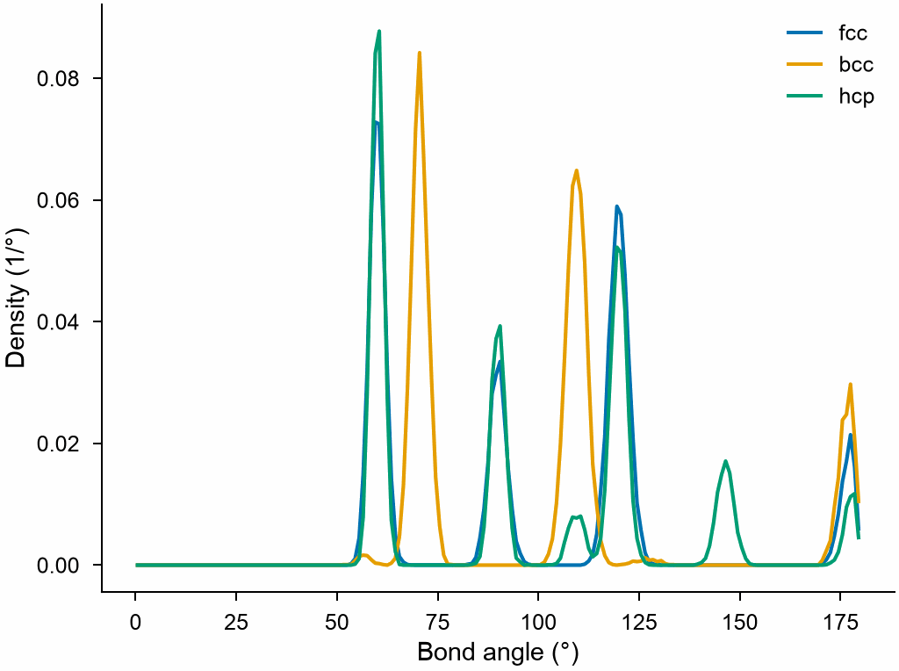

# Bond angle distribution

`BondAngleDistribution` counts the angles between the bonds of each atom, in
total and for each triplet of elements.

```python
import numpy as np

import mdapy as mp
from mdapy.analysis import BondAngleDistribution

# fcc copper of 3 x 3 x 3 cubic cells
a = 3.615
basis = np.array([[0, 0, 0], [0.5, 0.5, 0], [0.5, 0, 0.5], [0, 0.5, 0.5]])
cells = np.stack(np.meshgrid(*[np.arange(3)] * 3, indexing="ij"), -1).reshape(-1, 1, 3)
positions = ((cells + basis) * a).reshape(-1, 3)
system = mp.System(positions, mp.Box(3 * a), elements="Cu")

angles = BondAngleDistribution(cutoff=3.0, bins=180).compute(system)
# per atom, 24, 12, 24 and 6 angles at 60, 90, 120 and 180 degrees
angles.angle, angles.counts
angles.triplet("Cu", "Cu", "Cu")  # the angles at Cu between two Cu neighbors
```

The three close-packed and body-centered lattices, each shaken by 0.05 Å:

```python
from mdapy.build import build_crystal
from mdapy.visualization import plot

rng = np.random.default_rng(0)
crystals = {
    "fcc": (build_crystal("fcc", 3.615, elements="Cu", repeat=(5, 5, 5)), 3.0),
    "bcc": (build_crystal("bcc", 2.87, elements="Fe", repeat=(6, 6, 6)), 2.7),
    "hcp": (build_crystal("hcp", 3.21, elements="Mg", repeat=(6, 6, 4)), 3.6),
}
with plot.style():
    fig, ax = plot.figure("single")
    for name, (crystal, cutoff) in crystals.items():
        shaken = crystal.with_columns(
            positions=crystal["positions"] + rng.normal(0, 0.05, (len(crystal), 3))
        )
        result = BondAngleDistribution(cutoff=cutoff, bins=180).compute(shaken)
        ax.plot(result.angle, result.density, label=name)
    ax.set_xlabel("Bond angle (°)")
    ax.set_ylabel("Density (1/°)")
    ax.legend(frameon=False)
    plot.save(fig, "images/bond-angles", formats=("png",))
```



*fcc and hcp share their angles at 60°, 90°, 120° and 180° and differ by
those near 109° and 146° that only hcp has; bcc, with its 8 nearest
neighbors, has 70.5°, 109.5° and 180°.*

For water, `BondAngleDistribution(cutoffs={("O", "H"): 1.2})` keeps only
the O–H bonds and `triplet("O", "H", "H")` gives the H–O–H angles.

## Parameters

| Name | Type | Default | Unit | Meaning |
|---|---|---|---|---|
| `cutoff` | float | `None` | Å | bonds are shorter than it |
| `bins` | int | 180 | | number of bins of equal width from 0 to 180 degrees |
| `cutoffs` | dict | `None` | Å | instead of `cutoff`, a bond length for each pair of elements `(a, b)`, in either order; pairs not given are never bonded |

`compute(system, *, neighbors=None, progress=None, cancel=None)` takes the
arguments of [every analysis](overview.md#parameters). A given neighbor list
must reach the largest cutoff; without one, the bonds are found and used at
once, never stored. Partial counts and `cutoffs` need an `element` column.

## Results

A `BondAngleResult`:

| Attribute or method | Type | Meaning |
|---|---|---|
| `angle` | (bins,) float64 | bin centers in degrees |
| `edges` | (bins + 1,) float64 | bin edges in degrees |
| `counts` | (bins,) int64 | number of angles in each bin |
| `density` | (bins,) float64 | the counts normalized so that their integral over degrees is 1 |
| `partial` | dict | counts for each triplet `(a, b, c)`: an atom of element `a` at the vertex and neighbors of elements `b` and `c`, `b` not after `c` by atomic number; they add up to `counts` |
| `triplet(a, b, c)` | (bins,) int64 | the counts of the triplet, with `b` and `c` in either order |

## Errors

The constructor raises `InvalidParameter` without exactly one of `cutoff`
and `cutoffs`, for a cutoff that is not positive, an unknown element or
fewer than one bin; `compute` raises it for a neighbor list that does not
fit, and `MissingProperty` for `cutoffs` without an `element` column;
`triplet` raises `InvalidParameter` for a triplet without counts.

## Definition

Every two bonds $ij$ and $ik$ of an atom $i$ give the angle $\theta_{jik}$
between the vectors to $j$ and $k$, counted in the bin
$\lfloor \theta / \Delta\theta \rfloor$; an atom with $n$ bonds gives
$n(n - 1)/2$ angles. Bonds join atoms closer than the cutoff of their pair
of elements, also across periodic boundaries.

## See also

- OVITO [Bond angle distribution](https://docs.ovito.org/reference/pipelines/modifiers/bond_angle_distribution.html).
- LAMMPS [`compute adf`](https://docs.lammps.org/compute_adf.html).
