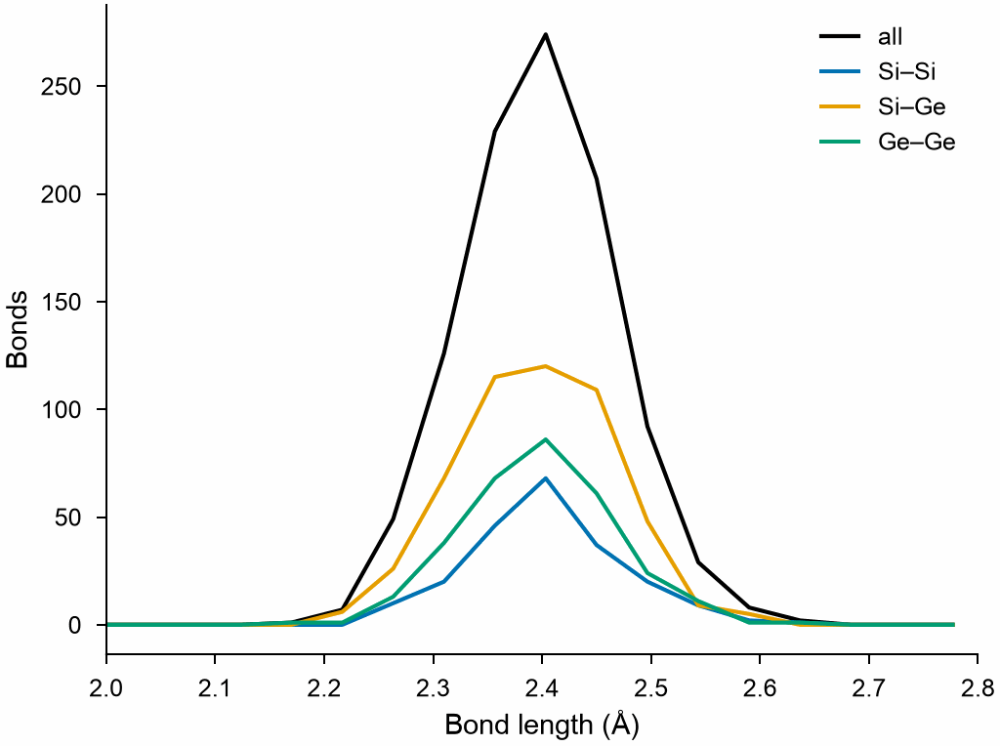

# Bond length distribution

`BondLengthDistribution` counts the lengths of the bonds of a topology, in
total and for each pair of elements, as OVITO's bond length distribution.
The bonds come from a file, such as a LAMMPS data file, or from
[`create_bonds`](../build/bonds.md).

```python
import numpy as np

import mdapy as mp
from mdapy import transform
from mdapy.analysis import BondLengthDistribution
from mdapy.build import build_crystal

# a silicon-germanium alloy on the diamond lattice, its atoms shaken by 0.05 Å
alloy = build_crystal("diamond", 5.53, elements="Si", repeat=(4, 4, 4))
rng = np.random.default_rng(0)
alloy = alloy.with_columns(
    element=rng.choice(["Si", "Ge"], size=len(alloy)),
    positions=alloy["positions"] + rng.normal(0, 0.05, (len(alloy), 3)),
)
bonded = transform.create_bonds(alloy, 2.8)

lengths = BondLengthDistribution(bins=60, cutoff=2.8).compute(bonded)
lengths.length, lengths.counts  # bin centers in Å, bonds in each bin
lengths.lengths  # the length of each bond
lengths.pair("Si", "Ge")  # the Si-Ge bonds
```

The total distribution and its three pairs:

```python
from mdapy.visualization import plot

with plot.style():
    fig, ax = plot.figure("single")
    ax.plot(lengths.length, lengths.counts, color="black", label="all")
    for a, b in [("Si", "Si"), ("Si", "Ge"), ("Ge", "Ge")]:
        ax.plot(lengths.length, lengths.pair(a, b), label=f"{a}–{b}")
    ax.set_xlim(2.0, 2.8)
    ax.set_xlabel("Bond length (Å)")
    ax.set_ylabel("Bonds")
    ax.legend(frameon=False)
    plot.save(fig, "images/bond-lengths", formats=("png",))
```



*The bonds of 2.39 Å on the common lattice, spread by the shaking; the
random alloy has twice as many Si–Ge bonds as Si–Si or Ge–Ge bonds.*

## Parameters

`BondLengthDistribution(bins=100, cutoff=None)`

| Name | Type | Default | Unit | Meaning |
|---|---|---|---|---|
| `bins` | int | 100 | | number of bins of equal width from 0 to the cutoff |
| `cutoff` | float | `None` | Å | the upper end of the bins; longer bonds are not counted. By default the longest bond |

`compute(system)` takes a system with bonds in its topology. Each bond is
measured to the nearest periodic image of its second atom. Partial counts
need an `element` column.

## Results

A `BondLengthResult`:

| Attribute or method | Type | Meaning |
|---|---|---|
| `length` | (bins,) float64 | bin centers in Å |
| `edges` | (bins + 1,) float64 | bin edges in Å |
| `counts` | (bins,) int64 | number of bonds in each bin |
| `density` | (bins,) float64 | the counts normalized so that their integral over Å is 1 |
| `lengths` | (bonds,) float64 | the length of each bond, in the order of the topology |
| `partial` | dict | counts for each pair of elements `(a, b)`, `a` not after `b` by atomic number; they add up to `counts` |
| `pair(a, b)` | (bins,) int64 | the counts of the pair, `a` and `b` in either order |

## Errors

The constructor raises `InvalidParameter` for fewer than one bin or a
cutoff that is not positive; `compute` raises `MissingProperty` for a
system without bonds; `pair` raises `InvalidParameter` for a pair without
counts.

## Definition

A bond between atoms $i$ and $j$ is
$\lvert \mathbf{r}_j - \mathbf{r}_i \rvert$ long, the difference taken to
the nearest periodic image, and counted in the bin
$\lfloor l / \Delta l \rfloor$, $\Delta l$ the cutoff over the number of
bins.

## See also

- [Bond angle distribution](bond-angles.md).
- OVITO [Bond length distribution](https://docs.ovito.org/reference/pipelines/modifiers/bond_length_distribution.html).
