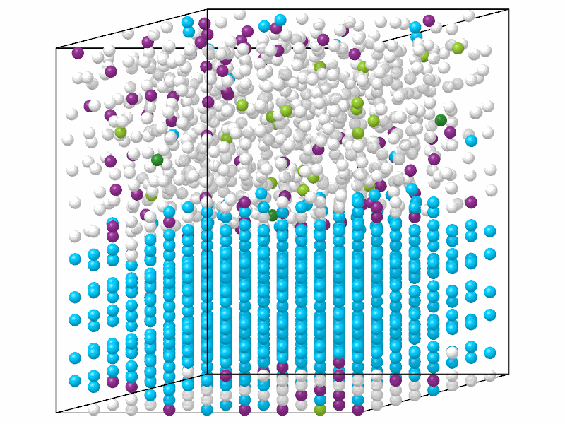

# CHILL+

`ChillPlus` tells hexagonal ice, cubic ice, clathrate hydrates and their
interfaces from liquid water, by the correlation of the bond order of
neighboring molecules.

```python
import numpy as np

from mdapy.build import build_crystal
from mdapy.identify import ChillPlus

# the oxygen atoms of hexagonal ice, one per molecule, the upper half
# disordered like liquid water
ice = build_crystal("lonsdaleite", 4.52, c=7.36, elements="O", repeat=(8, 8, 6))
upper = ice["positions"][:, 2] > 22.0
shake = np.random.default_rng(0).normal(0, 0.5, (len(ice), 3))
water = ice.with_columns(positions=ice["positions"] + shake * upper[:, None])

result = ChillPlus(cutoff=3.5).compute(water)
result.counts()  # {'other': 719, 'hexagonal_ice': 698, ...}
water = water.with_columns(result)  # the column 'structure'
```

For water of more than oxygen, `water.filter(element="O")` keeps one atom per
molecule. Each molecule in the color of its structure:

```python
from mdapy.visualization import render

side = [0, -1, 0.15]  # seen from the side, slightly from above
render(water, "images/chill-plus.png", color=result, view=side, width=800, height=600)
```



*Hexagonal ice (light blue) under its disordered half (white, other). The
molecules at the two interfaces, the lower one across the periodic boundary,
are interfacial ice (purple); a few disordered molecules happen to have the
bonds of a hydrate (green).*

## Parameters

| Name | Type | Default | Unit | Meaning |
|---|---|---|---|---|
| `cutoff` | float | 3.5 | Å | neighbors are the molecules closer than it; 3.5 Å for the oxygen atoms of water |

`compute(system, *, neighbors=None, progress=None, cancel=None)` takes the
arguments of [every analysis](overview.md#parameters); the system holds one
atom per molecule, for water its oxygen atoms. A given neighbor list must
reach the cutoff.

## Results

A [`StructureResult`](overview.md#results) with the types below.

## Errors

The constructor raises `InvalidParameter` for a cutoff that is not positive;
`compute` raises it for a neighbor list that does not fit.

## Definition

Each molecule $i$ gets the bond order $q_{3m}(i) = \sum_j Y_{3m}(\hat{\mathbf
r}_{ij})$ over its neighbors $j$, with the spherical harmonics $Y_{3m}$ of
degree 3, and each bond the correlation

$$
c(i, j) = \frac{\operatorname{Re} \sum_m q_{3m}(i)\, q_{3m}(j)^*}{|q_3(i)|\, |q_3(j)|}.
$$

A bond is staggered when $c < -0.8$ and eclipsed when $-0.35 < c < 0.25$. A
molecule with four neighbors is, checked from the top of the table down:

| Index | Name | Default color | Bonds |
|---|---|---|---|
| 1 | `hexagonal_ice` | light blue | 3 staggered and 1 eclipsed |
| 2 | `cubic_ice` | orange | 4 staggered |
| 3 | `interfacial_ice` | purple | 3 staggered and no eclipsed, or 2 staggered |
| 4 | `hydrate` | green | 4 eclipsed |
| 5 | `interfacial_hydrate` | yellow-green | 3 eclipsed |
| 0 | `other` | light grey | any other molecule |

!!! quote "Please cite"
    [Nguyen and Molinero (2015)](../reference/references.md#nguyen2015).
