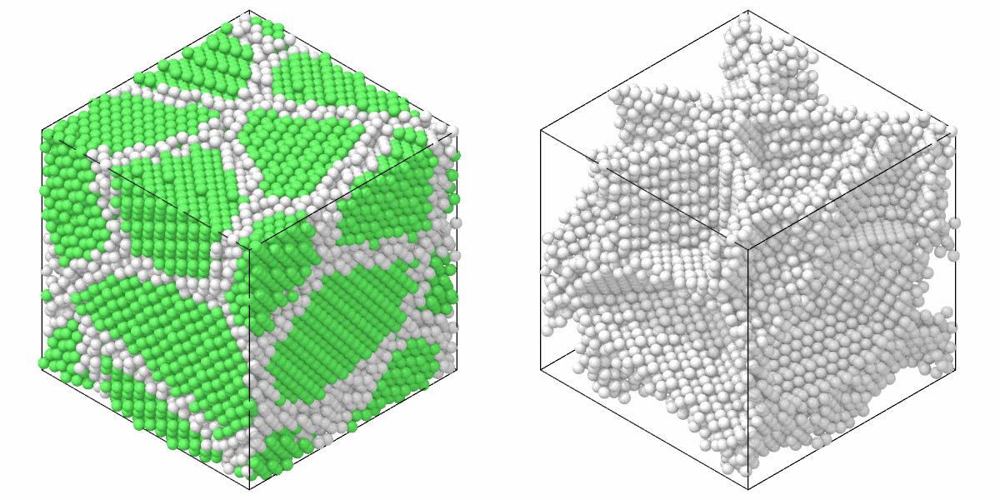

# Common neighbor analysis

`CommonNeighborAnalysis` gives each atom the crystal structure of its
neighborhood: fcc, hcp, bcc, icosahedral or other.

```python
import numpy as np

import mdapy as mp
from mdapy.identify import CommonNeighborAnalysis

# fcc copper of 4 x 4 x 4 cubic cells
a = 3.615
basis = np.array([[0, 0, 0], [0.5, 0.5, 0], [0.5, 0, 0.5], [0, 0.5, 0.5]])
cells = np.stack(np.meshgrid(*[np.arange(4)] * 3, indexing="ij"), -1).reshape(-1, 1, 3)
positions = ((cells + basis) * a).reshape(-1, 3)
system = mp.System(positions, mp.Box(4 * a), elements="Cu")

result = CommonNeighborAnalysis().compute(system)  # adaptive
result.counts()  # {'other': 0, 'fcc': 256, 'hcp': 0, 'bcc': 0, 'ico': 0}
system = system.with_columns(result)  # the column 'structure'

fixed = CommonNeighborAnalysis(cutoff=0.854 * a).compute(system)  # conventional
```

In a polycrystal the atoms that are not fcc mark the grain boundaries:

```python
from mdapy.build import build_crystal, build_polycrystal
from mdapy.visualization import render, write_png

copper = build_crystal("fcc", 3.615, elements="Cu")
grains = build_polycrystal(copper, mp.Box(60.0), 6, seed=4)
structures = CommonNeighborAnalysis().compute(grains)
whole = render(grains, color=structures, width=600, height=600)
fcc = structures.structure == 1
boundaries = render(grains, atoms=~fcc, color=structures, width=600, height=600)
write_png("images/cna.png", np.hstack([whole, boundaries]))
```



*A copper polycrystal of six grains as built, colored by structure: fcc green,
other white. Right: the same without the fcc atoms, which leaves the network
of grain boundaries.*

## Parameters

| Name | Type | Default | Unit | Meaning |
|---|---|---|---|---|
| `cutoff` | float | `None` | Å | cutoff of the neighbors and of the bonds between them; without it, each atom has its own cutoff (adaptive analysis) |

`compute(system, *, neighbors=None, progress=None, cancel=None)` takes the
arguments of [every analysis](overview.md#parameters). A given neighbor list
must reach the cutoff or, without a cutoff, hold the 14 nearest neighbors of
every atom.

## Results

A [`StructureResult`](overview.md#results) with the types

| Index | Name | Default color |
|---|---|---|
| 0 | `other` | light grey |
| 1 | `fcc` | green |
| 2 | `hcp` | red |
| 3 | `bcc` | blue |
| 4 | `ico` | yellow |

## Errors

The constructor raises `InvalidParameter` for a cutoff that is not positive;
`compute` raises it for a neighbor list that does not fit.

## Definition

Each bond from an atom to one of its neighbors gets a signature of three
numbers: the number of neighbors the two atoms have in common, the number of
bonds among those common neighbors, and the number of bonds in the largest
connected group those bonds form. An atom with 12 neighbors is fcc when all 12
signatures are (4, 2, 1), hcp when six are (4, 2, 1) and six (4, 2, 2), and
icosahedral when all are (5, 5, 5). An atom with 14 neighbors is bcc when
eight signatures are (6, 6, 6) and six (4, 4, 4). Any other atom is `other`.

Without `cutoff`, the analysis is adaptive: each atom has its own cutoff from
its nearest neighbors, so strained or hot crystals of any lattice constant
need no parameter. For fcc, hcp and icosahedral order it takes the 12
nearest neighbors $r_1 \le \dots \le r_{12}$ and the cutoff

$$
r_c = \frac{1 + \sqrt 2}{2}\, \frac{1}{12} \sum_{j=1}^{12} r_j ,
$$

halfway between the first and second shells of fcc; neighbors and bonds
between them count when they are no longer than $r_c$. When that does not
give fcc, hcp or icosahedral, it takes the 14 nearest neighbors for bcc and

$$
r_c = \frac{1 + \sqrt 2}{2}\, \frac{1}{14}
\Big(\frac{2}{\sqrt 3} \sum_{j=1}^{8} r_j + \sum_{j=9}^{14} r_j\Big).
$$

With `cutoff`, the conventional analysis, the neighbors of an atom are those
closer than the cutoff, and an atom must have exactly 12 or 14 of them; the
same cutoff decides the bonds between neighbors. A cutoff between the first
and second shells is $0.854\,a$ for fcc and $1.207\,a$ for bcc of lattice
constant $a$.

In a system without periodic directions and fewer than 15 atoms, the
neighbors of each atom are all the others.

## See also

- LAMMPS [`compute cna/atom`](https://docs.lammps.org/compute_cna_atom.html),
  the conventional analysis.

!!! quote "Please cite"
    [Honeycutt and Andersen (1987)](../reference/references.md#honeycutt1987) and [Faken and Jónsson (1994)](../reference/references.md#faken1994); for the adaptive analysis, also [Stukowski (2012)](../reference/references.md#stukowski2012).
