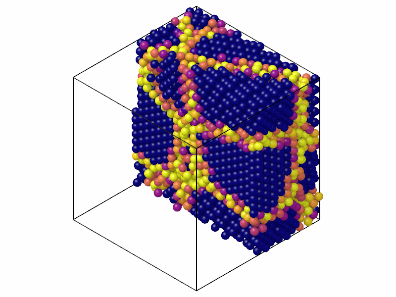

# Common neighbor parameter

`CommonNeighborParameter` measures how symmetrically the common neighbors of
each atom and its neighbors are arranged: zero in perfect fcc, bcc and
diamond, large at defects and surfaces, defined for any structure.

```python
import numpy as np

import mdapy as mp
from mdapy.identify import CommonNeighborParameter

# fcc copper of 4 x 4 x 4 cubic cells, with one atom missing
a = 3.615
basis = np.array([[0, 0, 0], [0.5, 0.5, 0], [0.5, 0, 0.5], [0, 0.5, 0.5]])
cells = np.stack(np.meshgrid(*[np.arange(4)] * 3, indexing="ij"), -1).reshape(-1, 1, 3)
positions = ((cells + basis) * a).reshape(-1, 3)[1:]
system = mp.System(positions, mp.Box(4 * a), elements="Cu")

result = CommonNeighborParameter(cutoff=3.0).compute(system)
result.cnp.max()  # Å^2, at the neighbors of the vacancy
system = system.with_columns(result)  # the column 'cnp'
```

In a polycrystal, cut in half to show the boundaries inside:

```python
from mdapy.build import build_crystal, build_polycrystal
from mdapy.visualization import render

grains = build_polycrystal(
    build_crystal("fcc", 3.615, elements="Cu"), mp.Box(50.0), 5, seed=4
)
cnp = CommonNeighborParameter(cutoff=3.08).compute(grains).cnp
render(grains, "images/cnp.png", atoms=grains["positions"][:, 0] < 25, color=cnp,
       colormap="plasma", value_range=(0, 20), width=800, height=600)  # fmt: skip
```



*Zero inside the grains (dark blue), up to 20 Ų and more at the boundaries.*

## Parameters

| Name | Type | Default | Unit | Meaning |
|---|---|---|---|---|
| `cutoff` | float | | Å | neighbors and common neighbors are closer than it |

`compute(system, *, neighbors=None, progress=None, cancel=None)` takes the
arguments of [every analysis](overview.md#parameters). A given neighbor list
must reach the cutoff.

## Results

A `CommonNeighborParameterResult`:

| Attribute | Type | Unit | Meaning |
|---|---|---|---|
| `cnp` | (N,) float64 | Ų | the parameter of each atom, NaN for an atom without neighbors; also its column `cnp` |

## Errors

The constructor raises `InvalidParameter` for a cutoff that is not positive;
`compute` raises it for a neighbor list that does not fit.

## Definition

For an atom $i$ with $N_i$ neighbors $j$, the common neighbors $k$ of $i$
and $j$ are the atoms closer than the cutoff to both. With $\mathbf r_{ik} =
\mathbf x_i - \mathbf x_k$,

$$
Q_i = \frac{1}{N_i} \sum_{j} \Bigl| \sum_{k} (\mathbf r_{ik} + \mathbf r_{jk}) \Bigr|^2 .
$$

It is zero in perfect fcc, bcc and diamond, and $2a^2/3$ in ideal hcp of
lattice constant $a$ with the cutoff between its first and second shells. Unlike the [centro-symmetry parameter](csp.md) it needs a cutoff
rather than a number of neighbors.

!!! quote "Please cite"
    [Tsuzuki et al. (2007)](../reference/references.md#tsuzuki2007).
