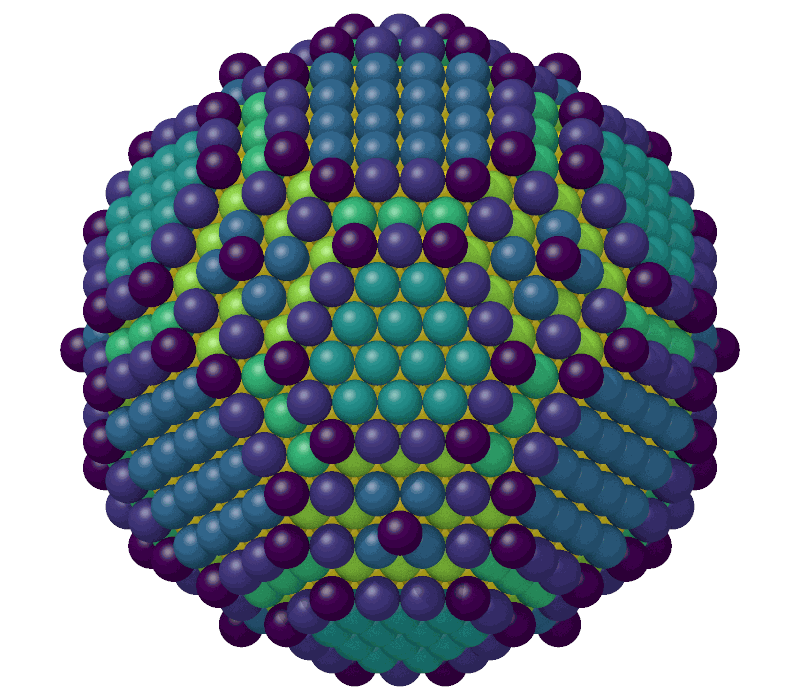

# Coordination number

`CoordinationNumber` counts the neighbors of each atom, in total and by
element, within one cutoff or a cutoff for each pair of elements.

```python
import numpy as np

import mdapy as mp
from mdapy.analysis import CoordinationNumber

# a CsCl-ordered CuZn crystal of 4 x 4 x 4 cubic cells
a = 2.95
basis = np.array([[0, 0, 0], [0.5, 0.5, 0.5]])
cells = np.stack(np.meshgrid(*[np.arange(4)] * 3, indexing="ij"), -1).reshape(-1, 1, 3)
positions = ((cells + basis) * a).reshape(-1, 3)
system = mp.System(positions, mp.Box(4 * a), elements=["Cu", "Zn"] * 64)

result = CoordinationNumber(cutoff=3.2).compute(system)
result.coordination  # 14 for every atom: 8 unlike and 6 like neighbors
result.partial["Zn"]  # neighbors of element Zn
unlike = CoordinationNumber(cutoffs={("Cu", "Zn"): 2.7}).compute(system)
system = system.with_columns(result)  # coordination, coordination_Cu, ...
```

On a particle, the coordination shows the facets, edges and corners:

```python
from mdapy.build import build_crystal
from mdapy.visualization import render

crystal = build_crystal("fcc", 3.615, elements="Cu", repeat=(12, 12, 12))
center = crystal.box.matrix.diagonal() / 2
inside = np.linalg.norm(crystal["positions"] - center, axis=1) < 18.0
particle = crystal.filter(inside).with_box(mp.Box(12 * 3.615, pbc=False))

coordination = CoordinationNumber(cutoff=3.0).compute(particle).coordination
render(particle, "images/coordination.png", color=coordination.astype(float),
       value_range=(6, 12), box=False, width=800, height=700)  # fmt: skip
```



*A sphere of 18 Å radius cut from copper, colored from 6 neighbors or fewer
(dark purple) to 12 (yellow, the inside). The (111) facets have 9 neighbors, the
(100) facets 8 and the atoms at edges and corners fewer.*

## Parameters

| Name | Type | Default | Unit | Meaning |
|---|---|---|---|---|
| `cutoff` | float | `None` | Å | neighbors are closer than it |
| `cutoffs` | dict | `None` | Å | instead of `cutoff`, a cutoff for each pair of elements `(a, b)`, in either order; pairs not given are never neighbors |

`compute(system, *, neighbors=None, progress=None, cancel=None)` takes the
arguments of [every analysis](overview.md#parameters). A given neighbor list
must reach the largest cutoff; without one, the neighbors are counted as
they are found, never stored. Partial counts and `cutoffs` need an `element`
column.

## Results

A `CoordinationResult`:

| Attribute | Type | Meaning |
|---|---|---|
| `coordination` | (N,) int64 | the number of neighbors of each atom; its column `coordination` |
| `partial` | dict | the number of neighbors of each element, by element; columns `coordination_<element>` |

## Errors

The constructor raises `InvalidParameter` without exactly one of `cutoff`
and `cutoffs`, for a cutoff that is not positive or an unknown element;
`compute` raises it for a neighbor list that does not fit, and
`MissingProperty` for `cutoffs` without an `element` column.

## Definition

The neighbors of an atom are the other atoms and periodic images closer than
the cutoff of their pair of elements.

## See also

- OVITO [Coordination analysis](https://docs.ovito.org/reference/pipelines/modifiers/coordination_analysis.html).
- LAMMPS [`compute coord/atom`](https://docs.lammps.org/compute_coord_atom.html).
