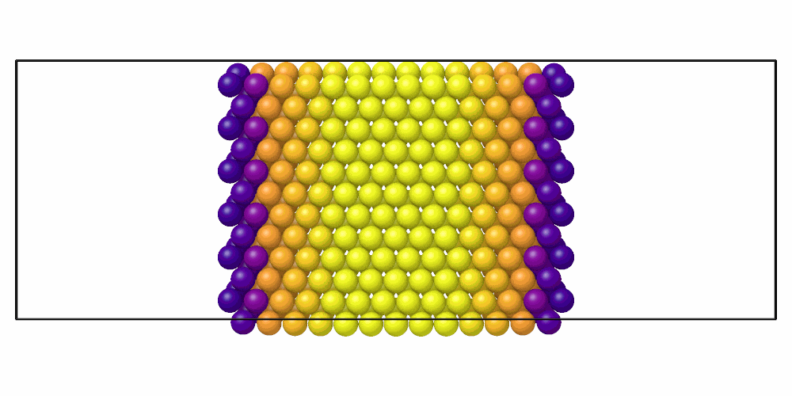

# Centro-symmetry parameter

`CentroSymmetryParameter` measures how far the neighbors of each atom are
from coming in opposite pairs: zero in perfect fcc and bcc, large at
surfaces, dislocation cores and stacking faults.

```python
import numpy as np

import mdapy as mp
from mdapy.identify import CentroSymmetryParameter

# fcc copper of 4 x 4 x 4 cubic cells, with one atom missing
a = 3.615
basis = np.array([[0, 0, 0], [0.5, 0.5, 0], [0.5, 0, 0.5], [0, 0.5, 0.5]])
cells = np.stack(np.meshgrid(*[np.arange(4)] * 3, indexing="ij"), -1).reshape(-1, 1, 3)
positions = ((cells + basis) * a).reshape(-1, 3)[1:]
system = mp.System(positions, mp.Box(4 * a), elements="Cu")

result = CentroSymmetryParameter(num_neighbors=12).compute(system)
result.csp.max()  # Å^2, at the neighbors of the vacancy
system = system.with_columns(result)  # the column 'csp'
```

Around a dislocation, the stacking fault and the partial dislocations stand
out:

```python
from mdapy.build import build_crystal, edge_dislocation
from mdapy.calculators import EAM
from mdapy.simulation import minimize
from mdapy.visualization import render, write_png

cell = build_crystal(
    "fcc", 3.615, elements="Cu", orientation=[(1, -1, 0), (1, 1, -2), (1, 1, 1)]
)
edge = edge_dislocation(cell, (30, 6, 12))
relaxed = minimize(edge, EAM.zhou(["Cu"]), max_force=1e-3, max_steps=3000).system
csp = CentroSymmetryParameter().compute(relaxed).csp

z = relaxed["positions"][:, 2]
shown = (csp > 0.5) & (np.abs(z - z.mean()) < 15)  # not the free surfaces
write_png(
    "images/csp.png",
    render(relaxed, atoms=shown, color=csp, colormap="plasma", value_range=(0, 6),
           view="top", width=1000, height=500),
)  # fmt: skip
```



*A relaxed edge dislocation in copper seen from above its glide plane, the
atoms with a parameter above 0.5 Ų: the stacking fault (yellow, about
5.7 Ų) between the cores of the two Shockley partials (purple, about
1.7 Ų).*

## Parameters

| Name | Type | Default | Unit | Meaning |
|---|---|---|---|---|
| `num_neighbors` | int | 12 | | number $N$ of nearest neighbors, even: 12 for fcc, 8 for bcc |

`compute(system, *, neighbors=None, progress=None, cancel=None)` takes the
arguments of [every analysis](overview.md#parameters). A given neighbor list
must hold the `num_neighbors` nearest neighbors of every atom.

## Results

A `CentroSymmetryResult`:

| Attribute | Type | Unit | Meaning |
|---|---|---|---|
| `csp` | (N,) float64 | Ų | the parameter of each atom; also its column `csp` |

## Errors

The constructor raises `InvalidParameter` for a `num_neighbors` that is odd
or below 2; `compute` raises it for a neighbor list that does not hold the
`num_neighbors` nearest neighbors, or a system without periodic directions
with no more atoms than `num_neighbors`.

## Definition

Of the $N$ nearest neighbors of an atom, at $\mathbf r_1, \dots, \mathbf r_N$
from it, every pair $(a, b)$ gives $|\mathbf r_a + \mathbf r_b|^2$, which is
zero for opposite neighbors. The parameter is the sum of the $N/2$ smallest
of these values. It is zero in perfect fcc and bcc and $a^2$ for the twelve
neighbors of ideal hcp of lattice constant $a$.

The sum of the smallest values is the definition of LAMMPS `compute
centro/atom`; it can use one neighbor in two pairs.

## See also

- LAMMPS [`compute centro/atom`](https://docs.lammps.org/compute_centro_atom.html).

!!! quote "Please cite"
    [Kelchner et al. (1998)](../reference/references.md#kelchner1998).
