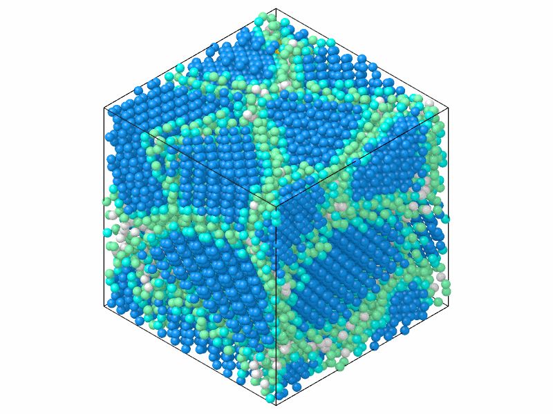

# Diamond structure

`DiamondStructure` tells cubic diamond from hexagonal diamond (lonsdaleite)
in silicon, germanium, carbon and other tetrahedrally bonded crystals, where
common neighbor analysis of the four nearest neighbors says nothing.

```python
import numpy as np

import mdapy as mp
from mdapy.identify import DiamondStructure

# cubic diamond silicon of 3 x 3 x 3 cells
a = 5.431
basis = np.array([
    [0, 0, 0], [0.5, 0.5, 0], [0.5, 0, 0.5], [0, 0.5, 0.5],
    [0.25, 0.25, 0.25], [0.75, 0.75, 0.25], [0.75, 0.25, 0.75], [0.25, 0.75, 0.75],
])  # fmt: skip
cells = np.stack(np.meshgrid(*[np.arange(3)] * 3, indexing="ij"), -1).reshape(-1, 1, 3)
positions = ((cells + basis) * a).reshape(-1, 3)
system = mp.System(positions, mp.Box(3 * a), elements="Si")

result = DiamondStructure().compute(system)
result.counts()["cubic_diamond"]  # 216
```

In a polycrystal of silicon:

```python
from mdapy.build import build_crystal, build_polycrystal
from mdapy.visualization import render

grains = build_polycrystal(
    build_crystal("diamond", 5.431, elements="Si"), mp.Box(60.0), 6, seed=4
)
structures = DiamondStructure().compute(grains)
render(grains, "images/diamond.png", color=structures, width=800, height=600)
```



*Six grains of silicon as built: cubic diamond in blue, its first and
second neighbors in cyan and green. An atom is cubic diamond only if its
second neighbors are in order too; the atoms of the boundaries next to the
grains are their neighbors, the others white.*

## Parameters

`DiamondStructure()` has no parameters.
`compute(system, *, neighbors=None, progress=None, cancel=None)` takes the
arguments of [every analysis](overview.md#parameters). A given neighbor list
must hold the 4 nearest neighbors of every atom.

## Results

A [`StructureResult`](overview.md#results) with the types

| Index | Name | Default color |
|---|---|---|
| 0 | `other` | light grey |
| 1 | `cubic_diamond` | blue |
| 2 | `cubic_diamond_first_neighbor` | cyan |
| 3 | `cubic_diamond_second_neighbor` | light green |
| 4 | `hexagonal_diamond` | orange |
| 5 | `hexagonal_diamond_first_neighbor` | yellow |
| 6 | `hexagonal_diamond_second_neighbor` | yellow green |

The types, their numbers and their colors are those of OVITO.

## Errors

`compute` raises `InvalidParameter` for a neighbor list that does not hold
the 4 nearest neighbors, or a system without periodic directions of fewer
than 5 atoms.

## Definition

The first neighbors of an atom are its 4 nearest. Each of them has 4 nearest
neighbors of its own, one of which must be the atom itself; otherwise the
atom is `other`. The other three of each give the 12 second neighbors of the
atom, which form an fcc shell in cubic diamond and an hcp shell in hexagonal
diamond. Common neighbor analysis of these 12, with the cutoff
$\frac{1+\sqrt 2}{2}$ times their mean distance, decides: fcc is
`cubic_diamond` and hcp `hexagonal_diamond`. Then, atom by atom in the
order of the system, an atom that is still `other` and among the 4 nearest
of a diamond atom becomes its first neighbor (of cubic or hexagonal
diamond, as that atom); after all first neighbors, an atom that is still
`other` and among the 4 nearest of a first neighbor becomes a second
neighbor of the same kind. The first atom in order to reach an atom
decides its kind.

!!! quote "Please cite"
    [Maras et al. (2016)](../reference/references.md#maras2016).
