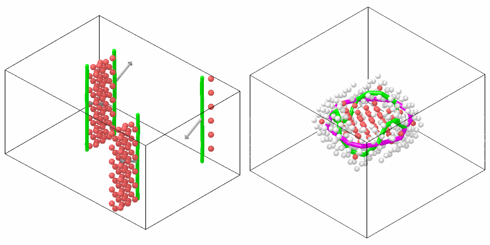

# Dislocation analysis

`DislocationAnalysis` finds the dislocations of a crystal, by the
dislocation extraction algorithm (DXA) of OVITO: lines through the cores,
the Burgers vector of each, and the junctions where they meet. Partial
dislocations at the edges of stacking faults are found as well. The defects
that are not dislocations, such as grain boundaries, free surfaces and
voids, make the defect mesh around them.

!!! warning "Experimental"
    This is a new implementation of OVITO's method, and still a young one.
    On straight dislocations, single loops and simple relaxed defects it
    finds what OVITO finds; where lines meet in networks, in strongly
    disordered crystal and at grain boundaries, its lines can differ from
    OVITO's by several per cent (see
    [how the results compare with OVITO](#how-the-results-compare-with-ovito)).
    OVITO remains the reference: check results that matter against it.

```python
import numpy as np

from mdapy.analysis import DislocationAnalysis
from mdapy.build import dislocation_quadrupole

# two edge dislocations of copper and their opposites, each split into two
# Shockley partials 10 Å apart
system = dislocation_quadrupole(
    "fcc edge", 3.615, (168.4, 121.4, 75.4), (14, 8, 6), elements="Cu", dissociation=10
)
result = DislocationAnalysis("fcc").compute(system)
len(result.lines)  # 4 partials
line = result.lines[0]
line.family  # 1/6<112>: a Shockley partial
line.burgers  # [-1/6, -1/3, 1/6] in the lattice frame, units of a
line.spatial_burgers  # Å, [-1.278, 0, 0.738] along the axes of the box
line.loop, line.infinite  # True, True: straight through the periodic box
line.length  # Å, 26.6
result.lengths()  # Å, {"1/2<110>": 0, "1/6<112>": 106.3, ..., "other": 0}
result.counts()  # atoms, {"other": 120, "fcc": 3630, "hcp": 138, ...}
system = system.with_columns(result)  # structure, crystal_cluster
```

A disc of vacancies in a (111) plane collapses into a Frank loop, which in
copper turns into a stacking-fault tetrahedron: six Shockley partials and
six stair-rod dislocations along its edges, meeting at junctions.

```python
from mdapy.build import build_crystal
from mdapy.calculators import EAM
from mdapy.simulation import minimize

copper = build_crystal(
    "fcc",
    3.615,
    elements="Cu",
    orientation=[(1, -1, 0), (1, 1, -2), (1, 1, 1)],
    repeat=(14, 8, 4),
)
p = copper["positions"] - copper.box.matrix.diagonal() / 2
plane = p[np.argmin(np.abs(p[:, 2])), 2]  # the (111) plane through the middle
disc = (np.abs(p[:, 2] - plane) < 0.3) & (np.linalg.norm(p[:, :2], axis=1) < 10)
relaxed = minimize(copper.filter(~disc), EAM.zhou(["Cu"]), max_force=1e-2).system

tetrahedron = DislocationAnalysis("fcc").compute(relaxed)
len(tetrahedron.lines), len(tetrahedron.junctions)  # 12 lines, 6 junctions
tetrahedron.lengths()  # Å, {"1/6<112>": 68.8, "1/6<110>": 56.7, ...}
tetrahedron.lines[0].junctions  # the junctions at its first and last point
```

The partials with the stacking faults between them, and the tetrahedron,
drawn by the [renderer](../visualization/rendering.md) in the colors of
their families:

```python
from mdapy.visualization import render, write_png

colors = np.array(result.colors)
pictures = [
    render(
        system,
        atoms=result.structure == result.names.index("hcp"),
        color=colors[result.structure],
        radius=0.8,
        dislocations=result,
        burgers_vectors=True,
        burgers_scale=5,
        width=500,
        height=500,
    ),
    render(
        relaxed,
        atoms=tetrahedron.structure != tetrahedron.names.index("fcc"),
        color=colors[tetrahedron.structure],
        radius=0.6,
        dislocations=tetrahedron,
        width=500,
        height=500,
    ),
]
write_png("images/dislocations.png", np.hstack(pictures))
```



*Left: the four Shockley partials (green) with their Burgers vectors (gray
arrows), and between each pair the two layers of hcp atoms (red) of its
stacking fault, one across the periodic boundary. Right: the stacking-fault tetrahedron of the relaxed Frank loop,
Shockley partials (green) and stair-rods (magenta) along its edges, with
the hcp atoms of its faces and the other atoms of its corners (white).*

## Parameters

| Name | Type | Default | Unit | Meaning |
|---|---|---|---|---|
| `crystal` | str | | | the crystal: `fcc`, `hcp`, `bcc`, `cubic_diamond` or `hexagonal_diamond` |
| `circuit_length` | int | 14 | | the number of edges of the longest Burgers circuit that finds a line; at least 3 |
| `stretch` | int | 9 | | the number of edges more a circuit may grow to follow a line |
| `perfect_only` | bool | `False` | | find perfect dislocations only: the atoms of stacking faults are other, and partials make one line |
| `point_separation` | float | 2.5 | | how sparse the points along the lines are: each is the mean of a run of the points found, longer where the line is wider; 0 keeps them all |
| `smoothing` | int | 1 | | the number of smoothing steps of the lines |
| `mesh_smoothing` | int | 8 | | the number of smoothing steps of the defect mesh |
| `interface_mesh` | bool | `False` | | also give the interface mesh, on which the circuits run |

`compute(system, *, progress=None, cancel=None)` takes the `progress` and
`cancel` of [every analysis](overview.md#parameters), but no neighbor list.
No two atoms may be at the same position.

The structures are those of OVITO's dislocation analysis, found with the
crystal: fcc and hcp for `fcc` or `hcp` (each the stacking fault of the
other), bcc for `bcc`, cubic and hexagonal diamond for either diamond.
Longer circuits find dislocations of wider cores, and take longer.

## Results

A `DislocationResult`:

| Attribute or method | Type | Meaning |
|---|---|---|
| `crystal` | str | the crystal analyzed |
| `lines` | tuple of `DislocationLine` | the dislocation lines |
| `junctions` | (J, 3) float64 | the points in Å where three or more lines meet, in the box |
| `structure` | (N,) int8 | the structure of each atom, an index into `names`; its column `structure` |
| `names` | tuple of str | `other`, `fcc`, `hcp`, `bcc`, `cubic_diamond`, `hexagonal_diamond` |
| `colors` | tuple of (r, g, b) | the default color of each structure |
| `crystal_cluster` | (N,) int64 | the crystal cluster of each atom, −1 for none; its column `crystal_cluster` |
| `clusters` | `CrystalClusters` | the crystal clusters |
| `defect_mesh` | `TriangleMesh` | the surface around the defects that are not dislocations, closed over the free ends of the lines, its normals pointing into the crystal |
| `defect_atoms` | (V,) int64 | the atom at each vertex of the defect mesh, −1 at the end of a line |
| `interface_mesh` | `TriangleMesh` or `None` | the mesh between the good crystal and the rest, with `interface_mesh=True` |
| `interface_atoms` | (V,) int64 or `None` | the atom at each of its vertices |
| `lengths()` | dict | the total length of the lines of each family of the crystal in Å, `other` last |
| `total_length` | float | the total length of the lines in Å |
| `counts()` | dict | the number of atoms of each structure, by name |

A `DislocationLine`:

| Attribute | Type | Meaning |
|---|---|---|
| `points` | (P, 3) float64 | the points along the line in Å, unwrapped: consecutive points are close also across a periodic boundary |
| `burgers` | (3,) float64 | the Burgers vector in the lattice frame of its crystal cluster, in units of the lattice constant |
| `spatial_burgers` | (3,) float64 | the Burgers vector in Å along the axes of the box, as the crystal cluster is turned and stretched |
| `cluster` | int | the crystal cluster of the lattice frame |
| `family` | str | the family of the Burgers vector, or `other` |
| `length` | float | the length in Å |
| `loop` | bool | whether the line closes on itself: a loop, or a line through periodic boundaries |
| `infinite` | bool | whether it closes through periodic boundaries |
| `junctions` | (int, int) | the junctions at its first and last point, −1 for a free end and for the ends of a closed line |

The families of Burgers vectors, by crystal:

| Crystal | Families |
|---|---|
| `fcc` | `1/2<110>` perfect, `1/6<112>` Shockley, `1/6<110>` stair-rod, `1/3<100>` Hirth, `1/3<111>` Frank |
| `bcc` | `1/2<111>`, `<100>`, `<110>` |
| `cubic_diamond` | `1/2<110>`, `1/6<112>`, `1/6<110>`, `1/3<111>` |
| `hcp` | `1/3<11-20>`, `<0001>`, `<1-100>`, `1/3<1-100>`, `1/3<11-23>` |
| `hexagonal_diamond` | `1/3<11-20>`, `<0001>`, `<1-100>`, `1/3<1-100>` |

A `CrystalClusters`:

| Attribute | Type | Meaning |
|---|---|---|
| `structure` | (C,) int8 | the structure of each cluster, an index into `names` |
| `size` | (C,) int64 | the number of atoms of each |
| `orientation` | (C, 3, 3) float64 | the matrix that takes vectors of its lattice frame, in units of the lattice constant, to vectors in Å along the axes of the box |

The lattice frame of a cubic crystal is that of its cubic cell; that of
hcp and hexagonal diamond has c along z and a<sub>1</sub> along x, in units
of the cubic lattice constant with the same nearest neighbors (√2 a for
hcp). Of the frames the symmetry of the lattice allows, that of a cluster
of the crystal is the one closest to the axes of the box, so that the
lattice Burgers vectors of a crystal along the box read as usual.

`render(system, dislocations=result)` draws the lines as tubes in the
colors of their families, cut at the periodic boundaries; their colors are
`DislocationAnalysis.FAMILY_COLORS[crystal]`. With `burgers_vectors=True`
an arrow from the middle of each line shows its Burgers vector in space,
`burgers_scale` times as long. `mesh=result.defect_mesh` draws the defect
mesh.

## Errors

The constructor raises `InvalidParameter` for an unknown `crystal`, a
`circuit_length` below 3, a `stretch`, `smoothing` or `mesh_smoothing` that
is not an integer of at least 0, and a `point_separation` that is negative
or not finite; `compute` raises it for a periodic box so short that an atom
meets its own periodic image or an edge of the mesh spans half of it
(replicate the system first).

## How the results compare with OVITO

The tests of mdapy compare the analysis with that of OVITO 3.17 on the
same atoms. It is a separate program, and does not give OVITO's numbers
everywhere:

| Atoms | Compared with OVITO |
|---|---|
| any | the same structure of each atom |
| straight dislocations of fcc, bcc, hcp and both diamonds, perfect or split into partials | the same lines and Burgers vectors, lengths within 0.5 % |
| single loops, a loop on a twin boundary, a stacking-fault tetrahedron | the same lines and Burgers vectors, lengths within 3 % |
| lines that meet: crossing loops, networks | where two lines meet, a short junction line in one and a node of four lines in the other may come out; the same Burgers vectors, total lengths within about 5 % |
| strongly disordered crystal: large thermal displacements, many vacancies | lines through such regions may end or run otherwise; lengths may differ by up to 20 % |
| polycrystals | lines and the defect mesh at the grain boundaries may differ by 5 to 10 % |

Where they differ, and why:

- The circuits choose among equal paths, where a search starts, and, by a
  fixed random sequence, where a circuit is swept from; the choices depend
  on the order of the atoms and on the inner workings of each program.
  OVITO's results change too when the atoms come in another order. Those
  of mdapy are the same on every run and for any number of threads.
- At a grain boundary an atom outside the crystal takes the cluster of most
  of the crystal atoms around it; OVITO takes that of the first one its
  tessellation lists, which another program cannot repeat. The good
  crystal reaches into the boundaries a little differently.
- The tessellation of a perfect lattice has equal choices, such as the two
  diagonals of four atoms on a circle. mdapy settles them by moving the
  atoms by up to $10^{-4}$ Å, OVITO by its own rule: the triangles of the
  meshes there can differ, their areas do not.
- Of the lattice frames the symmetry of the lattice allows, both give a
  cluster the one closest to the axes of the box. When two are as close,
  they may take different ones: the lattice Burgers vectors then differ by
  a rotation of the lattice, the spatial ones do not. The Burgers vector
  of a line is given in the frame of a cluster its first circuit touches;
  in a distorted crystal two such clusters are turned slightly apart, and
  the spatial Burgers vectors can differ by up to 0.1 Å.

OVITO's options to analyze the selected atoms only and to mark the atoms of
the cores, and its export to CA files, are not here.

## Definition

The atoms of the crystal are found by common neighbor analysis with
adaptive cutoffs, with the rules of OVITO's dislocation analysis, and their
neighbors put in the order of the ideal ones of their lattice. Neighboring
atoms of one structure whose neighbors map onto each other by a rotation of
the lattice make a crystal cluster, with one lattice frame; two clusters
that touch, or both touch a third, are related by the rotation between
their frames. Each edge of the Delaunay tessellation of the atoms gets an
ideal vector, the vector between its atoms in the perfect crystal, along
the neighbors of the crystal atoms, at most four steps; an atom of no
cluster takes that of most of the crystal atoms it neighbors.

A tetrahedron is good when the ideal vectors of its six edges are known and
add up to zero around each of its faces, the rotations between the frames
too, the elastic mapping compatible there. The interface mesh is made of
the faces between the good tetrahedra and the rest. A Burgers circuit is a
closed path of $n$ edges along it; its Burgers vector

$$
\mathbf b = \sum_{k=1}^{n} \mathsf R_k \, \mathbf v_k
$$

adds up the ideal vectors $\mathbf v_k$ of its edges, each turned by
$\mathsf R_k$ into the frame of the first. Circuits that do not close,
$\mathbf b \neq 0$, enclose dislocations: found shortest first, up to
`circuit_length` edges, each is swept along its line in both directions
over the triangles of the mesh, taking them, and the centers of the
circuits on the way are the points of the line. Lines whose circuits close
in on each other meet in a junction, or, two of them, join; circuits around
the holes left between others find the lines missing there. The faces of
the mesh no circuit took, closed over the free ends of the lines, are the
defect mesh. Burgers vectors are then given in the frame of a cluster of
the crystal, each line runs along the axis it runs along most, and the
lines are coarsened and smoothed.

The sense of a line and its Burgers vector are those of OVITO, which
[`insert_dislocation`](../build/dislocations.md) and the dislocation
models of the structure builder follow too: along +z the analysis finds
the Burgers vector put in. In the convention of Hirth and Lothe (FS/RH) it
is the opposite.

!!! quote "Please cite"
    [Stukowski and Albe (2010)](../reference/references.md#stukowski2010)
    and [Stukowski, Bulatov and Arsenlis (2012)](../reference/references.md#stukowski2012dxa).

## See also

- OVITO [Dislocation analysis (DXA)](https://docs.ovito.org/reference/pipelines/modifiers/dislocation_analysis.html),
  the same method and the reference.
- [Dislocations](../build/dislocations.md) to build them,
  [common neighbor analysis](cna.md) and [planar faults](planar-faults.md)
  for the atoms of the defects, and the [surface mesh](surface-mesh.md).
