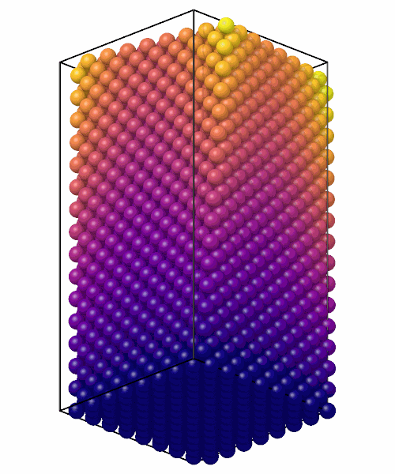

# Atomic displacement

`AtomicDisplacement` gives the displacement of each atom from its position
in a reference configuration, the atoms matched by their ids, across the
periodic boundaries by the nearest image.

```python
import numpy as np

from mdapy.analysis import AtomicDisplacement
from mdapy.build import build_crystal

reference = build_crystal("fcc", 3.615, elements="Cu", repeat=(8, 8, 16))
reference = reference.with_columns(id=np.arange(1, len(reference) + 1))

# the crystal twisted about z: each layer turned by an angle that grows with z
center = reference.box.matrix.diagonal()[:2] / 2
x = reference["positions"]
angle = 0.2 * x[:, 2] / reference.box.matrix[2, 2]
c, s = np.cos(angle), np.sin(angle)
turned = x.copy()
turned[:, 0] = center[0] + c * (x[:, 0] - center[0]) - s * (x[:, 1] - center[1])
turned[:, 1] = center[1] + s * (x[:, 0] - center[0]) + c * (x[:, 1] - center[1])
twisted = reference.with_columns(positions=turned)

result = AtomicDisplacement(reference).compute(twisted)
result.displacement  # (N, 3) Å
result.magnitude  # Å, largest at the top, far from the axis
twisted = twisted.with_columns(result)  # displacement, displacement_magnitude
```

```python
from mdapy.visualization import render

render(
    twisted,
    "images/displacement.png",
    color="displacement_magnitude",
    colormap="plasma",
    view=[1, -1, 0.6],
    width=500,
    height=600,
)
```



*The crystal colored by the length of the displacements: zero at the
bottom, growing with the height and the distance from the axis.*

## Parameters

`AtomicDisplacement(reference, *, minimum_image=True, affine=False)`

| Name | Type | Default | Meaning |
|---|---|---|---|
| `reference` | System | | the reference configuration |
| `minimum_image` | bool | `True` | along each periodic direction, the periodic image of the reference position nearest the atom |
| `affine` | bool | `False` | measure in the reference box: the current positions mapped into it first, which removes the homogeneous deformation of the box |

`compute(system)` takes the current configuration. The atoms are matched
by the column `id` when both systems have it, in any order; without ids,
the two must have the same atoms in the same order.

## Results

An `AtomicDisplacementResult`:

| Attribute | Type | Meaning |
|---|---|---|
| `displacement` | (N, 3) float64 | the displacement of each atom in Å, in the order of the system; its column `displacement` |
| `magnitude` | (N,) float64 | its length in Å; its column `displacement_magnitude` |

## Errors

`compute` raises `InvalidParameter` for an atom whose id is not in the
reference, and, without ids, for systems of different numbers of atoms.

## Definition

The displacement of an atom is $\mathbf u = \mathbf x - \mathbf x_0$, with
$\mathbf x_0$ its position in the reference. With `affine`, $\mathbf x$ is
first mapped into the reference box: $\mathbf x \to (\mathbf x - \mathbf o)
H^{-1} H_0 + \mathbf o_0$, with $H$, $H_0$ the matrices of the box vectors as
rows and $\mathbf o$, $\mathbf o_0$ the origins. With `minimum_image`, the
fractional coordinates of $\mathbf u$ along the periodic vectors are
rounded to the nearest integers and those taken away.

## See also

- OVITO [Displacement vectors](https://docs.ovito.org/reference/pipelines/modifiers/displacement_vectors.html),
  whose displacements `AtomicDisplacement` gives, with and without the
  minimum image and the affine mapping to the reference.
- [Mean squared displacement](msd.md) over a trajectory, and
  [Atomic strain](atomic-strain.md) against a reference.
