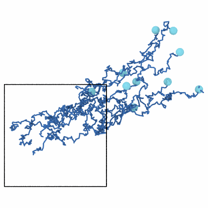
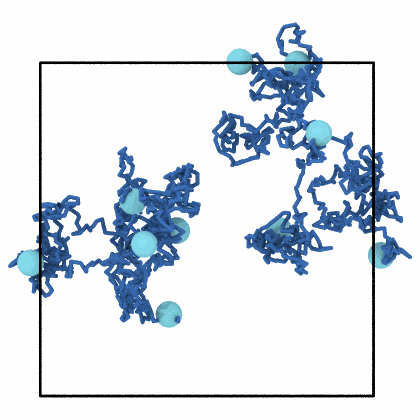

# Center-of-mass drift

`remove_drift` moves each frame of a trajectory so that the center of mass
of its atoms stays where it is in a reference frame, as OVITO's center of
mass correction does. It takes away the drift of the whole system, from a
thermostat that does not keep the momentum or a cluster that flies off,
before positions are averaged or paths drawn.

```python
import numpy as np

import mdapy as mp
from mdapy.analysis import trajectory_lines
from mdapy.transform import remove_drift
from mdapy.visualization import render

# ten atoms that wander and drift together through a periodic box
rng = np.random.default_rng(2)
box = mp.Box(20.0)
steps = rng.normal(0, 0.3, (200, 10, 3)) + [0.08, 0.05, 0.0]
walk = rng.random((10, 3)) * 20 + np.cumsum(steps, axis=0)
frames = [mp.System(box.wrap(x)[0], box, elements="Ar") for x in walk]

steady = remove_drift(frames)  # the frames moved, read when they are used
for name, these in (("drift", frames), ("steady", steady)):
    paths = trajectory_lines(these)  # unwrapped, (10, 200, 3)
    render(
        these[-1].with_columns(positions=paths[:, -1]),
        f"images/{name}.png",
        radius=0.8,
        lines=paths,
        line_radius=0.12,
        line_color="#3b6fb6",
        view=(0.0, 0.0, -1.0),
        width=420,
        height=420,
    )
```

{ width="49%" }
{ width="49%" }

*The unwrapped paths of ten atoms over 200 frames, seen along the z axis,
and the atoms where they end: with the drift of the whole system toward the
upper right (left), and with the center of mass kept where it is in the
first frame (right).*

## Parameters

`remove_drift(frames, reference=0, *, atoms=None, unwrap=True)`

| Name | Type | Default | Meaning |
|---|---|---|---|
| `frames` | sequence of `System` | | the frames, such as a [`Trajectory`](../getting-started/trajectory.md), a slice of one or a list |
| `reference` | int | `0` | the frame whose center of mass is kept; negative counts from the end |
| `atoms` | mask or indices | all | the atoms of the first frame whose center of mass is kept, as OVITO's only selected |
| `unwrap` | bool | `True` | follow the atoms through the periodic boundaries to find the center of mass, or take the positions as they are |

The masses are the `mass` column of the first frame, else the masses of
its elements, else all equal, which gives the geometric center. The atoms
are matched by their ids and followed through the periodic boundaries as
for the [mean squared displacement](msd.md#parameters): by the image flags,
or else through the nearest periodic image of each step. OVITO takes the
positions as they are, the same as `unwrap=False`; of wrapped positions,
whose center of mass jumps when an atom crosses a boundary, it gives the
right drift only after its unwrap trajectories modifier, the same as
`unwrap=True`.

## Results

A sequence of the frames, as long as `frames`, read when they are used
like a [`Trajectory`](../getting-started/trajectory.md): indexing with an
integer gives one frame, with a slice the frames it selects, and iterating
goes through them in turn. Each frame has all its atoms moved by one
translation, its other columns and its box unchanged; atoms may stand
outside the box after the move, and [`wrap`](../build/transform.md) puts
them back. Its `shifts` are the (T, 3) translations in Å, the drift of
the center of mass with the sign turned. The centers of mass are found in
one pass over the frames when `remove_drift` is called.

## Errors

`remove_drift` raises `InvalidParameter` for no frames, a reference that is
not one of the frames, atoms that are not a mask or indices of the first
frame, chosen atoms whose masses add up to zero, and frames that do not
hold the same atoms, as the
[mean squared displacement](msd.md#errors) does.
