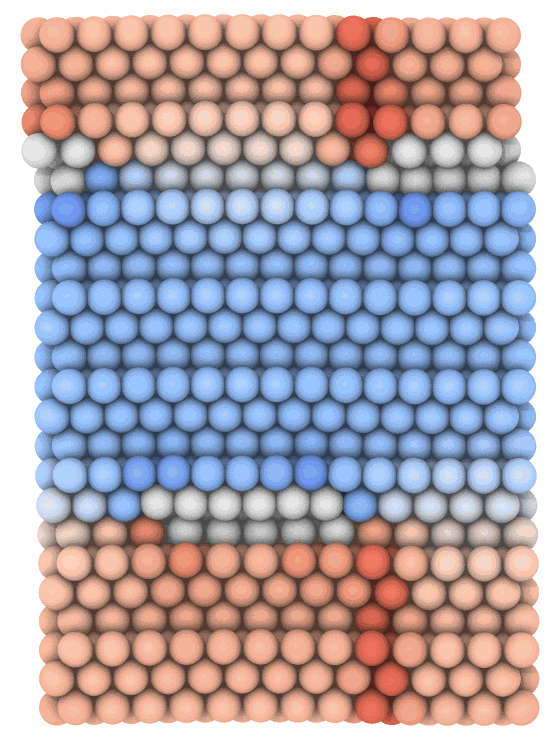

# Elastic strain

`ElasticStrain` gives the elastic strain of each atom of a crystal: how
its nearest neighbors are stretched and sheared from those of the ideal
crystal of given lattice constants, as OVITO's elastic strain calculation
does. Unlike the [atomic strain](atomic-strain.md), it needs no reference
configuration, and it leaves out the slip of dislocations, which moves
atoms without straining the lattice.

```python
import numpy as np

import mdapy as mp
from mdapy.analysis import ElasticStrain
from mdapy.build import build_crystal, dislocation_quadrupole
from mdapy.visualization import render

# copper squeezed by 1 % along x: the strain of the deformation
cu = build_crystal("fcc", 3.615, elements="Cu", repeat=(5, 5, 5))
squeezed = cu.with_box(mp.Box(cu.box.matrix * [[0.99], [1], [1]]), scale_positions=True)
result = ElasticStrain("fcc", 3.615).compute(squeezed)
result.strain_tensor[0]  # (3, 3), -0.0102 along x
squeezed = squeezed.with_columns(
    result
)  # structure, elastic_strain, elastic_volumetric_strain

# hcp magnesium of other constants than the ideal ratio
ElasticStrain("hcp", 3.21, c=5.21)

# two dissociated edge dislocations of copper in a periodic box, along their lines
dipole = dislocation_quadrupole("fcc edge", 3.615, (168.4, 121.4, 75.4), (14, 8, 3),
                                elements="Cu", dissociation=10)  # fmt: skip
strain = ElasticStrain("fcc", 3.615).compute(dipole)
render(dipole, "images/elastic-strain.png", color=strain.volumetric, colormap="coolwarm",
       value_range=(-0.02, 0.02), view="top", box=False, width=560, height=740)  # fmt: skip
```



*The volumetric elastic strain about two edge dislocations of copper of
opposite sign, seen along their lines, each split into two Shockley
partials with a stacking fault between them: the crystal is squeezed
(blue) between their glide planes and stretched (red) beyond them; the
atoms of the faults and the cores, which are not fcc, have none (white).*

## Parameters

`ElasticStrain(crystal, a, c=None)`

| Name | Type | Default | Unit | Meaning |
|---|---|---|---|---|
| `crystal` | str | | | `"fcc"`, `"hcp"`, `"bcc"`, `"cubic_diamond"` or `"hexagonal_diamond"` |
| `a` | float | | Å | the lattice constant of the unstrained crystal: of the cubic cell, or a of the hexagonal cell |
| `c` | float | a √(8/3) | Å | the lattice constant c of the unstrained hexagonal cell; only for hcp and hexagonal diamond |

`compute(system, *, progress=None, cancel=None)` finds the atoms of the
crystal as the [dislocation analysis](dislocations.md) does, with the
stacking faults of fcc and hcp in each other's structure and those of the
two diamonds in each other's, and their neighbors: the 12 nearest of fcc
and hcp, the 14 nearest of bcc, and of the diamonds the 4 nearest and
their 3 nearest each.

## Results

An `ElasticStrainResult`:

| Attribute | Type | Meaning |
|---|---|---|
| `structure` | (N,) int8 | the structure of each atom, an index into `names`; its column `structure` |
| `names`, `colors` | tuples | other, fcc, hcp, bcc, cubic_diamond, hexagonal_diamond, and their colors, those of [PTM](ptm.md) |
| `strain_tensor` | (N, 3, 3) float64 | the elastic strain $\varepsilon$ of each atom of the crystal in the spatial frame, zero for the other atoms; its column `elastic_strain` |
| `volumetric` | (N,) float64 | $\operatorname{tr}\varepsilon / 3$, zero for the atoms not of the crystal; its column `elastic_volumetric_strain` |

The structures, the strain tensors and the volumetric strains are those of
OVITO 3.17.1 atom by atom, within 1e-12, on dislocations, stacking faults
and deformed crystals of the five lattices. Where OVITO joins crystal
regions across a stacking fault of a hexagonal crystal, it keeps their
relation in single precision, and its strains of those atoms differ by
up to 1e-7. OVITO can also give the strain in the frame of the lattice and
the deformation gradient, which depend on which of the equivalent frames
of the lattice it takes for a crystal region; mdapy gives the strain in the
spatial frame only, OVITO's default.

## Errors

The constructor raises `InvalidParameter` for an unknown crystal, a
lattice constant that is not positive, and `c` for a cubic crystal;
`compute` raises it for a box so short along a periodic direction that an
atom meets its own periodic image among its neighbors, which replicating
the system along that direction mends.

## Definition

The neighbors of an atom of the crystal are at the vectors
$\mathbf d_k$, each the nearest periodic image, and are matched to the
ideal vectors $\mathbf v_k$ of the crystal by the bonds among them, as the
structure identification orders them. The ideal vectors are those of the
cubic cell of constant $a$; those of hcp and hexagonal diamond, of the
cubic crystal with the same nearest neighbors, are stretched along c by
$(c/a)/\sqrt{8/3}$. The elastic deformation gradient minimizes
$\sum_k |\mathbf d_k - F \mathbf v_k|^2$:

$$
F = \Big(\sum_k \mathbf d_k \mathbf v_k^T\Big)\Big(\sum_k \mathbf v_k \mathbf v_k^T\Big)^{-1},
\qquad
\varepsilon = \tfrac{1}{2}\big(I - F^{-T} F^{-1}\big),
$$

the Euler–Almansi strain, which does not depend on how the lattice of the
crystal is turned, nor on which of its equivalent frames the ideal vectors
are taken in.

## See also

- OVITO [Elastic strain calculation](https://docs.ovito.org/reference/pipelines/modifiers/elastic_strain.html).
- [Atomic strain](atomic-strain.md), against a reference configuration.

!!! quote "Please cite"
    [Stukowski and Arsenlis (2012)](../reference/references.md#stukowski2012elastic).
