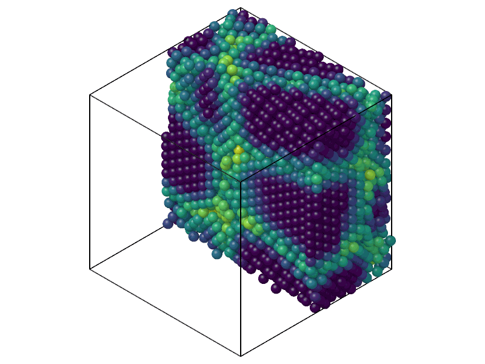

# Entropy fingerprint

`EntropyFingerprint` gives the pair entropy fingerprint of each atom, a
measure of local order that needs no reference structure: low (more
negative) in crystals, high in liquids and gases.

```python
import numpy as np

import mdapy as mp
from mdapy.analysis import EntropyFingerprint

# fcc copper of 4 x 4 x 4 cubic cells, slightly disordered
a = 3.615
basis = np.array([[0, 0, 0], [0.5, 0.5, 0], [0.5, 0, 0.5], [0, 0.5, 0.5]])
cells = np.stack(np.meshgrid(*[np.arange(4)] * 3, indexing="ij"), -1).reshape(-1, 1, 3)
rng = np.random.default_rng(0)
positions = ((cells + basis) * a).reshape(-1, 3) + rng.normal(0, 0.05, (256, 3))
system = mp.System(positions, mp.Box(4 * a), elements="Cu")

result = EntropyFingerprint(cutoff=5.0, sigma=0.2, average_cutoff=3.0).compute(system)
result.entropy  # in units of the Boltzmann constant
system = system.with_columns(result)  # the column entropy_average
```

In a polycrystal, cut in half:

```python
from mdapy.build import build_crystal, build_polycrystal
from mdapy.visualization import render

grains = build_polycrystal(
    build_crystal("fcc", 3.615, elements="Cu"), mp.Box(50.0), 5, seed=4
)
fingerprint = EntropyFingerprint(cutoff=5.0, sigma=0.2, average_cutoff=3.0).compute(
    grains
)
render(grains, "images/entropy.png", atoms=grains["positions"][:, 0] < 25,
       color=fingerprint.entropy, width=800, height=600)  # fmt: skip
```



*The averaged entropy is lowest in the ordered grains (dark) and highest at
the boundaries and their junctions (green and yellow).*

## Parameters

| Name | Type | Default | Unit | Meaning |
|---|---|---|---|---|
| `cutoff` | float | | Å | neighbors are closer than it |
| `sigma` | float | 0.2 | Å | width of the Gaussian of each neighbor, below `cutoff` |
| `local_density` | bool | `False` | | use the density of each atom's neighbors instead of that of the system |
| `average_cutoff` | float | `None` | Å | average each value with those of the neighbors closer than it |

`compute(system, *, neighbors=None, progress=None, cancel=None)` takes the
arguments of [every analysis](overview.md#parameters). A given neighbor list
must reach the larger of `cutoff` and `average_cutoff`; without one, the
neighbors within `cutoff` are found and used at once, never stored.

## Results

An `EntropyResult`:

| Attribute | Type | Meaning |
|---|---|---|
| `entropy` | (N,) float64 | the fingerprint of each atom, in units of the Boltzmann constant; its column `entropy`, or `entropy_average` when averaged |
| `average` | bool | whether the values are averaged |

## Errors

The constructor raises `InvalidParameter` for a cutoff that is not
positive, a `sigma` not between 0 and the cutoff, or an `average_cutoff`
that is not positive; `compute` raises it for a neighbor list that does not
fit.

## Definition

For each atom $i$ a local radial distribution is built from its neighbors
$j$ closer than the cutoff $r_c$, each smeared by a Gaussian of width
$\sigma$:

$$
g_i(r) = \frac{1}{4\pi\rho r^2} \sum_j \frac{1}{\sqrt{2\pi}\,\sigma}
e^{-(r - r_{ij})^2 / 2\sigma^2},
\qquad
s_i = -2\pi\rho \int_0^{r_c} \big[g_i \ln g_i - g_i + 1\big]\, r^2 \,\mathrm dr ,
$$

where $\rho$ is the number density of the system or, with `local_density`,
the number of neighbors over the volume of the cutoff sphere. $g_i$ is
evaluated at $r = k\sigma$ up to the cutoff and the integral is the
trapezoid rule over those points, as in LAMMPS; where $g_i < 10^{-10}$ the
integrand is $r^2$. With `average_cutoff`, $s_i$ is averaged with the values
of the neighbors closer than it.

LAMMPS `compute entropy/atom` spreads each neighbor over seven points only;
mdapy uses the whole Gaussian, so that equivalent atoms get equal values.
The two agree to about 0.5 %.

## See also

- LAMMPS [`compute entropy/atom`](https://docs.lammps.org/compute_entropy_atom.html).

!!! quote "Please cite"
    [Piaggi and Parrinello (2017)](../reference/references.md#piaggi2017).
