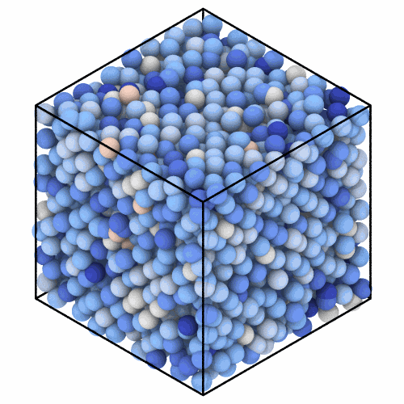

# Difference between frames

`FrameDifference` gives the change of a column of each atom from a
reference frame, such as the first of a trajectory, the atoms matched by
their ids, as OVITO's difference between frames. It adds the column
`<name>_change` to a system.

```python
import numpy as np

import mdapy as mp
from mdapy.analysis import CoordinationNumber, FrameDifference
from mdapy.build import build_crystal

# copper with ids, then the same atoms shaken by 0.4 Å and in another order
copper = build_crystal("fcc", 3.615, elements="Cu", repeat=(8, 8, 8))
copper = copper.with_columns(id=np.arange(1, len(copper) + 1))
rng = np.random.default_rng(4)
hot = copper.with_columns(
    positions=copper["positions"] + rng.normal(0, 0.4, (len(copper), 3))
)
hot = hot.with_table(hot.table[rng.permutation(len(hot))])

coordination = CoordinationNumber(3.0)
before = copper.with_columns(coordination.compute(copper))
after = hot.with_columns(coordination.compute(hot))
change = FrameDifference("coordination").compute(after, before)
after = after.with_columns(change)  # the column coordination_change
```

The atoms colored by the change of their number of neighbors:

```python
from mdapy.visualization import render, write_png

write_png(
    "images/frame-difference.png",
    render(
        after,
        color="coordination_change",
        colormap="coolwarm",
        value_range=(-6, 6),
        view="iso",
        width=500,
        height=500,
    ),
)
```



*Each atom of the crystal had 12 neighbors within 3 Å; shaken, most have
fewer (blue) and a few more (orange).*

## Parameters

`FrameDifference(column)`

| Name | Type | Meaning |
|---|---|---|
| `column` | str | a column of numbers, a component such as `"velocities.z"` or an expression over the columns |

`compute(system, reference)` takes the frame and the reference frame. Their
atoms are matched by the `id` column where both have one, else taken in the
same order. Positions change through the periodic boundaries as they are
given; the [atomic displacement](displacement.md) follows them.

## Results

A `FrameDifferenceResult`:

| Attribute | Type | Meaning |
|---|---|---|
| `difference` | (N,) or (N, k) float64 | the value of each atom of the system minus its value in the reference |
| `name` | str | the column |

`System.with_columns(result)` adds `difference` as the column, its dots as
underscores, followed by `_change`, such as `velocities_z_change`.

## Errors

The constructor raises `InvalidParameter` for a column that is not a name;
`compute` raises it for a column of text, repeated ids in the reference, or
without ids a reference of another number of atoms, and `MissingProperty`
for an atom that is not in the reference.

## See also

- [Frozen values](freeze.md): the value of the reference itself.
- OVITO [Difference between frames](https://docs.ovito.org/reference/pipelines/modifiers/difference_between_frames.html).
