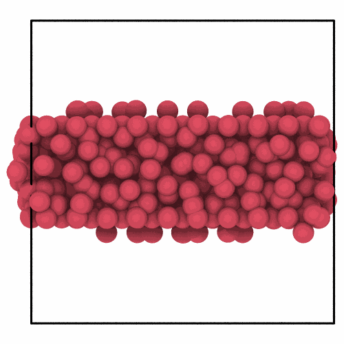

# Frozen values

`freeze` gives the atoms of one frame the values a column has in another,
such as the first of a trajectory, matched by their ids, as OVITO's freeze
property. It keeps a property of the start, such as the structure of each
atom, at hand in every later frame, to compare with what the atom is now.

```python
import numpy as np

import mdapy as mp
from mdapy.build import build_crystal
from mdapy.identify import CommonNeighborAnalysis
from mdapy.transform import freeze

# copper with ids, and the same atoms later with a slab melted (shaken by 0.6 Å)
copper = build_crystal("fcc", 3.615, elements="Cu", repeat=(10, 10, 10))
copper = copper.with_columns(id=np.arange(1, len(copper) + 1))
rng = np.random.default_rng(5)
z = copper["positions.z"]
shake = np.where((z > 14) & (z < 22), 0.6, 0.05)[:, None]
later = copper.with_columns(
    positions=copper["positions"] + rng.normal(0, 1, (len(copper), 3)) * shake
)

cna = CommonNeighborAnalysis()
start = copper.with_columns(cna.compute(copper))
later = later.with_columns(cna.compute(later))
later = freeze(later, start, "structure")  # the column structure_frozen
changed = later.where("structure != structure_frozen")
```

The atoms that are no longer what they were:

```python
from mdapy.visualization import render, write_png

write_png(
    "images/freeze.png",
    render(later, atoms=changed, color="#d1495b", view="front", width=500, height=500),
)
```



*Of the atoms that started fcc, those of the melted slab are no longer fcc;
the rest of the crystal, barely shaken, is unchanged.*

## Parameters

`freeze(system, reference, column, name=None)`

| Name | Type | Default | Meaning |
|---|---|---|---|
| `system` | System | | the frame that takes the values |
| `reference` | System | | the frame of the values, its atoms matched by the `id` column where both have one, else in the same order |
| `column` | str | | a column, a component such as `"positions.z"` or an expression over the columns |
| `name` | str | `None` | the new column; by default the column, its dots as underscores, followed by `_frozen` |

## Results

The system with the values of the reference in the new column; its other
columns as they are.

## Errors

`MissingProperty` if an atom of the system is not in the reference;
`InvalidParameter` for repeated ids in the reference or, without ids, a
reference of another number of atoms.

## See also

- [Difference between frames](frame-difference.md): the change since the reference.
- OVITO [Freeze property](https://docs.ovito.org/reference/pipelines/modifiers/freeze_property.html).
