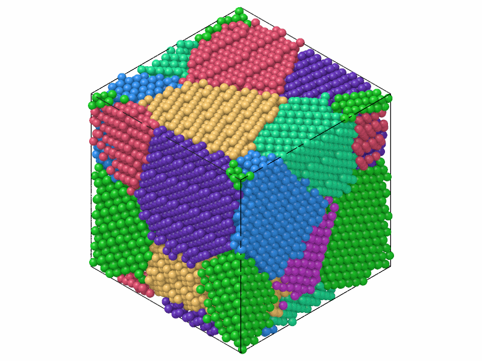
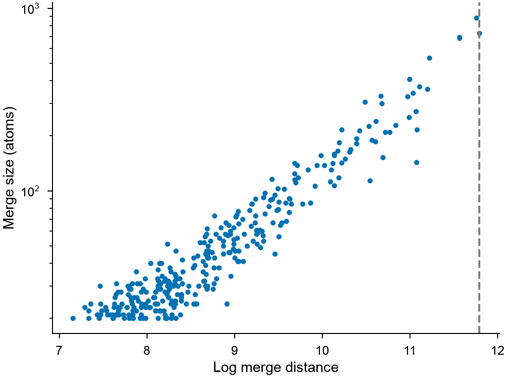

# Grain segmentation

`GrainSegmentation` finds the grains of a polycrystal: groups of crystalline
atoms whose lattices have nearly the same orientation, from the orientations
[polyhedral template matching](ptm.md) gives. It gives the same grains as
OVITO's Grain segmentation, atom by atom, with its centers of mass and
radii.

```python
import numpy as np

import mdapy as mp
from mdapy.build import build_crystal, build_polycrystal
from mdapy.identify import GrainSegmentation

# eight grains of copper, the atoms displaced by about 0.04 Å
copper = build_crystal("fcc", 3.615, elements="Cu")
grains = build_polycrystal(copper, mp.Box(60.0), 8, seed=2)
shake = np.random.default_rng(0).normal(0, 0.04, (len(grains), 3))
grains = grains.with_columns(positions=grains["positions"] + shake)

result = GrainSegmentation().compute(grains)
result.count  # 8
result.size  # [2855, 2684, ..., 1319] atoms, largest first
result.orientation[0]  # mean lattice orientation of the largest, (x, y, z, w)
result.center[0], result.radius_of_gyration[0]  # Å
grains = grains.with_columns(result)  # the column grain, -1 for none

# merged along the bonds of least misorientation, up to 3 degrees
tree = GrainSegmentation(3.0, method="spanning_tree").compute(grains)
```

Each atom in the color of its grain, and the merges of the clusters with the
threshold chosen:

```python
from mdapy.visualization import plot, render

render(
    grains,
    "images/grain-segmentation.png",
    color=result.atom_colors(),
    width=800,
    height=600,
)

with plot.style():
    fig, ax = plot.figure("single")
    ax.scatter(np.log(result.merge_distance), result.merge_size, s=4)
    ax.axvline(result.threshold, color="0.5", linestyle="--")
    ax.set_xlabel("Log merge distance")
    ax.set_ylabel("Merge size (atoms)")
    ax.set_yscale("log")
    plot.save(fig, "images/grain-merges", formats=("png",))
```



*The eight grains, each in its own color; the atoms of the boundaries have
joined the nearest grain.*



*The merges of two clusters of at least 20 atoms, larger clusters merging at
larger distances. All are within grains: the grains here are misoriented by
more than 4°, so no bond joins two of them. The threshold (dashed) is the
largest distance of the merges that follow the trend; merges of distinct
grains or subgrains, misoriented by less, would stand out beyond it.*

## Parameters

`GrainSegmentation(threshold=None, *, method="graph", min_grain_size=100,
stacking_faults=True, adopt_orphans=True, structures=("fcc", "hcp", "bcc"),
rmsd_cutoff=0.1)`

| Name | Type | Default | Unit | Meaning |
|---|---|---|---|---|
| `threshold` | float | `None` | | `"graph"`: the largest log merge distance of the merges kept, by default chosen from the merges; `"spanning_tree"`: the largest misorientation, needed |
| `method` | str | `"graph"` | | `"graph"`: node pair sampling of the graph of bonds; `"spanning_tree"`: merges along the bonds of least misorientation |
| `min_grain_size` | int | 100 | atoms | smaller clusters are no grains |
| `stacking_faults` | bool | `True` | | the atoms of stacking faults and twin boundaries (hcp in fcc, hexagonal in cubic diamond, or the other way round) join the grains around them |
| `adopt_orphans` | bool | `True` | | atoms in no grain join the grain nearest along their bonds |
| `structures`, `rmsd_cutoff` | | | | those of [polyhedral template matching](ptm.md), done when no result of it is given |

The threshold of the spanning tree is in degrees. The structures must
include those of the grains; a grain of hcp atoms needs `"hcp"`, a grain of
silicon `"cubic_diamond"`.

`compute(system, *, ptm=None, neighbors=None, progress=None, cancel=None)`
takes the arguments of [every analysis](overview.md#parameters) and a
[`PTMResult`](ptm.md) of the system, from
`PolyhedralTemplateMatching(template_neighbors=True)`, to reuse; the box
must be at least twice as wide as the bonds along its periodic directions.

## Results

A `GrainResult`:

| Attribute | Shape | Unit | Meaning |
|---|---|---|---|
| `grain` | (N,) int64 | | the grain of each atom, an index into the arrays below; -1 for none |
| `size` | (G,) | atoms | of each grain, largest first |
| `structure` | (G,) int8 | | structure of each grain, an index into `names` |
| `names` | | | the structures of [polyhedral template matching](ptm.md) |
| `orientation` | (G, 4) | | mean lattice orientation, a quaternion (x, y, z, w) as those of the atoms |
| `center` | (G, 3) | Å | center of mass, inside the box |
| `radius` | (G,) | Å | of the smallest sphere about the center that holds the grain |
| `radius_of_gyration` | (G,) | Å | |
| `colors` | (G, 3) | | a distinct color for each grain, RGB from 0 to 1 |
| `atom_colors(none=(0.8, 0.8, 0.8))` | (N, 3) | | the color of the grain of each atom, `none` for atoms in no grain |
| `threshold` | float | | the threshold applied: log merge distance, or degrees for the spanning tree |
| `merge_distance`, `merge_size` | (M,) | , atoms | the merges of two clusters of at least 20 atoms, in order: merge distance (degrees for the spanning tree) and the atoms of the smaller cluster |
| `count` | int | | the number of grains |

`with_columns(result)` adds the column `grain`. The centers of mass weigh
the atoms by the column `mass` when there is one. A grain that reconnects
to itself through the periodic boundaries has no center of mass: its
center and radii are those of whichever of its atoms are unwrapped together.

## Errors

The constructor raises `InvalidParameter` for an unknown method, a spanning
tree without a positive threshold, a threshold that is not finite, or a
minimum size that is not a positive integer; `compute` raises it for a
template matching without its neighbors or of another system, and for a box
too short for the bonds.

## Definition

Polyhedral template matching gives each atom a structure and a lattice
orientation. Each atom is bonded to the neighbors of its template, an atom
of no structure to its 8 nearest. The misorientation of a bond is the
smallest angle that turns the lattice of one atom into that of the other,
over the rotations of the lattice that leave it unchanged; it is defined
for atoms of the same structure. With `stacking_faults`, the atoms of the
less common of fcc and hcp (of cubic and hexagonal diamond) take, one after
the other from the bond of least misorientation, the structure and the
equivalent orientation of their neighbors across a coherent interface.

The clusters grow from single atoms by merges along the bonds misoriented by
less than 4°, each merge adding to a cluster the orientation of the other,
turned to the nearest equivalent:

- `"graph"`: the bonds are the edges of a graph of weights
  $\exp(-\theta^2/3)$, $\theta$ in degrees; node pair sampling
  ([Bonald et al. 2018](../reference/references.md#bonald2018)) merges the
  pair of clusters $a$, $b$ of least distance $w_a w_b / w_{ab}$, where $w$
  are the weights of the clusters and of the edges between them, the
  distance of a merge. The automatic threshold fits the logarithm of the
  merge distance against that of the merge size (the harmonic mean of the
  sizes of the two clusters) with a line, by least absolute deviations,
  and keeps the merges up to the last one that lies less than 1.5 median
  deviations above it.
- `"spanning_tree"`: the bonds are taken from the least misoriented up, as
  in a minimum spanning tree; the distance of a merge is the misorientation
  of its bond ([Panzarino and Rupert 2014](../reference/references.md#panzarino2014)).

The merges up to the threshold make the clusters; those of at least
`min_grain_size` atoms are the grains, numbered from the largest. The other
atoms, the orphans ([Hoffrogge and Barrales-Mora 2017](../reference/references.md#hoffrogge2017)),
join the grain whose nearest atom is the closest along the bonds. The
orientations of the atoms enter in single precision, as OVITO keeps them,
so that an atom between two choices of nearly the same misorientation goes
the way OVITO sends it.

!!! quote "Please cite"
    [Larsen et al. (2016)](../reference/references.md#larsen2016) for
    polyhedral template matching and
    [Bonald et al. (2018)](../reference/references.md#bonald2018) for node
    pair sampling.
