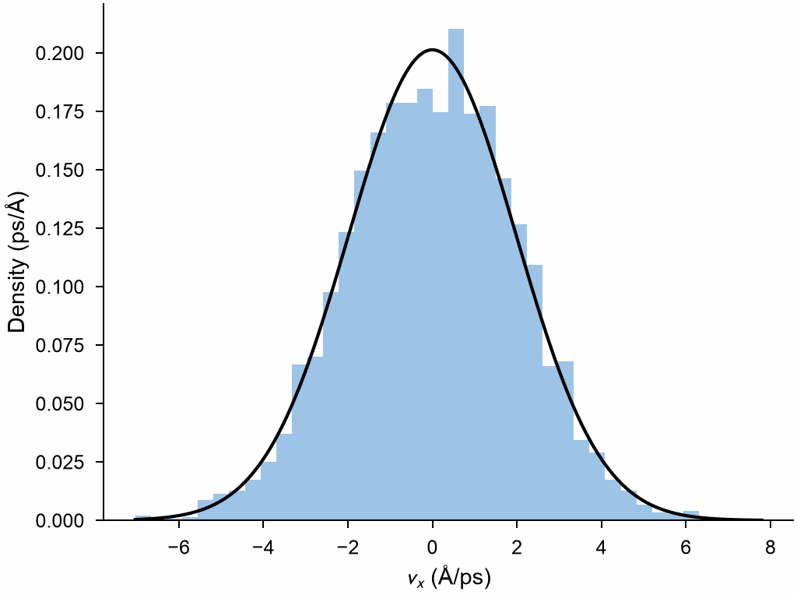

# Histograms

`Histogram` counts the values of a column of the atoms in bins of equal
width, as OVITO's histogram: a column, a component such as
`"velocities.x"` or an expression over the columns, of all atoms or of those
chosen.

```python
import numpy as np

import mdapy as mp
from mdapy.analysis import Histogram
from mdapy.build import build_crystal

# copper at 300 K: velocities in Å/ps of the Maxwell-Boltzmann distribution
copper = build_crystal("fcc", 3.615, elements="Cu", repeat=(10, 10, 10))
kT, mass = 0.025852, 63.546  # eV, amu
sigma = np.sqrt(kT / mass / 1.0364269e-4)  # (Å/ps)², from eV/amu
rng = np.random.default_rng(1)
copper = copper.with_columns(velocities=rng.normal(0, sigma, (len(copper), 3)))

histogram = Histogram("velocities.x", bins=40).compute(copper)
histogram.center, histogram.counts  # bin centers, atoms in each bin
fast = Histogram("velocities.x", bins=40, range=(-10, 10)).compute(
    copper, atoms=copper.where("velocities.y > 0")
)
```

The distribution of one component and the Gaussian it follows:

```python
from mdapy.visualization import plot

with plot.style():
    fig, ax = plot.figure("single")
    width = histogram.edges[1] - histogram.edges[0]
    ax.bar(histogram.center, histogram.density, width=width, color="#9ec5e8")
    v = np.linspace(histogram.edges[0], histogram.edges[-1], 200)
    ax.plot(v, np.exp(-0.5 * (v / sigma) ** 2) / (sigma * np.sqrt(2 * np.pi)), "k")
    ax.set_xlabel("$v_x$ (Å/ps)")
    ax.set_ylabel("Density (ps/Å)")
    plot.save(fig, "images/histogram", formats=("png",))
```



*4000 values of $v_x$ in 40 bins, normalized as a density, against the
Gaussian of variance $k_BT/m$.*

## Parameters

`Histogram(column, bins=50, range=None)`

| Name | Type | Default | Unit | Meaning |
|---|---|---|---|---|
| `column` | str | | | a column of numbers, a component such as `"positions.z"` or an expression over the columns |
| `bins` | int | 50 | | number of bins of equal width |
| `range` | (float, float) | `None` | that of the column | lowest and highest value of the bins; values outside are not counted. By default from the lowest to the highest finite value, or one unit above a single value |

`compute(system, *, atoms=None)` counts the atoms given as a boolean mask or
indices, such as those of [`System.where`](../getting-started/selecting.md#masks),
or all. NaN and infinite values are left out and counted apart.

## Results

A `HistogramResult`:

| Attribute | Type | Meaning |
|---|---|---|
| `center` | (bins,) float64 | bin centers |
| `edges` | (bins + 1,) float64 | bin edges; the last bin holds its upper edge |
| `counts` | (bins,) int64 | number of values in each bin |
| `frequency` | (bins,) float64 | the counts divided by the number of values counted |
| `density` | (bins,) float64 | the frequency divided by the width of a bin |
| `nonfinite` | int | the number of values left out as NaN or infinite |
| `name` | str | the column |

## Errors

The constructor raises `InvalidParameter` for fewer than one bin or a range
that does not increase; `compute` raises it for a column of text, a column
of several components (give one of them) or a wrong mask.

## See also

- [Reductions](reduce.md): one number from a column.
- [Spatial binning](spatial-binning.md): a column along the box.
- OVITO [Histogram](https://docs.ovito.org/reference/pipelines/modifiers/histogram.html).
