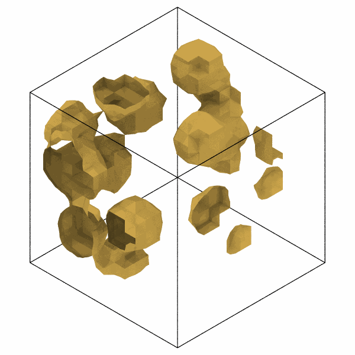
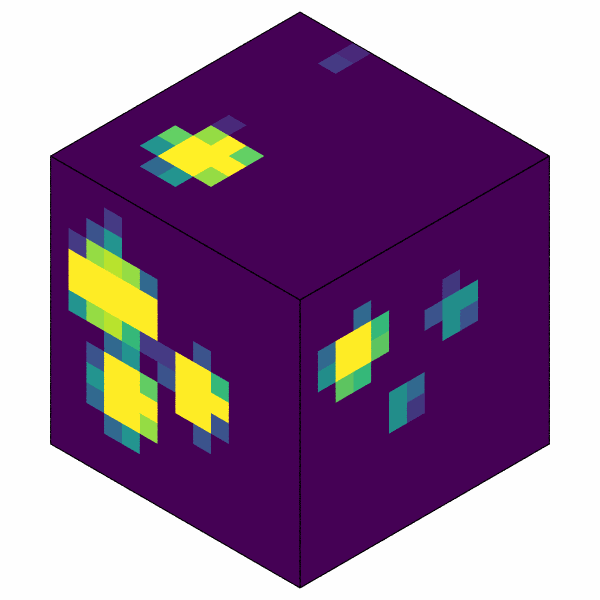

# Isosurfaces and voxels

`isosurface` gives the surface where a field on a grid over the box, such
as a property of the atoms binned along the three box vectors, crosses a
level: the boundary of the regions of high density, of one element, of
large strain. `voxel_faces` shows the grid itself, as colors of its cells
on the faces of the box.

```python
import numpy as np

import mdapy as mp
from mdapy.analysis import SpatialBinning, isosurface
from mdapy.build import build_crystal
from mdapy.visualization import colormap, render, voxel_faces

# nickel with twelve spherical copper precipitates of radius 8 Å
nickel = build_crystal("fcc", 3.55, elements="Ni", repeat=(16, 16, 16))
box = nickel.box
centers = np.random.default_rng(3).random((12, 3))
step = box.to_fractional(nickel["positions"])[:, None, :] - centers
step -= np.round(step)
inside = (np.linalg.norm(step @ box.matrix, axis=-1) < 8).any(axis=1)
alloy = nickel.with_columns(
    element=np.where(inside, "Cu", "Ni"), copper=inside.astype(float)
)

# the copper fraction in 14 x 14 x 14 cells, and where it is one half
fraction = SpatialBinning("copper", 14, axes=(0, 1, 2)).compute(alloy)
surface = isosurface(fraction.values, box, 0.5)  # a TriangleMesh
surface.area  # Ų

render(alloy, "images/isosurface.png", atoms=[], mesh=surface, mesh_color="#c8a24a",
       width=600, height=600)  # fmt: skip
faces, values = voxel_faces(fraction.values, box)
render(alloy, "images/voxels.png", atoms=[], mesh=faces,
       mesh_color=colormap(values, "viridis", (0, 1)), width=600, height=600)  # fmt: skip
```

{ width="49%" }
{ width="49%" }

*Left: the surface where the copper fraction is one half, which wraps the
precipitates, cut at the faces of the box where it crosses them and
moved in through the opposite faces. Right:
the copper fraction of the cells at the faces of the box, from none
(purple) to all (yellow), where the precipitates are cut by them.*

## Parameters

`isosurface(values, box, level)` and `voxel_faces(values, box)`

| Name | Type | Unit | Meaning |
|---|---|---|---|
| `values` | (na, nb, nc) array | | the field at the centers of the cells of a grid that divides the box into na, nb and nc cells along a, b and c, such as `SpatialBinning(..., axes=(0, 1, 2)).compute(system).values` |
| `box` | `Box` | | the box the grid divides |
| `level` | float | as the field | the value on the surface |

The values must be finite: the mean of a property in a bin without atoms
is NaN, and `np.nan_to_num` or a sum or density instead of the mean
mends that.

## Results

`isosurface` gives a [`TriangleMesh`](surface-mesh.md#results),
the triangles of the surface, whose normals point toward lower values,
from inside the regions above the level to outside; it crosses the
periodic boundaries of the box, and ends at the outermost cell centers
along the box vectors that are not periodic. Its `area` is the area in Ų.
Where the field does not cross the level, the mesh is empty.

`voxel_faces` gives a `TriangleMesh` of the six faces of the box, two
triangles for each cell at each face, and the value of the cell of each
triangle; `colormap(values, name, value_range)` makes them colors, and
`render(mesh=..., mesh_color=...)` draws them, as OVITO shows a voxel
grid.

## Errors

Both raise `InvalidParameter` for values that are not a three-dimensional
grid of finite numbers, and `isosurface` for a level that is not finite.

## Definition

The samples of the field are at the centers of the cells; between each
eight neighboring samples, along the periodic box vectors also across the
boundary, lies a cube of the dual grid. Each cube is cut into six
tetrahedra that share its diagonal from corner (0, 0, 0) to (1, 1, 1),
which neighboring cubes cut alike, so that their faces meet. A sample
above the level is inside. In each tetrahedron whose corners are some
inside and some not, the surface crosses each edge between an inside and
an outside corner where the field, linear along the edge, equals the
level: one triangle where one corner is on its own side, two where two
are inside. Neighboring tetrahedra share the crossings on their common
edges, so that the surface is one piece without gaps, closed where the
regions above the level do not reach a box face that is not periodic.
Unlike marching cubes, the tetrahedra leave no case ambiguous.

## See also

- [Spatial binning](spatial-binning.md), which gives the grids.
- [Surface mesh](surface-mesh.md), the surface of the solid of the atoms
  themselves.
- [Rendering](../visualization/rendering.md#parameters).
