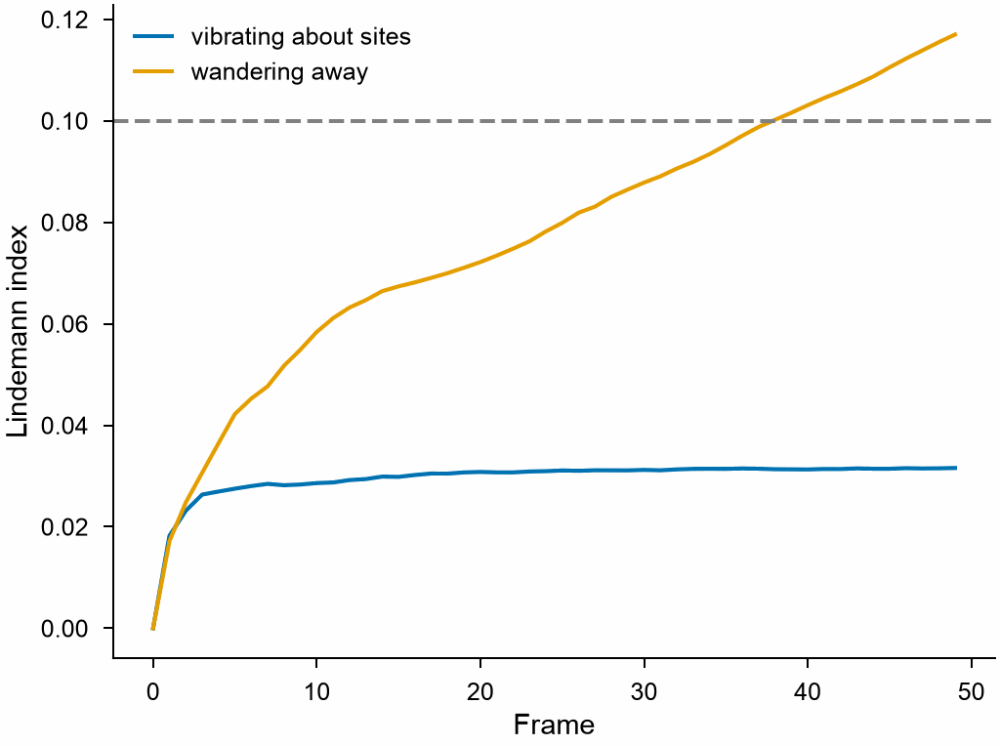

# Lindemann index

`LindemannIndex` measures how much the distances between atoms fluctuate
over a trajectory, relative to their mean; it rises sharply at melting,
which makes it a criterion of melting for clusters and nanoparticles.

```python
import numpy as np

import mdapy as mp
from mdapy.analysis import LindemannIndex

# a cluster of 30 atoms vibrating about its sites for 50 frames
rng = np.random.default_rng(0)
sites = rng.random((30, 3)) * 8 + 10
box = mp.Box(30.0, pbc=False)
frames = [
    mp.System(sites + rng.normal(scale=0.1, size=(30, 3)), box, elements="Ar")
    for _ in range(50)
]

result = LindemannIndex().compute(frames)
result.index  # over every pair of atoms
result.running  # of the frames up to each one
system = frames[0].with_columns(result)  # the column 'lindemann'
```

The same cluster with atoms that wander away, as in a liquid, against the
one that vibrates:

```python
from mdapy.visualization import plot

steps = rng.normal(scale=0.15, size=(50, 30, 3))
liquid = [
    mp.System(sites + walk, box, elements="Ar") for walk in np.cumsum(steps, axis=0)
]
melted = LindemannIndex().compute(liquid)

with plot.style():
    fig, ax = plot.figure("single")
    ax.plot(result.running, label="vibrating about sites")
    ax.plot(melted.running, label="wandering away")
    ax.axhline(0.1, color="0.5", linestyle="--")
    ax.set_xlabel("Frame")
    ax.set_ylabel("Lindemann index")
    ax.legend()
    plot.save(fig, "images/lindemann", formats=("png",))
```



*The running index levels off for atoms that vibrate about their sites and
keeps rising for atoms that wander away. The dashed line marks 0.1, about
where the index of a solid stands when it melts.*

## Parameters

| Name | Type | Default | Unit | Meaning |
|---|---|---|---|---|
| `unwrap` | bool | `True` | | follow the atoms through the periodic boundaries, or take the positions as they are, already unwrapped |

`compute(frames, *, progress=None, cancel=None)` takes a sequence of systems
as the [mean squared displacement](msd.md#parameters) does, with the atoms
matched by their ids and unwrapped in the same way, and the `progress` and
`cancel` of [every analysis](overview.md#parameters). The distances are
those between the unwrapped positions, not between the nearest periodic
images.

## Results

A `LindemannResult`:

| Attribute | Type | Meaning |
|---|---|---|
| `index` | float | the index $\delta$ over every pair of atoms and every frame |
| `atomic` | (N,) float64 | the index $\delta_i$ of each atom, averaged over its pairs, the atoms in the order of the first frame; its column `lindemann` |
| `running` | (T,) float64 | $\delta$ over the frames from the first to each one; 0 for the first |

## Errors

`compute` raises `InvalidParameter` as the
[mean squared displacement](msd.md#errors) does and for fewer than two
atoms, and `Cancelled` when cancelled.

## Definition

With $r_{ij}$ the distance between atoms $i$ and $j$ and
$\langle \cdot \rangle$ the average over the frames, for $N$ atoms,

$$
\delta = \frac{2}{N(N-1)} \sum_{i<j}
\frac{\sqrt{\langle r_{ij}^2 \rangle - \langle r_{ij} \rangle^2}}{\langle r_{ij} \rangle} ,
\qquad
\delta_i = \frac{1}{N-1} \sum_{j \ne i}
\frac{\sqrt{\langle r_{ij}^2 \rangle - \langle r_{ij} \rangle^2}}{\langle r_{ij} \rangle} .
$$

$\delta$ is the mean of the $\delta_i$. A rigid motion of all atoms leaves
every distance unchanged and gives 0.

!!! quote "Please cite"
    [Lindemann (1910)](../reference/references.md#lindemann1910); for this index of the distances, [Zhou et al. (2002)](../reference/references.md#zhou2002).
