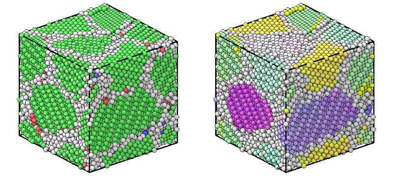

# Polyhedral template matching

`PolyhedralTemplateMatching` gives each atom the crystal structure of its
neighborhood, the rotation of that crystal, its elastic deformation and the
chemical ordering of its elements, by matching the polyhedron of its
nearest neighbors to the templates of nine structures. It runs the PTM
library of P. M. Larsen, the version that OVITO 3.17 ships, and gives the
same results as OVITO, atom by atom.

```python
import numpy as np

from mdapy.build import build_crystal
from mdapy.identify import PolyhedralTemplateMatching

# Cu3Au: an fcc lattice ordered in the L1_2 structure, slightly disordered
alloy = build_crystal("l1_2", 3.75, elements=("Cu", "Au"), repeat=(4, 4, 4))
rng = np.random.default_rng(1)
alloy = alloy.with_columns(
    positions=alloy["positions"] + rng.normal(scale=0.05, size=(256, 3))
)

ptm = PolyhedralTemplateMatching(deformation_gradient=True, ordering=True)
result = ptm.compute(alloy)
result.counts()["fcc"]  # 256
result.interatomic_distance.mean()  # about 2.65 Å, 3.75 / sqrt(2)
result.orientation[0]  # near (0, 0, 0, 1): the cubic axes along x, y and z
result.ordering_names[result.ordering[0]]  # "L12_A": a Cu site
alloy = alloy.with_columns(result)  # structure, rmsd, orientation and more
```



*A copper polycrystal: the structure of each atom (fcc green, hcp red,
other white), and the orientation of the grains, colored by the
rotation of each atom.*

## Parameters

`PolyhedralTemplateMatching(structures=("fcc", "hcp", "bcc"), *, rmsd_cutoff=0.1, deformation_gradient=False, ordering=False, template_neighbors=False)`

| Name | Type | Default | Unit | Meaning |
|---|---|---|---|---|
| `structures` | iterable of str | `("fcc", "hcp", "bcc")` | | the structures to look for: `fcc`, `hcp`, `bcc`, `ico`, `sc`, `cubic_diamond`, `hexagonal_diamond` and `graphene` |
| `rmsd_cutoff` | float | 0.1 | | atoms that deviate more from their best template are `other`; 0 for no cutoff |
| `deformation_gradient` | bool | `False` | | compute the elastic deformation gradient of each atom |
| `ordering` | bool | `False` | | identify the chemical ordering from the `element` column |
| `template_neighbors` | bool | `False` | | give the neighbors of each atom in the order of its template |

`compute(system, *, neighbors=None, progress=None, cancel=None)` takes the
arguments of [every analysis](overview.md#parameters). A given neighbor list
must hold the 18 nearest neighbors of every atom.

## Results

A `PTMResult`, a [`StructureResult`](overview.md#results) with the types
`other`, `fcc`, `hcp`, `bcc`, `ico`, `sc`, `cubic_diamond`,
`hexagonal_diamond` and `graphene`, numbered as in OVITO, and:

| Attribute | Type | Unit | Meaning |
|---|---|---|---|
| `rmsd` | (N,) float64 | | the root-mean-square deviation from the best template, after scaling; 0 where none matches |
| `interatomic_distance` | (N,) float64 | Å | the distance between nearest neighbors of the matched lattice |
| `orientation` | (N, 4) float64 | | the rotation of the lattice from its standard orientation, a quaternion (x, y, z, w) |
| `deformation_gradient` | (N, 3, 3) float64 or `None` | | the elastic deformation gradient, from the template scaled to the interatomic distance to the neighbors |
| `ordering` | (N,) int8 or `None` | | the chemical ordering, an index into `ordering_names`: `other`, `pure`, `L10`, `L12_A`, `L12_B`, `B2`, `zincblende_wurtzite` and `boron_nitride` |
| `correspondences` | (N,) uint64 | | the order of the neighbors that matches the template, encoded as OVITO's Correspondences |
| `template_index` | (N,) int8 | | which of the equivalent templates of the structure matched |
| `neighbors` | (N, 16) `index_dtype` or `None` | | the neighbors of each atom in the order of the points of its template, -1 beyond its count |

The columns are `structure`, `rmsd`, `interatomic_distance`, `orientation`,
and when computed `deformation_gradient` (9 values per atom, by rows) and
`ordering`. As in OVITO, an atom above the RMSD cutoff is `other` but keeps
the other results of its best template; an atom that matches no template
gets zeros.

## Errors

The constructor raises `InvalidParameter` for an unknown structure, no
structure, or a negative RMSD cutoff; `compute` raises it for a neighbor
list that does not hold the 18 nearest neighbors, and `MissingProperty` for
the ordering without an `element` column.

## Definition

The 18 nearest neighbors of an atom are first ordered by the solid angles
of the faces of its Voronoi cell, which they share. For fcc, hcp, icosahedral,
bcc and simple cubic, the first 12, 14 or 6 of them form a convex hull; its
graph of edges, put in a canonical form, finds the templates of the same
graph and every way the neighbors can map onto the points of a template.
For the diamond structures, the 4 nearest neighbors and 3 of each of their
own neighbors are matched together, and for graphene 3 and 2 of each. For
every mapping, the neighbors are centered and scaled, and the rotation that
brings the template closest to them is found by the quaternion method; the
root-mean-square deviation of that fit, the RMSD, picks the best mapping and
structure. The interatomic distance comes from the scale of the fit, and the
deformation gradient is the linear map that brings the scaled template
closest to the neighbors. The chemical ordering compares the elements of the
neighbors with the sublattices of the ordered structures on the same
template.

Neighbors at exactly the same distance, as in a perfect crystal, may come
in an order other than OVITO's. The structure types are then the same, but
an atom that matches no structure may report another best template.

## See also

- [Common neighbor analysis](cna.md), faster, without orientations.
- OVITO [Polyhedral template matching](https://docs.ovito.org/reference/pipelines/modifiers/polyhedral_template_matching.html).

!!! quote "Please cite"
    [Larsen, Schmidt and Schiøtz (2016)](../reference/references.md#larsen2016).
