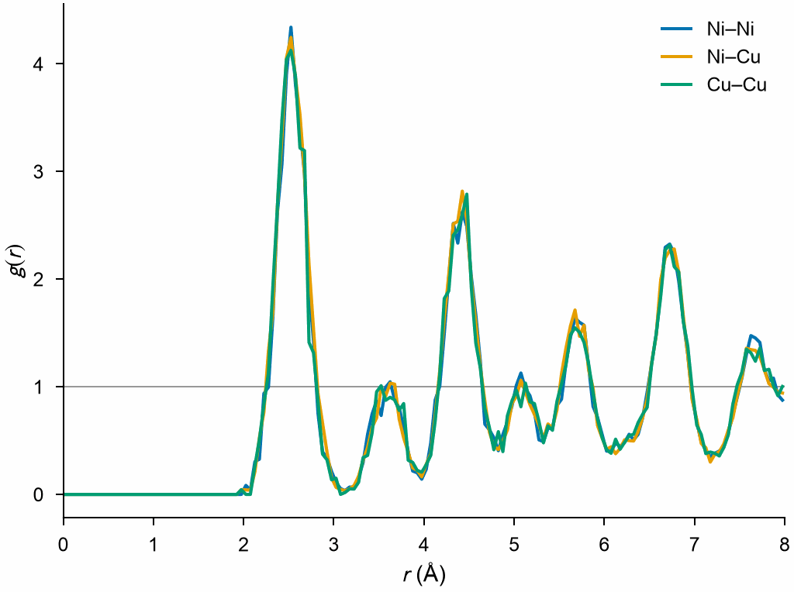

# Radial distribution function

`RadialDistributionFunction` gives the radial distribution function g(r) of
a system and its partial functions for each pair of elements.

```python
import numpy as np

import mdapy as mp
from mdapy.analysis import RadialDistributionFunction

# a random Cu-Ni alloy on an fcc lattice of 5 x 5 x 5 cubic cells
a = 3.6
basis = np.array([[0, 0, 0], [0.5, 0.5, 0], [0.5, 0, 0.5], [0, 0.5, 0.5]])
cells = np.stack(np.meshgrid(*[np.arange(5)] * 3, indexing="ij"), -1).reshape(-1, 1, 3)
positions = ((cells + basis) * a).reshape(-1, 3)
elements = np.random.default_rng(0).choice(["Cu", "Ni"], len(positions))
system = mp.System(positions, mp.Box(5 * a), elements=list(elements))

rdf = RadialDistributionFunction(r_max=8.0, bins=160).compute(system)
rdf.r, rdf.g  # bin centers in Å and g(r)
rdf.pair("Cu", "Ni")  # a partial function
rdf.coordination[-1]  # mean number of neighbors closer than 8 Å
```

Plotted with [`mdapy.visualization.plot`](../visualization/plots.md), for a
larger alloy whose atoms are shaken by 0.12 Å as at a finite temperature:

```python
from mdapy.build import build_crystal, random_alloy
from mdapy.visualization import plot

alloy = random_alloy(
    build_crystal("fcc", 3.6, repeat=(6, 6, 6)), {"Cu": 1, "Ni": 1}, seed=1
)
shake = np.random.default_rng(0).normal(0, 0.12, (len(alloy), 3))
hot = alloy.with_columns(positions=alloy["positions"] + shake)
partials = RadialDistributionFunction(r_max=8.0, bins=160).compute(hot)
with plot.style():
    fig, ax = plot.figure("single")
    plot.rdf(partials, ax=ax, partial=True)
    plot.save(fig, "images/rdf", formats=("png",))
```



*The three partial functions of the random alloy agree: Cu and Ni share the
sites at random. The peaks are the neighbor shells of fcc at
a/√2, a, a√(3/2), a√2 and beyond.*

## Parameters

| Name | Type | Default | Unit | Meaning |
|---|---|---|---|---|
| `r_max` | float | | Å | largest distance; it may exceed half the box, periodic images count |
| `bins` | int | 200 | | number of bins of equal width from 0 to `r_max` |

`compute(system, *, neighbors=None, progress=None, cancel=None)` takes the
arguments of [every analysis](overview.md#parameters). A given neighbor list
must reach `r_max`; without one, the pairs are counted as they are found,
never stored. Partial functions need an `element` column.

## Results

A `RadialDistributionResult`:

| Attribute or method | Type | Meaning |
|---|---|---|
| `r` | (bins,) float64 | bin centers in Å |
| `edges` | (bins + 1,) float64 | bin edges in Å |
| `g` | (bins,) float64 | g(r) |
| `coordination` | (bins,) float64 | mean number of neighbors closer than the upper edge of each bin |
| `partial` | dict | g_ab(r) of each pair of elements `(a, b)`, `a` not after `b` by atomic number |
| `pair(a, b)` | (bins,) float64 | g_ab(r), with `a` and `b` in either order |

## Errors

The constructor raises `InvalidParameter` for an `r_max` that is not
positive or fewer than one bin; `compute` raises it for a neighbor list that
does not fit, and `pair` for a pair of elements without a function.

## Definition

With $n_k$ the number of ordered pairs $(i, j)$, $j$ any atom or periodic
image other than $i$ itself, at a distance in bin $k$ from $r_k$ to
$r_{k+1}$, and $n^{ab}_k$ those with $i$ of element $a$ and $j$ of element
$b$,

$$
g(r_k) = \frac{V}{N^2}\, \frac{n_k}{\tfrac{4}{3}\pi\,(r_{k+1}^3 - r_k^3)},
\qquad
g_{ab}(r_k) = \frac{V}{N_a N_b}\, \frac{n^{ab}_k}{\tfrac{4}{3}\pi\,(r_{k+1}^3 - r_k^3)},
$$

with $V$ the volume of the box, $N$ the number of atoms and $N_a$ that of
element $a$; a pair at distance $r$ is in bin $\lfloor r / \Delta r \rfloor$.
The partial functions add up as $g = \sum_{a,b} x_a x_b\, g_{ab}$ with the
fractions $x_a = N_a / N$. The volume is that of the box also along
directions that are not periodic, where $g$ does not tend to 1.

This is the normalization of OVITO. LAMMPS `compute rdf` divides by
$N(N - 1)$ instead of $N^2$, and by $N_a(N_a - 1)$ for like pairs, so its
values are larger by about $N / (N - 1)$.

## See also

- OVITO [Coordination analysis](https://docs.ovito.org/reference/pipelines/modifiers/coordination_analysis.html).
- LAMMPS [`compute rdf`](https://docs.lammps.org/compute_rdf.html).
