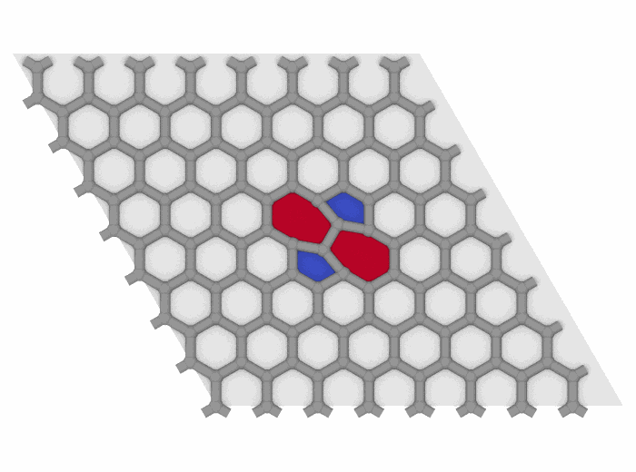

# Ring statistics

`RingStatistics` finds the rings of a network of bonds, as in silica,
amorphous silicon, carbon or ice: closed paths of bonds through distinct
atoms in which no two atoms are closer through the network than along the
ring, the shortest-path rings of Franzblau. It gives each ring, how many
there are of each size and how many rings each atom is in.

```python
import numpy as np

import mdapy as mp
from mdapy.analysis import RingStatistics
from mdapy.build import build_crystal
from mdapy.visualization import colormap, render

# graphene with a Stone-Wales defect: one bond turned by 90 degrees
sheet = build_crystal("graphene", 2.46, c=10.0, elements="C", repeat=(8, 8, 1))
x = sheet["positions"].copy()
middle = sheet.box.matrix.sum(axis=0) / 2
first = int(np.argmin(np.linalg.norm(x[:, :2] - middle[:2], axis=1)))
second = int(np.argsort(np.linalg.norm(x - x[first], axis=1))[1])
center = (x[first] + x[second]) / 2
turn = np.array([[0.0, -1, 0], [1, 0, 0], [0, 0, 1]])
x[[first, second]] = center + (x[[first, second]] - center) @ turn.T
defect = sheet.with_columns(positions=x)

rings = RingStatistics(8, cutoff=1.7).compute(defect)
rings.counts  # [0, 0, 0, 0, 0, 2, 60, 2, 0]: two pentagons, two heptagons
rings.atoms[0], rings.sizes[0]  # the atoms of the first ring and its size
defect = defect.with_columns(rings)  # the number of rings of each atom

mesh, ring = rings.polygons(defect)  # a fan of triangles about each ring
size = rings.sizes[ring]
render(defect, "images/rings.png", radius=0.35, bonds=1.7, mesh=mesh,
       mesh_color=colormap(size, "coolwarm", (5, 7)), view="top", box=False,
       width=700, height=520)  # fmt: skip
```



*The rings of graphene with a Stone–Wales defect, colored by size: the
turned bond makes two pentagons (blue) and two heptagons (red) among the
hexagons.*

## Parameters

`RingStatistics(max_size=8, *, min_size=3, cutoff=None, cutoffs=None)`

| Name | Type | Default | Unit | Meaning |
|---|---|---|---|---|
| `max_size` | int | 8 | | the largest ring, at most 36 |
| `min_size` | int | 3 | | the smallest ring, at least 3 |
| `cutoff` | float | `None` | Å | atoms closer than it are bonded |
| `cutoffs` | dict | `None` | Å | the bond length of each pair of elements `(a, b)`, in either order; pairs not given are never bonded, as for [clusters](clusters.md) |

Without `cutoff` or `cutoffs`, the bonds are those of the
[topology](../getting-started/topology.md) of the system, such as those of
a LAMMPS data file, each between the nearest periodic images of its two
atoms. `compute(system, *, progress=None, cancel=None)` takes the arguments
of [every analysis](overview.md#parameters). The time grows with the number
of paths of up to half the largest ring from each atom: rings of up to 12
atoms of a thousand atoms of diamond take a tenth of a second.

## Results

A `RingResult`:

| Attribute | Type | Meaning |
|---|---|---|
| `atoms` | (M, max_size) int64 | the atoms of each ring in order around it, from its atom of the smallest index on toward the smaller of its two neighbors; -1 after the last |
| `shifts` | (M, max_size, 3) int32 | the periodic image of each atom of a ring relative to its first atom, so that `positions[atoms] + shifts @ box.matrix` is the ring whole |
| `sizes` | (M,) int64 | the number of atoms of each ring |
| `counts` | (max_size + 1,) int64 | the number of rings of each size |
| `per_atom` | (N,) int64 | the number of rings each atom is in; its column `rings` |

The rings are in the order of their first atom, then of size, then of
their atoms. `polygons(system)` gives a `TriangleMesh` of the rings, a fan
of triangles about the center of each, and the ring of each triangle, for
`render(mesh=..., mesh_color=...)`.

## Errors

`RingStatistics` raises `InvalidParameter` for sizes that are not integers
with 3 ≤ `min_size` ≤ `max_size` ≤ 36, and for both `cutoff` and
`cutoffs`; `compute` raises `MissingProperty` without a cutoff for a
system with no bonds in its topology, and with `cutoffs` for a system
without an element column.

## Definition

A ring is a closed path of bonds through distinct atoms, its atoms told
apart by their periodic images, so that a path around a periodic box is no
ring however small the box. A ring of n atoms is a shortest-path ring when
the number of bonds between any two of its atoms along the shortest path
through the whole network equals the smaller number along the ring:

$$
d(i, j) = \min(|k_i - k_j|,\; n - |k_i - k_j|)
$$

for atoms at places $k_i$ and $k_j$ of the ring. A ring with a shortcut,
a shorter path between two of its atoms elsewhere in the network, is
two smaller rings and is left out. Two atoms joined by several paths of
the same length make every ring of two of them a shortest-path ring: the
faces of a cube and the four hexagons about its body diagonals, three
rings of six atoms where two atoms are joined by three paths of three
bonds. Other definitions differ in such cases: OVITO's find rings keeps
some of them, and primitive or strong rings keep fewer.

Each ring is found from its atom of the smallest index: a breadth-first
search of the network from it, each atom in each periodic image a node of
its own, gives every shortest path out to half the largest ring; a ring of
2k atoms is two such paths to an atom k bonds away that share no other
atom, a ring of 2k + 1 atoms two paths to the two ends of a bond k bonds
away, and each is kept when no two of its atoms have a shortcut.

## See also

- OVITO [Find rings](https://docs.ovito.org/reference/pipelines/modifiers/find_rings.html).
- [Cluster analysis](clusters.md), with the same bonds.

!!! quote "Please cite"
    [Franzblau (1991)](../reference/references.md#franzblau1991).
