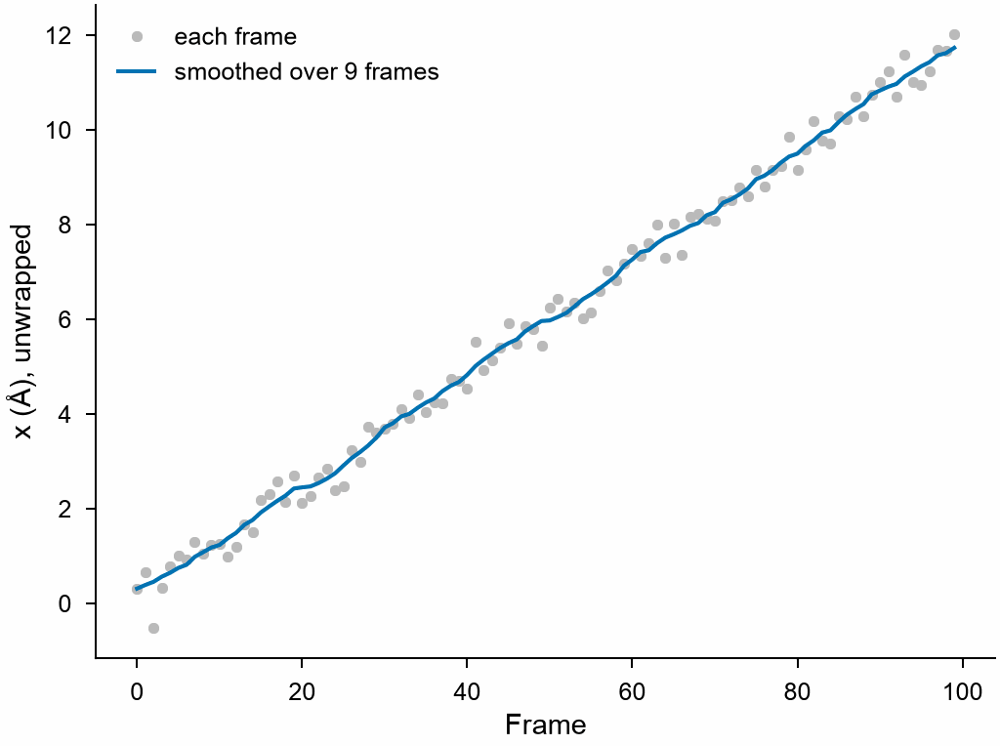

# Smoothed trajectories

`smooth_trajectory` averages the positions of each frame over a window of
frames about it, the atoms followed through the periodic boundaries, as
OVITO's smooth trajectory. The thermal vibrations average out and the slow
motion stays; velocities, forces and other columns of real numbers are
averaged too.

```python
import numpy as np

import mdapy as mp
from mdapy.transform import smooth_trajectory

# an atom that drifts slowly along x through a periodic box of 10 Å,
# vibrating by 0.3 Å in each of 100 frames
box = mp.Box(10.0)
rng = np.random.default_rng(6)
t = np.arange(100)
x = 0.12 * t + rng.normal(0, 0.3, 100)
frames = [
    mp.System(box.wrap([[x[k], 5.0, 5.0]])[0], box, elements="Ar").with_columns(id=[1])
    for k in t
]

smoothed = smooth_trajectory(frames, 9)  # the frames, each computed when used
smoothed[50]["positions"]  # the mean of frames 46 to 54 about the atom
```

The path of the atom unwrapped, frame by frame and smoothed:

```python
from mdapy.analysis import trajectory_lines
from mdapy.visualization import plot

with plot.style():
    fig, ax = plot.figure("single")
    ax.plot(
        t, trajectory_lines(frames)[0, :, 0], ".", color="#bbbbbb", label="each frame"
    )
    ax.plot(t, trajectory_lines(smoothed)[0, :, 0], label="smoothed over 9 frames")
    ax.set_xlabel("Frame")
    ax.set_ylabel("x (Å), unwrapped")
    ax.legend(frameon=False)
    plot.save(fig, "images/smooth-trajectory", formats=("png",))
```



*The atom crosses the box about once every 80 frames; the smoothed path
follows the drift through the boundary without the jumps.*

## Parameters

`smooth_trajectory(frames, window)`

| Name | Type | Meaning |
|---|---|---|
| `frames` | sequence of System | the same atoms in every frame, such as a [`Trajectory`](../getting-started/trajectory.md), matched by the `id` column where the frames have one, else in the same order; without an `image` column, atoms must move less than half the box between frames |
| `window` | int | the number of frames averaged: the frame, `(window - 1) // 2` frames before it and `window // 2` after it, the first and last frames repeated beyond the ends; 1 leaves the positions as they are |

## Results

A sequence of systems, one per frame, each computed when it is used: the
mean positions placed about the atoms where they are in that frame, the
mean of every other column of real numbers matched by atom, and the columns
of integers or text, such as ids and elements, as they are.

## Errors

`InvalidParameter` for a window that is not a positive integer, no frames,
or frames that do not hold the same atoms; `IndexError` for a frame beyond
the end.

## See also

- [Time averages](time-average.md): the mean over all frames.
- OVITO [Smooth trajectory](https://docs.ovito.org/reference/pipelines/modifiers/smooth_trajectory.html).
