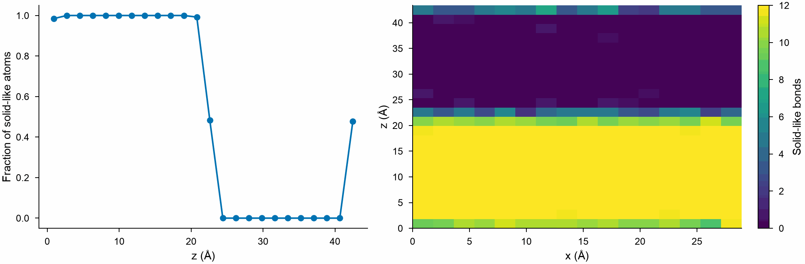

# Spatial binning

`SpatialBinning` divides the box into bins of equal size along one, two or
three of its vectors and reduces a property of the atoms in each: its mean,
sum, sum per volume, minimum or maximum. Profiles across interfaces and
surfaces, and maps over a plane, are made this way.

```python
import numpy as np

from mdapy.analysis import SpatialBinning, SteinhardtParameters
from mdapy.build import build_crystal

# copper whose upper half is disordered like a liquid
rng = np.random.default_rng(0)
melt = build_crystal("fcc", 3.615, elements="Cu", repeat=(8, 8, 12))
upper = melt["positions"][:, 2] > 22.0
shake = (
    rng.normal(0, 0.1, (len(melt), 3))
    + rng.normal(0, 0.6, (len(melt), 3)) * upper[:, None]
)
melt = melt.with_columns(positions=melt["positions"] + shake)
melt = melt.with_columns(SteinhardtParameters(solid=True).compute(melt))

# the fraction of solid-like atoms in 24 slabs along z
profile = SpatialBinning("solid", 24, axes="z").compute(melt)
profile.centers[0]  # Å along c, the middle of each slab
profile.values  # 1 in the crystal, near 0 above 22 Å
profile.counts  # atoms in each slab

# a map over x and z of the mean number of solid-like bonds
bonds = SpatialBinning("solid_bonds", (16, 24), axes=("x", "z")).compute(melt)
bonds.values.shape  # (16, 24)

# the solid-like atoms per ų in each slab
density = SpatialBinning("solid", 24, reduction="density").compute(melt)
```

```python
from mdapy.visualization import plot

with plot.style():
    fig, (left, right) = plot.figure("double", 60, ncols=2)
    left.plot(profile.centers[0], profile.values, marker="o", markersize=3)
    left.set_xlabel("z (Å)")
    left.set_ylabel("Fraction of solid-like atoms")
    image = right.imshow(
        bonds.values.T,
        origin="lower",
        extent=(0, melt.box.matrix[0, 0], 0, melt.box.matrix[2, 2]),
        aspect="auto",
        vmin=0,
        vmax=12,
    )
    right.set_xlabel("x (Å)")
    right.set_ylabel("z (Å)")
    fig.colorbar(image, ax=right, label="Solid-like bonds")
    plot.save(fig, "images/spatial-binning", formats=("png",))
```



*Left: the fraction of solid-like atoms falls from 1 to 0 across the
interface at 22 Å, and rises again at the top, where the crystal below
the periodic boundary orders the first layer. Right: the mean number of
solid-like bonds over x and z.*

## Parameters

| Name | Type | Default | Unit | Meaning |
|---|---|---|---|---|
| `property` | str | | | a column, a component such as `positions.z`, or an expression over the columns, as `system[...]` takes |
| `bins` | int or sequence of int | | | the number of bins along each axis, or one number for all |
| `axes` | int, str or sequence | `"z"` | | the box vectors binned along, one to three of 0, 1, 2 or x, y, z |
| `reduction` | str | `"mean"` | | one of `REDUCTIONS`: `"mean"`, `"sum"`, `"density"` (the sum per ų), `"min"`, `"max"` |

`compute(system)` takes the system. Along periodic vectors the atoms are
wrapped into the box first; along the others, those outside the box are
left out.

## Results

A `SpatialBinningResult`:

| Attribute | Type | Meaning |
|---|---|---|
| `values` | (n1[, n2[, n3]]) float64 | the reduced property in each bin, with a last axis for its components when it has several; NaN for the mean, minimum or maximum of an empty bin |
| `counts` | (n1[, n2[, n3]]) int64 | the number of atoms in each bin |
| `centers` | tuple of (n,) float64 | for each axis, the centers of its bins in Å along its box vector, from the origin of the box |

The bins are numbered as the axes are given: `values[i, j]` for the bin `i`
along the first axis and `j` along the second.

## Errors

The constructor raises `InvalidParameter` for no axis or more than three,
an unknown or repeated axis, a number of bins that is not a positive
integer or not one per axis, and an unknown reduction; `compute` raises it
for a property the system does not have.

## Definition

The bin of an atom along a box vector is $\lfloor n s \rfloor$, with $s$
its fractional coordinate along that vector, from 0 to below 1, and $n$
the number of bins. The density is the sum divided by the volume of a bin,
$V / (n_1 n_2 n_3)$.

## See also

- OVITO [Spatial binning](https://docs.ovito.org/reference/pipelines/modifiers/spatial_binning.html),
  whose values `SpatialBinning` gives for the bins that hold atoms (OVITO
  gives 0 for empty ones).
