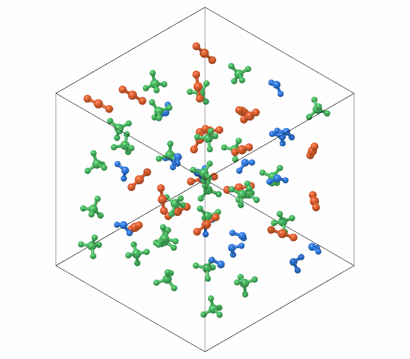

# Chemical species

`ChemicalSpecies` finds the molecules of a system, the groups of atoms
joined by bonds, and their chemical formulas, from the radii of the
elements or bond lengths given by hand; and counts the molecules of each
formula along a trajectory, as the products of reactions form.

```python
import numpy as np

import mdapy as mp
from mdapy.analysis import ChemicalSpecies

# two water molecules and a carbon dioxide in a 20 Å box
water = np.array([[0, 0, 0.119], [0, 0.763, -0.477], [0, -0.763, -0.477]])
co2 = np.array([[0, 0, 0], [0, 0, 1.16], [0, 0, -1.16]])
positions = np.vstack([water + 2, water + 8, co2 + 14])
system = mp.System(
    positions, mp.Box(20.0), elements=["O", "H", "H"] * 2 + ["C", "O", "O"]
)

result = ChemicalSpecies().compute(system)
result.formulas  # ['H2O', 'H2O', 'CO2']
result.counts()  # formula and count: H2O 2, CO2 1
system = system.with_columns(result)  # the column 'molecule', from 1

# by the van der Waals radii, as VMD and OVITO bond atoms
vdw = ChemicalSpecies("vdw").compute(system)
```

A box of 64 molecules of three kinds, each kind in its own color:

```python
from mdapy.visualization import render

methane = np.array([[0, 0, 0], [0.629, 0.629, 0.629], [-0.629, -0.629, 0.629],
                    [-0.629, 0.629, -0.629], [0.629, -0.629, -0.629]])  # fmt: skip
kinds = [
    (water, ["O", "H", "H"]),
    (co2, ["C", "O", "O"]),
    (methane, ["C", "H", "H", "H", "H"]),
]
rng = np.random.default_rng(0)
grid = (
    np.stack(np.meshgrid(*[np.arange(4)] * 3, indexing="ij"), -1).reshape(-1, 3) * 5.0
    + 2.5
)
positions, elements = [], []
for center in grid:  # a molecule of a random kind, turned at random, near each point
    shape, names = kinds[rng.integers(3)]
    turn = np.linalg.qr(rng.normal(size=(3, 3)))[0]
    positions.append(shape @ turn.T + center + rng.normal(0, 0.6, 3))
    elements += names
gas = mp.System(np.vstack(positions), mp.Box(20.0), elements=elements)

found = ChemicalSpecies().compute(gas)
found.counts()  # CH4 28, CO2 19, H2O 17
kind = np.asarray(found.formulas)[found.molecule - 1]
palette = {"H2O": [0.2, 0.5, 0.9], "CO2": [0.9, 0.4, 0.2], "CH4": [0.3, 0.75, 0.4]}
render(gas, "images/species.png", color=np.array([palette[k] for k in kind]),
       representation="ball_and_stick", width=800, height=700)  # fmt: skip
```



*Water in blue, carbon dioxide in orange and methane in green: every atom
takes the color of the formula of its molecule.*

## Parameters

`ChemicalSpecies(radii="covalent", *, scale=None, tolerance=None, cutoffs=None)`

| Name | Type | Default | Unit | Meaning |
|---|---|---|---|---|
| `radii` | str or dict | `"covalent"` | Å | the radius of each element: `"covalent"`, the covalent radii, `"vdw"`, the van der Waals radii, or radii by element such as `{"H": 0.4, "O": 0.7}` |
| `scale` | float | 0.6 with `"vdw"`, else 1 | | factor on the sum of the radii of two atoms |
| `tolerance` | float | 0.45 with `"covalent"`, else 0 | Å | length added to it |
| `cutoffs` | dict | `None` | Å | bond lengths for pairs of elements `(a, b)`, in either order, instead of the radii; 0 for pairs never bonded |

Two atoms are bonded when they are closer than
$s(r_i + r_j) + t$, with $r$ their radii, $s$ the scale and $t$ the
tolerance, or than the cutoff of their pair of elements. Two rules come
ready:

- `"covalent"`, the default: the covalent radii plus 0.45 Å, the rule of
  Jmol and OpenBabel, and of the bonds mdapy draws in
  [pictures](../visualization/rendering.md);
- `"vdw"`: 0.6 of the van der Waals radii, without tolerance, and two
  hydrogen atoms never bonded, the rule of VMD and of OVITO's *Create
  bonds* in its van der Waals mode. VMD and OVITO have tables of radii of
  their own; with the same radii, the bonds are the same. A cutoff for
  `("H", "H")` bonds hydrogen atoms again, as in the H<sub>2</sub>
  molecule.

Hydrogen bonds and other contacts are left out by both. Radii by element
default to a scale of 1 and no tolerance: atoms closer than the sum of
their radii.

`compute(system, *, neighbors=None, progress=None, cancel=None)` takes the
arguments of [every analysis](overview.md#parameters); `neighbors` must
reach the longest bond. `bond_lengths(elements)` gives the bond length of
each pair of elements.

`count(frames)` computes each frame and gives a table of the number of
molecules of each formula in each frame: a `frame` column and a column for
each formula, the most common first.

## Results

A `SpeciesResult`:

| Attribute or method | Type | Meaning |
|---|---|---|
| `molecule` | (N,) int64 | the molecule of each atom, numbered from 1 by decreasing size, ties by their first atom |
| `formulas` | (M,) str | the chemical formula of each molecule |
| `sizes` | (M,) int64 | the number of atoms of each molecule |
| `counts()` | polars `DataFrame` | `formula` and `count`, the most common first |

The column is `molecule`, the molecule ID of LAMMPS data files. Formulas
are in Hill order: carbon, then hydrogen, then the other elements
alphabetically, or all alphabetically without carbon, so that ammonia is
`H3N` and sodium chloride `ClNa`; isomers have the same formula.

## Errors

The constructor raises `InvalidParameter` for unknown radii, elements or
pairs, radii that are not positive, a scale that is not positive, a
negative tolerance or cutoff; `compute` raises `MissingProperty` without an
`element` column and `InvalidParameter` for an element without a radius,
such as `"X"`, unless cutoffs cover its pairs.

## Definition

Molecules are the [clusters](clusters.md) of atoms joined by bonds,
across periodic boundaries too. The covalent radii are those of
[Cordero et al. (2008)](../reference/references.md#cordero2008), the van der
Waals radii those of [Alvarez (2013)](../reference/references.md#alvarez2013),
both in [`mdapy.elements`](../reference/elements.md).
