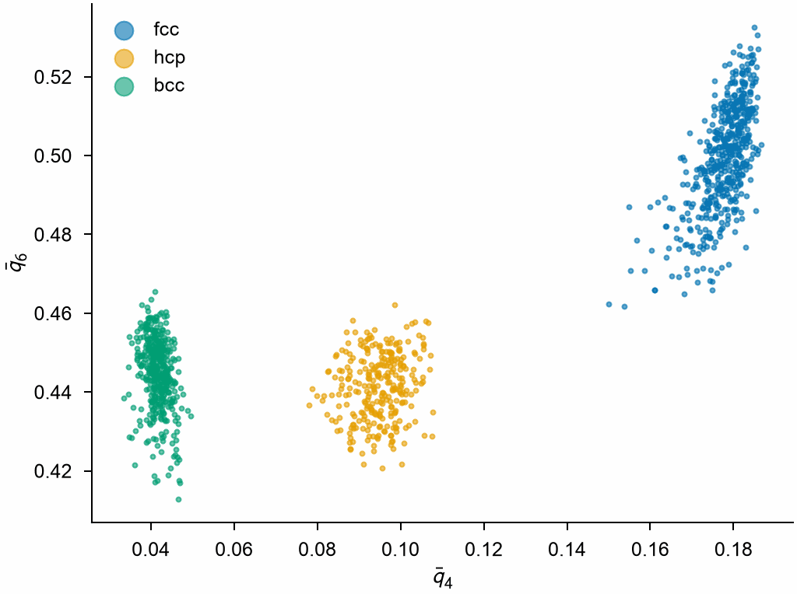
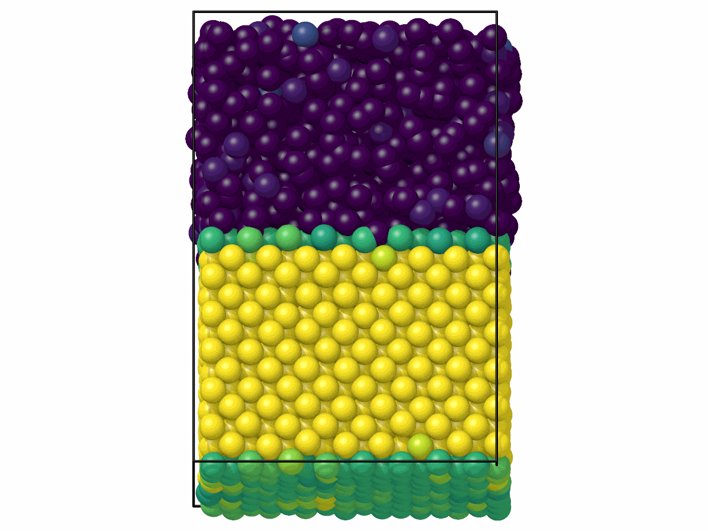

# Steinhardt parameters

`SteinhardtParameters` gives the bond-orientational order parameters $q_l$
of each atom, which tell crystals, liquids and glasses apart, plain or
averaged over the neighbors, with neighbors by number, by distance or by
Voronoi cell, optionally weighted by the areas of the Voronoi faces; with
`solid`, it also tells the solid-like atoms from the liquid-like ones by the
order their bonds share.

```python
import numpy as np

import mdapy as mp
from mdapy.analysis import SteinhardtParameters

# fcc copper of 3 x 3 x 3 cubic cells
a = 3.615
basis = np.array([[0, 0, 0], [0.5, 0.5, 0], [0.5, 0, 0.5], [0, 0.5, 0.5]])
cells = np.stack(np.meshgrid(*[np.arange(3)] * 3, indexing="ij"), -1).reshape(-1, 1, 3)
positions = ((cells + basis) * a).reshape(-1, 3)
system = mp.System(positions, mp.Box(3 * a), elements="Cu")

result = SteinhardtParameters(degrees=(4, 6), num_neighbors=12).compute(system)
result[6]  # q6 of each atom: 0.574524 in fcc
averaged = SteinhardtParameters(cutoff=3.0, average=True).compute(system)
weighted = SteinhardtParameters(voronoi=True, weighted=True).compute(system)
system = system.with_columns(result)  # columns q4 and q6
```

The averaged parameters tell the structures apart even when the atoms are
shaken by 0.15 Å:

```python
from mdapy.build import build_crystal
from mdapy.visualization import plot

rng = np.random.default_rng(0)
crystals = {
    "fcc": build_crystal("fcc", 3.615, elements="Cu", repeat=(5, 5, 5)),
    "hcp": build_crystal("hcp", 3.21, elements="Mg", repeat=(6, 6, 4)),
    "bcc": build_crystal("bcc", 2.87, elements="Fe", repeat=(6, 6, 6)),
}
with plot.style():
    fig, ax = plot.figure("single")
    for name, crystal in crystals.items():
        shaken = crystal.with_columns(
            positions=crystal["positions"] + rng.normal(0, 0.15, (len(crystal), 3))
        )
        neighbors = 14 if name == "bcc" else 12  # bcc: the first two shells
        q = SteinhardtParameters(
            degrees=(4, 6), num_neighbors=neighbors, average=True
        ).compute(shaken)
        ax.scatter(q[4], q[6], s=2, alpha=0.6, label=name)
    ax.set_xlabel(r"$\bar q_4$")
    ax.set_ylabel(r"$\bar q_6$")
    ax.legend(frameon=False, markerscale=4)
    plot.save(fig, "images/steinhardt", formats=("png",))
```



*Each atom of the three crystals as a point: fcc, hcp and bcc fall in
separate clouds, as in [Lechner and Dellago (2008)](../reference/references.md#lechner2008).*

With `solid`, each atom gets its number of solid-like bonds, those to
neighbors whose harmonics of degree 6 are nearly parallel to its own, and is
solid-like with at least 7: copper whose upper half is disordered like a
liquid, the lower half shaken as at a high temperature:

```python
from mdapy.visualization import render

melt = build_crystal("fcc", 3.615, elements="Cu", repeat=(8, 8, 12))
upper = melt["positions"][:, 2] > 22.0
shake = (
    rng.normal(0, 0.1, (len(melt), 3))
    + rng.normal(0, 0.6, (len(melt), 3)) * upper[:, None]
)
melt = melt.with_columns(positions=melt["positions"] + shake)

phases = SteinhardtParameters(solid=True).compute(melt)
phases.solid  # True for the solid-like atoms
phases.solid_bonds  # their solid-like bonds, of 12
melt = melt.with_columns(phases)  # columns q4, q6, solid and solid_bonds

side = [0, -1, 0.15]
render(
    melt,
    "images/steinhardt-solid.png",
    color=phases.solid_bonds,
    value_range=(0, 12),
    view=side,
)
```



*The solid-like bonds of each atom, from 0 (dark) to 12 (yellow): all 12 in
the crystal, few in the disordered half, a few layers in between at the
interfaces, the lower one across the periodic boundary.*

## Parameters

| Name | Type | Default | Unit | Meaning |
|---|---|---|---|---|
| `degrees` | sequence of int | (4, 6) | | the degrees $l$, from 0 to 20 |
| `num_neighbors` | int | `None` | | the number of nearest neighbors; 12 when neither it, `cutoff` nor `voronoi` is given |
| `cutoff` | float | `None` | Å | instead, the neighbors are closer than it |
| `voronoi` | bool | `False` | | instead, the neighbors share a face of the [Voronoi cell](voronoi.md) |
| `weighted` | bool | `False` | | with `voronoi`, weight each neighbor by the area of its face |
| `average` | bool | `False` | | average the $q_{lm}$ over the atom and its neighbors |
| `solid` | bool | `False` | | also count the solid-like bonds of each atom and tell the solid-like atoms |
| `solid_degree` | int | 6 | | with `solid`, the degree $l$ of the harmonics of the bonds |
| `bond_threshold` | float | 0.7 | | with `solid`, a bond is solid-like when the normalized product of the harmonics of its atoms exceeds it |
| `min_solid_bonds` | int | 7 | | with `solid`, an atom is solid-like with at least so many solid-like bonds |

`compute(system, *, neighbors=None, progress=None, cancel=None)` takes the
arguments of [every analysis](overview.md#parameters). A given neighbor list
must reach the cutoff, hold the `num_neighbors` nearest neighbors of every
atom, or, with `voronoi`, be a list of
[Voronoi neighbors](../getting-started/neighbor.md#voronoi-neighbors), whose
thresholds then choose the faces; without one, every face of a cell counts.
The walls of a box that is not periodic are not neighbors.

## Results

A `SteinhardtResult`:

| Attribute or method | Type | Meaning |
|---|---|---|
| `degrees` | tuple of int | the degrees |
| `q` | (N, degrees) float64 | $q_l$ of each atom, one column per degree; 0 for an atom without neighbors |
| `average` | bool | whether the parameters are averaged |
| `result[l]` | (N,) float64 | the parameter of degree $l$ |
| `solid_bonds` | (N,) int32 | with `solid`, the number of solid-like bonds of each atom; else `None` |
| `solid` | (N,) bool | with `solid`, whether each atom is solid-like; else `None` |

Its columns are `q4`, `q6`, …, or `q4_average`, … when averaged, and with
`solid` also `solid` and `solid_bonds`.

## Errors

The constructor raises `InvalidParameter` for a degree outside 0 to 20, more
than one of `num_neighbors`, `cutoff` and `voronoi`, either number not
positive, `weighted` without `voronoi`, a `solid_degree` that is not an
integer from 0 to 20, a `bond_threshold` outside −1 to 1, or a
`min_solid_bonds` that is not an integer of at least 0; `compute` raises it for a
neighbor list that does not fit or, with `voronoi`, two atoms at the same
position, and `result[l]` for a degree not computed.

## Definition

For the $N_b(i)$ neighbors $j$ of atom $i$, with $\hat{\mathbf r}_{ij}$ the
direction to $j$ and $Y_{lm}$ the spherical harmonics,

$$
q_{lm}(i) = \frac{1}{N_b(i)} \sum_{j} Y_{lm}(\hat{\mathbf r}_{ij}), \qquad
q_l(i) = \sqrt{\frac{4\pi}{2l + 1} \sum_{m=-l}^{l} \lvert q_{lm}(i) \rvert^2 } .
$$

With `weighted`, each neighbor counts by the area $A_{ij}$ of the face it
shares with atom $i$, so that a small face, which a tiny displacement can
create or remove, adds little:

$$
q_{lm}(i) = \frac{1}{\sum_j A_{ij}} \sum_{j} A_{ij}\, Y_{lm}(\hat{\mathbf r}_{ij}) .
$$

With `average`, the $q_{lm}$ of each atom are first averaged over the atom
and its neighbors, which separates crystal structures more sharply:

$$
\bar q_{lm}(i) = \frac{1}{N_b(i) + 1} \Big( q_{lm}(i) + \sum_{j} q_{lm}(j) \Big),
$$

and $\bar q_l$ is formed from them as $q_l$, the average itself unweighted.
Values for perfect lattices:

| Lattice | Neighbors | $q_4$ | $q_6$ |
|---|---|---|---|
| fcc | 12, or Voronoi | 0.190941 | 0.574524 |
| hcp | 12, or Voronoi | 0.097222 | 0.484762 |
| bcc | 8 | 0.509175 | 0.628539 |
| bcc | 14, or Voronoi | 0.036369 | 0.510688 |
| bcc | Voronoi, weighted | 0.224025 | 0.566940 |
| icosahedron | 12 | 0 | 0.663325 |

With `solid`, the bond between atom $i$ and its neighbor $j$ is solid-like
when the harmonics of the two atoms, of degree $l$ = `solid_degree`, point
alike:

$$
d_l(i, j) = \frac{\operatorname{Re} \sum_{m=-l}^{l} q_{lm}(i)\, q_{lm}(j)^*}
{\sqrt{\sum_m \lvert q_{lm}(i) \rvert^2} \sqrt{\sum_m \lvert q_{lm}(j) \rvert^2}}
> d_c ,
$$

$d_c$ = `bond_threshold`, from the plain $q_{lm}$ (not averaged), with the
neighbors and weights above; an atom with at least `min_solid_bonds` such
bonds is solid-like ([ten Wolde et al. 1996](../reference/references.md#tenwolde1996)).
For $l = 6$, $d_c = 0.7$ and 6 to 8 bonds suit fcc and bcc crystals
([Filion et al. 2010](../reference/references.md#filion2010)); in a perfect
crystal every bond is solid-like, $d_6 = 1$. An atom without neighbors has
no bonds.

## See also

- OVITO [Steinhardt parameters](https://docs.ovito.org/reference/pipelines/modifiers/steinhardt_parameters.html).
- LAMMPS [`compute orientorder/atom`](https://docs.lammps.org/compute_orientorder_atom.html).
- freud [`SolidLiquid`](https://freud.readthedocs.io/en/latest/modules/order.html#freud.order.SolidLiquid),
  the same solid-like bonds and atoms.

!!! quote "Please cite"
    [Steinhardt et al. (1983)](../reference/references.md#steinhardt1983); with `average`, also [Lechner and Dellago (2008)](../reference/references.md#lechner2008); with `weighted`, also [Mickel et al. (2013)](../reference/references.md#mickel2013); with `solid`, also [ten Wolde et al. (1996)](../reference/references.md#tenwolde1996).
