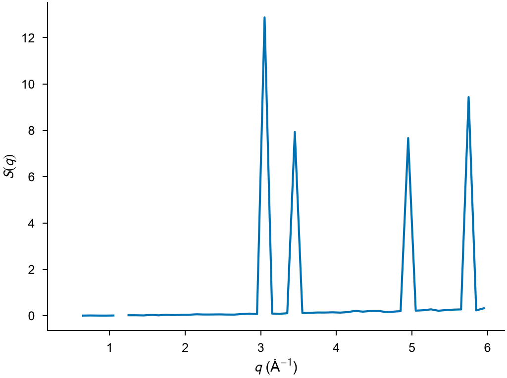
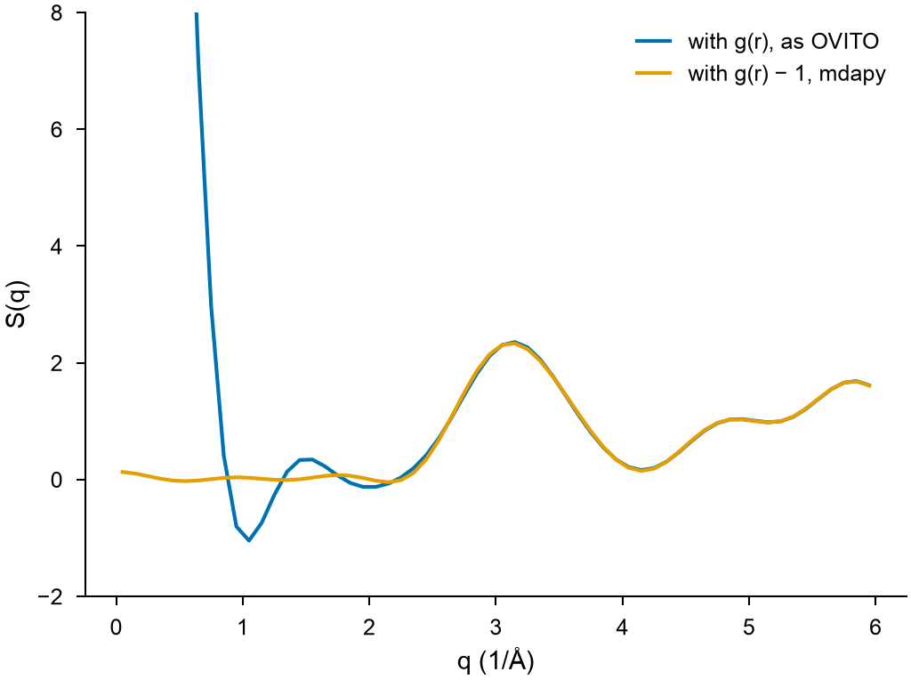

# Structure factor

`StructureFactor` gives the static structure factor S(q) of a periodic
system and its partial factors for each pair of elements, by the exact sum
over wave vectors or, for large systems, from the radial distribution
function.

```python
import numpy as np

import mdapy as mp
from mdapy.analysis import StructureFactor

# a random Cu-Ni alloy on a disordered fcc lattice of 4 x 4 x 4 cubic cells
a = 3.6
basis = np.array([[0, 0, 0], [0.5, 0.5, 0], [0.5, 0, 0.5], [0, 0.5, 0.5]])
cells = np.stack(np.meshgrid(*[np.arange(4)] * 3, indexing="ij"), -1).reshape(-1, 1, 3)
rng = np.random.default_rng(0)
positions = ((cells + basis) * a).reshape(-1, 3) + rng.normal(0, 0.1, (256, 3))
system = mp.System(
    positions, mp.Box(4 * a), elements=list(rng.choice(["Cu", "Ni"], 256))
)

direct = StructureFactor(q_max=6.0, bins=60).compute(system)
direct.q, direct.s  # bin centers in 1/Å and S(q)
direct.faber_ziman["Ni", "Cu"]  # a Faber-Ziman partial factor
debye = StructureFactor(q_max=6.0, bins=60, method="debye", r_max=7.2).compute(system)
```

```python
from mdapy.visualization import plot

with plot.style():
    fig, ax = plot.figure("single")
    plot.structure_factor(direct, ax=ax)
    plot.save(fig, "images/structure-factor", formats=("png",))
```



*The disordered alloy scatters at the (111), (200), (220) and (311)
reflections of fcc, $q = 2\pi\sqrt{h^2+k^2+l^2}/a$ = 3.02, 3.49, 4.94 and
5.79 Å⁻¹; between them $S(q)$ stays near zero.*

## Parameters

| Name | Type | Default | Unit | Meaning |
|---|---|---|---|---|
| `q_max` | float | | 1/Å | largest $\lvert \mathbf q \rvert$ |
| `bins` | int | 200 | | number of bins of equal width from 0 to `q_max` |
| `method` | str | `"direct"` | | `"direct"`, the sum over the wave vectors that fit the box, or `"debye"`, the transform of the radial distribution function |
| `r_max` | float | `None` | Å | with the Debye method, the largest distance of the radial distribution function; default half the length of the longest lattice vector |

`compute(system, *, neighbors=None, progress=None, cancel=None)` takes the
arguments of [every analysis](overview.md#parameters); the box must be
periodic in every direction. With the Debye method, a given neighbor list
must reach `r_max`. Partial factors need an `element` column.

The direct method costs the number of wave vectors, about $q_\text{max}^3 V
/ (12\pi^2)$ for a box of volume $V$, times the number of atoms. The Debye
method costs a radial distribution function up to `r_max`, which can be
chosen well below half the box for large systems.

## Results

A `StructureFactorResult`:

| Attribute or method | Type | Meaning |
|---|---|---|
| `q` | (bins,) float64 | bin centers in 1/Å |
| `edges` | (bins + 1,) float64 | bin edges in 1/Å |
| `s` | (bins,) float64 | S(q); with the direct method NaN in bins without wave vectors |
| `vectors` | (bins,) int64 or `None` | with the direct method, the number of wave vectors in each bin, one of each pair $\pm\mathbf q$ |
| `partial` | dict | $S_{ab}(q)$ of each pair of elements `(a, b)`, `a` not after `b` by atomic number |
| `faber_ziman` | dict | $A_{ab}(q)$, keyed as `partial` |
| `method` | str | `"direct"` or `"debye"` |
| `pair(a, b)` | (bins,) float64 | $S_{ab}(q)$, with `a` and `b` in either order |

## Errors

The constructor raises `InvalidParameter` for a `q_max` that is not
positive, fewer than one bin, an unknown method, or an `r_max` that is not
positive or given to the direct method; `compute` raises it for a box that
is not periodic in every direction, a neighbor list given to the direct
method or one that does not fit, and `pair` for a pair of elements without a
factor.

## Definition

With $\rho_a(\mathbf q) = \sum_{j \in a} e^{i\mathbf q \cdot \mathbf r_j}$
the density of element $a$ at wave vector $\mathbf q$ and $N$ the number of
atoms,

$$
S(\mathbf q) = \frac{1}{N} \Big| \sum_j e^{i\mathbf q \cdot \mathbf r_j} \Big|^2,
\qquad
S_{ab}(\mathbf q) = \frac{1}{N} \operatorname{Re}\big[\rho_a(\mathbf q)\, \rho_b(\mathbf q)^*\big],
$$

so that $S = \sum_a S_{aa} + 2 \sum_{a < b} S_{ab}$. The direct method
averages these over the wave vectors $\mathbf q = h\mathbf b_1 + k\mathbf
b_2 + l\mathbf b_3$ of the box, $\mathbf b$ its reciprocal vectors, in each
bin of $0 < |\mathbf q| \le q_\text{max}$. A perfect crystal gives $N$ at its
Bragg reflections and 0 elsewhere; an ideal gas gives 1.

The Debye method transforms the radial distribution function $g$ and its
partial functions $g_{ab}$, computed up to $r_\text{max}$ in bins of 0.01 Å,
with a window $w(r) = \sin(\pi r / r_\text{max}) / (\pi r / r_\text{max})$
against the ripples of the cutoff, at the number density $\rho = N / V$:

$$
S(q) = 1 + \frac{4\pi\rho}{q} \int_0^{r_\text{max}} r\, \big[g(r) - 1\big] \sin(qr)\, w(r)\, \mathrm dr ,
$$

and $A_{ab}(q)$ the same with $g_{ab}$. The integral is the sum over the
bins at their centers.

The Faber–Ziman partial factors, which tend to 1 at large $q$, and the
partial factors are related by

$$
A_{ab}(q) = \frac{S_{ab}(q) - x_a \delta_{ab}}{x_a x_b} + 1 ,
$$

with the fractions $x_a = N_a / N$; these are the conventions of OVITO.

## Why the results differ from OVITO

mdapy follows the definitions above. OVITO's structure factor modifier
(3.17.1) makes two other choices, so that its curves differ from those of
mdapy although the sums are the same: computed with OVITO's choices, mdapy
gives OVITO's numbers.

- **Direct method**: OVITO averages over the wave vectors with
  $h, k, l \ge 0$ only, an eighth of them. As $\mathbf q$ and
  $-\mathbf q$ give the same value, this leaves out the vectors of mixed
  signs, such as $(1, -1, 0)$. In a cubic crystal these are equivalent to
  vectors kept, but a family of equivalent vectors then counts by how many
  of its members have zero components; in a crystal of lower symmetry, a
  strained or textured one, or a small disordered system, they carry other
  values that OVITO's average misses. mdapy averages over every wave vector,
  one of each pair $\pm\mathbf q$.
- **Debye method**: OVITO transforms $g(r)$ rather than $g(r) - 1$. The
  difference,
  $\frac{4\pi\rho}{q} \int_0^{r_\text{max}} r \sin(qr)\, w(r)\, \mathrm dr$,
  is the transform of a uniform density inside $r_\text{max}$: it holds
  nothing of the structure, grows without bound as $q \to 0$ and decays
  with ripples at large $q$. mdapy leaves it out, so that $S(q)$ tends to 1
  at large $q$ and stays finite at small $q$.

The alloy above with both integrands:

```python
r_max = 7.2
r = (np.arange(720) + 0.5) * 0.01  # the bins of the radial distribution function
window = np.sinc(r / r_max)  # sin(πr/r_max) / (πr/r_max)
density = len(system) / system.box.volume
uniform = (
    4
    * np.pi
    * density
    / debye.q
    * (r * np.sin(np.outer(debye.q, r)) * window).sum(axis=1)
    * 0.01
)

with plot.style():
    fig, ax = plot.figure("single")
    ax.plot(debye.q, debye.s + uniform, label="with g(r), as OVITO")
    ax.plot(debye.q, debye.s, label="with g(r) − 1, mdapy")
    ax.set_xlabel("q (1/Å)")
    ax.set_ylabel("S(q)")
    ax.set_ylim(-2, 8)
    ax.legend()
    plot.save(fig, "images/structure-factor-ovito", formats=("png",))
```



*The Debye structure factor of the alloy from $g(r)$, as OVITO computes
it, and from $g(r) - 1$: the transform of the uniform density that sets
them apart dominates below 2 Å⁻¹; above, the two nearly agree.*

## See also

- OVITO [Structure factor](https://docs.ovito.org/reference/pipelines/modifiers/structure_factor.html).

!!! quote "Please cite"
    For the partial factors, [Faber and Ziman (1965)](../reference/references.md#faber1965).
