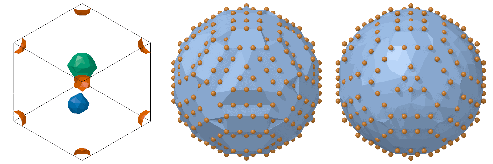

# Surface mesh

`SurfaceMesh` finds the surface of the solid the atoms make: the outside of
a particle, the two faces of a slab, the walls of the voids and pores in a
crystal. The surface is a mesh of triangles through the outer atoms, found
by the alpha-shape method: the space a probe sphere cannot enter is solid.
With `regions=True` the solid and the empty space are also split into
connected regions, among them the voids, with the volume and the area of
each.

```python
import numpy as np

from mdapy.analysis import SurfaceMesh
from mdapy.build import build_crystal

crystal = build_crystal("fcc", 3.615, elements="Cu", repeat=(14, 14, 14))
box = crystal.box
keep = np.ones(len(crystal), dtype=bool)
# voids of radius 7, 5 and 6 Å, the last around a corner of the box
for center, radius in [
    ((0.3, 0.3, 0.5), 7.0),
    ((0.7, 0.65, 0.4), 5.0),
    ((0, 0, 0), 6.0),
]:
    away = box.minimum_image(crystal["positions"] - np.array(center) @ box.matrix)
    keep &= np.linalg.norm(away, axis=1) > radius
system = crystal.filter(keep)

result = SurfaceMesh(radius=4.0, regions=True, surface=True).compute(system)
result.area  # Ų, 1504: the walls of the voids
result.solid_volume  # ų, 126360 of the 129631 of the box
regions = result.regions
voids = regions.voids  # the empty regions closed on every side: [1, 2, 3]
regions.volume[voids]  # ų, [1181, 598, 1492]
regions.area[voids]  # Ų, [536, 319, 649]
result.mesh  # TriangleMesh(166 vertices, 320 triangles, periodic)
system = system.with_columns(result)  # surface: the 166 atoms on it
```

A particle in a box that is not periodic is surrounded by the exterior, an
empty region without end:

```python
from mdapy import Box

block = build_crystal("fcc", 3.615, elements="Cu", repeat=(10, 10, 10))
middle = block.box.matrix.sum(axis=0) / 2
ball = block.filter(np.linalg.norm(block["positions"] - middle, axis=1) < 15)
particle = ball.with_box(Box(block.box.matrix, pbc=False))

outside = SurfaceMesh(regions=True).compute(particle)
outside.regions.exterior  # [True, False]: the space around, then the particle
outside.regions.volume  # ų, [inf, 12062]
outside.area  # Ų, 2570, through the centers of the outer atoms
```

The voids, each in its own color, the particle as it is and smoothed, drawn
by the [renderer](../visualization/rendering.md):

```python
from mdapy.visualization import render, write_png

colors = np.array([(0.84, 0.37, 0.0), (0.0, 0.45, 0.7), (0.0, 0.62, 0.45)])
empty = regions.faces[:, 1]  # the empty region on the outer side of each triangle
pictures = [
    render(
        system,
        atoms=np.zeros(len(system), dtype=bool),
        mesh=result.mesh,
        mesh_color=colors[np.searchsorted(voids, empty)],
        width=500,
        height=500,
    )
]
for smoothing in (0, 8):
    mesh = SurfaceMesh(smoothing=smoothing).compute(particle).mesh
    pictures.append(
        render(particle, radius=0.5, mesh=mesh, box=False, width=500, height=500)
    )
write_png("images/surface-mesh.png", np.hstack(pictures))
```



*Left: the three voids; the one around a corner of the box is cut by its
faces and seen in all eight corners. Middle: the surface of a copper
particle through the centers of its outer atoms, drawn small. Right: the
same surface after 8 smoothing steps.*

## Parameters

| Name | Type | Default | Unit | Meaning |
|---|---|---|---|---|
| `radius` | float | 4 | Å | radius of the probe sphere; larger than the distance between neighbors and smaller than the voids looked for |
| `smoothing` | int | 8 | | the number of smoothing steps of the mesh, which round its shape and leave the volumes as they are |
| `regions` | bool | `False` | | also split the solid and the empty space into regions, and find the voids |
| `surface` | bool | `False` | | also mark the atoms on the surface |

`compute(system, *, progress=None, cancel=None)` takes the `progress` and
`cancel` of [every analysis](overview.md#parameters), but no neighbor list.
No two atoms may be at the same position. Out of a box that is not periodic
is empty space.

A smaller probe fits into smaller gaps: a probe smaller than the distance
between neighbors sees the gaps between the atoms of a crystal as empty,
one as large as a void fills it. The volumes and the areas of the regions
do not depend on the smoothing; the area of the mesh does.

## Results

A `SurfaceMeshResult`:

| Attribute | Type | Meaning |
|---|---|---|
| `mesh` | `TriangleMesh` | the surface, its normals pointing out of the solid |
| `atoms` | (V,) int64 | the atom at each vertex of the mesh |
| `area` | float | the area of the surface in Ų |
| `solid_volume` | float | the volume of the solid in ų |
| `regions` | `SurfaceRegions` or `None` | the regions, with `regions=True` |
| `surface` | (N,) bool or `None` | whether each atom lies on the surface, with `surface=True`; its column `surface` |

A `SurfaceRegions`:

| Attribute | Type | Meaning |
|---|---|---|
| `solid` | (R,) bool | whether each region is solid |
| `volume` | (R,) float64 | the volume of each region in ų; infinite for the exterior |
| `area` | (R,) float64 | the area of the surface around each region in Ų |
| `exterior` | (R,) bool | whether the region is the empty space around the atoms, out of a box that is not periodic; the first region when there is one |
| `periodic` | (R,) bool | whether the region runs across a periodic boundary into its own image, without end, as the vacuum over a slab |
| `faces` | (F, 2) int64 | the solid and the empty region on the two sides of each triangle of the mesh |
| `voids` | (K,) int64 | the empty regions that are neither exterior nor periodic: closed by the solid on every side |

In a periodic box the volumes of the regions add up to that of the box.
OVITO also calls the vacuum over a slab a void; here it is `periodic` and
not among the `voids`.

### Triangle meshes

A `TriangleMesh`, also `mdapy.TriangleMesh`, holds any mesh of triangles,
across periodic boundaries too:

| Attribute or method | Type | Meaning |
|---|---|---|
| `vertices` | (V, 3) float64 | the positions of the vertices in Å |
| `faces` | (F, 3) int64 | the vertices of each triangle, counterclockwise seen from the side its normal points to |
| `shifts` | (F, 3, 3) int8 or `None` | the periodic image of each corner: corner k of triangle f is at `vertices[faces[f, k]] + shifts[f, k] @ box.matrix` |
| `box` | `Box` or `None` | the box of the periodic images |
| `corners()` | (F, 3, 3) float64 | the corners of each triangle in Å, each triangle whole |
| `areas` | (F,) float64 | the area of each triangle in Ų |
| `area` | float | their sum |
| `normals` | (F, 3) float64 | the unit normal of each triangle, zero for one without area |
| `pieces()` | (T, 3, 3) float64, (T,) int64 | the triangles cut at the periodic faces of the box and moved into it, and the triangle of each piece |

`TriangleMesh(vertices, faces, shifts=None, box=None)` makes one; like a
`Box` it cannot be changed. `render(system, mesh=...)` draws it as its
`pieces()`, with `mesh_color` one color or one per triangle and
`mesh_alpha` its opacity.

```python
mesh = result.mesh
corners = mesh.corners()  # (F, 3, 3) Å, each triangle whole
mesh.normals  # (F, 3) out of the solid: into the voids
pieces, triangle = mesh.pieces()  # in the box, for drawing elsewhere
```

## Errors

The constructor raises `InvalidParameter` for a `radius` that is not
positive and a `smoothing` that is not an integer of at least 0; `compute`
raises it for a periodic box so short that an atom meets its own periodic
image across a cell of the tessellation (replicate the system first).
`TriangleMesh` raises it for arrays of the wrong shape, vertices that are
not finite, faces of vertices that do not exist, and shifts without a box.

## Definition

The atoms, periodic images included, are divided into the tetrahedra of
their Delaunay tessellation: no atom lies inside the sphere through the
four corners of a tetrahedron. A tetrahedron is solid when the radius $R$
of that sphere is smaller than the probe radius $r$,

$$
R < r ,
$$

the others and the space outside the tessellation empty: the alpha shape
of the atoms. The surface is made of the faces between a solid and an empty
tetrahedron, turned so that their normals point to the empty side; its
vertices are the atoms on it. The volume of the solid is that of its
tetrahedra. Solid tetrahedra that share faces make a region, and so do
empty ones; a region that meets itself in another periodic image runs
without end.

Smoothing moves every vertex $\mathbf x$ toward the mean of its $n$
neighbors along the edges of the mesh,

$$
\mathbf x \leftarrow \mathbf x + \frac{\lambda}{n} \sum_{k=1}^{n}
(\mathbf x_k - \mathbf x) ,
$$

once with $\lambda = 0.5$ and once with $\mu = 1/(0.1 - 1/\lambda) \approx
-0.53$ per step, which rounds the mesh without shrinking it (Taubin), with
the factors OVITO takes.

The tessellation of a perfect crystal is not unique: four atoms of a square
can be split into two triangles along either diagonal. The atoms are moved
at random by up to $10^{-4}$ Å first, always the same way, which settles
each such choice. The area and the volumes are those of either choice; the
smoothed mesh can differ from OVITO's where OVITO chose otherwise, and is
the same as OVITO's when the atoms are not on a perfect lattice.

!!! quote "Please cite"
    [Edelsbrunner and Mücke (1994)](../reference/references.md#edelsbrunner1994)
    and [Stukowski (2014)](../reference/references.md#stukowski2014); with
    smoothing [Taubin (1995)](../reference/references.md#taubin1995).

## See also

- OVITO [Construct surface mesh](https://docs.ovito.org/reference/pipelines/modifiers/construct_surface_mesh.html),
  the same with its alpha-shape method.
- [Voronoi analysis](voronoi.md) for the empty space around single atoms,
  and [cluster analysis](clusters.md) for groups of atoms.
