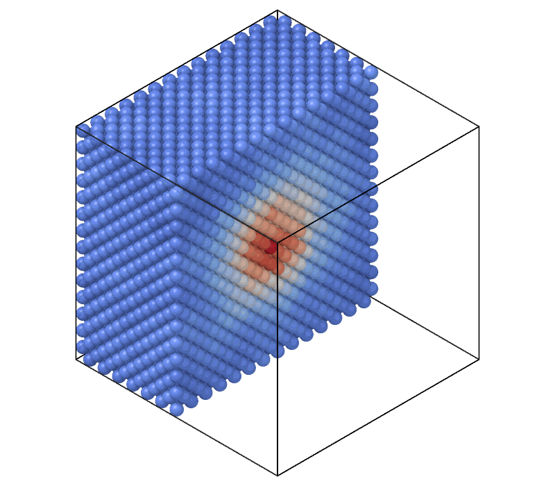

# Atomic temperature

`AtomicTemperature` gives each atom the temperature of the group formed by
the atom and its neighbors, from their velocities relative to the group's
center of mass; it shows hot spots, for example around a collision cascade
or a moving crack.

```python
import numpy as np

import mdapy as mp
from mdapy import units
from mdapy.analysis import AtomicTemperature

# an fcc Cu crystal of 6 x 6 x 6 cubic cells with velocities at 300 K
a = 3.615
cells = np.stack(np.meshgrid(*[np.arange(6)] * 3, indexing="ij"), -1).reshape(-1, 1, 3)
basis = np.array([[0, 0, 0], [0.5, 0.5, 0], [0.5, 0, 0.5], [0, 0.5, 0.5]])
positions = ((cells + basis) * a).reshape(-1, 3)
mass = 63.546  # amu
spread = np.sqrt(units.BOLTZMANN * 300 / (mass * units.AMU_A2_PER_PS2_TO_EV))
velocities = np.random.default_rng(0).normal(scale=spread, size=positions.shape)
system = mp.System(positions, mp.Box(6 * a), elements="Cu")
system = system.with_columns(velocities=velocities)  # Å/ps

result = AtomicTemperature(cutoff=3.0).compute(system)
result.temperature.mean()  # about 300 K
system = system.with_columns(result)  # the column 'temperature'
```

A thermal spike: atoms near the middle of a larger crystal move as if at
2300 K, the others at 300 K:

```python
from mdapy.build import build_crystal
from mdapy.visualization import render

crystal = build_crystal("fcc", a, elements="Cu", repeat=(14, 14, 14))
x = crystal["positions"] - crystal.box.matrix.diagonal() / 2
kelvin = 300 + 2000 * np.exp(-(x**2).sum(axis=1) / (2 * 8.0**2))
spread = np.sqrt(units.BOLTZMANN * kelvin / (mass * units.AMU_A2_PER_PS2_TO_EV))
rng = np.random.default_rng(1)
spike = crystal.with_columns(velocities=rng.normal(size=x.shape) * spread[:, None])

local = AtomicTemperature(cutoff=5.0).compute(spike).temperature
render(spike, "images/temperature.png", atoms=x[:, 1] < 0, color=local, colormap="coolwarm",
       value_range=(0, 2400), width=800, height=700)  # fmt: skip
```



*The crystal cut through the middle: the temperature averaged over the
neighbors within 5 Å, from 300 K (blue) to about 2000 K in the core (red).*

## Parameters

| Name | Type | Default | Unit | Meaning |
|---|---|---|---|---|
| `cutoff` | float | | Å | the neighbors closer than it form the group of an atom |

`compute(system, *, neighbors=None, progress=None, cancel=None)` takes the
arguments of [every analysis](overview.md#parameters). A given neighbor list
must reach `cutoff`; without one, the neighbors are found and used at once,
never stored. The system needs the `velocities` in Å/ps and the `mass`
column in amu, else an `element` column for the standard atomic weights.

## Results

A `TemperatureResult`:

| Attribute | Type | Meaning |
|---|---|---|
| `temperature` | (N,) float64 | the temperature in K of each atom and its neighbors; NaN for an atom without neighbors; its column `temperature` |

## Errors

The constructor raises `InvalidParameter` for a cutoff that is not positive;
`compute` raises it for a neighbor list that does not fit, and
`MissingProperty` without `velocities` or without both `mass` and `element`.

## Definition

For the group $G_i$ of atom $i$ and its neighbors closer than the cutoff,
$n_i$ atoms with masses $m_j$ and velocities $\mathbf v_j$,

$$
T_i = \frac{1}{3(n_i - 1)\, k_B} \sum_{j \in G_i} m_j
\lvert \mathbf v_j - \bar{\mathbf v}_i \rvert^2 ,
\qquad
\bar{\mathbf v}_i = \frac{\sum_{j \in G_i} m_j \mathbf v_j}{\sum_{j \in G_i} m_j} .
$$

Removing the motion of the center of mass takes three of the $3 n_i$
degrees of freedom, so that a group in equilibrium at a temperature $T$ has
$T_i = T$ on average and a uniform drift of the atoms changes nothing.
Periodic images of the atom itself are not counted.
