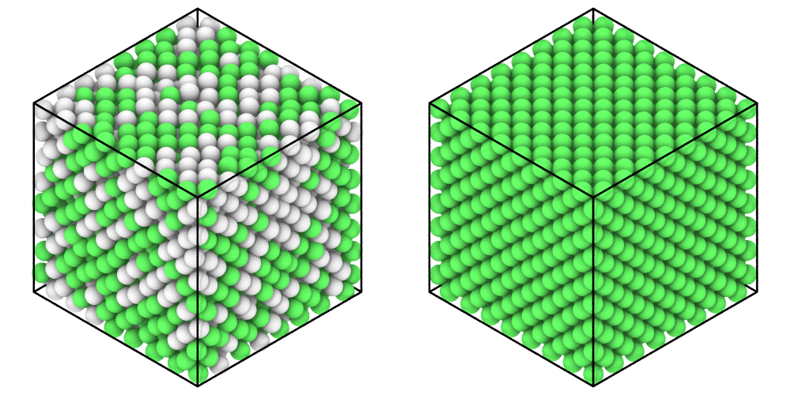

# Time averages

`TimeAverage` gives the mean of a quantity over the frames of a trajectory:
a column of the atoms, such as their positions, the box, or anything a
function computes from a frame, such as a radial distribution function, as
OVITO's time averaging does. Averaged positions take the thermal vibrations
out of a crystal, so that its structure shows clearly.

```python
import numpy as np

import mdapy as mp
from mdapy.analysis import RadialDistributionFunction, TimeAverage
from mdapy.build import build_crystal
from mdapy.identify import CommonNeighborAnalysis

# copper whose atoms vibrate about their sites, 0.18 Å along each axis
copper = build_crystal("fcc", 3.615, elements="Cu", repeat=(8, 8, 8))
copper = copper.with_columns(id=np.arange(1, len(copper) + 1))
rng = np.random.default_rng(0)
frames = [
    copper.with_columns(
        positions=copper["positions"] + rng.normal(0, 0.18, (len(copper), 3))
    )
    for _ in range(20)
]

positions = TimeAverage("positions").compute(frames)  # (N, 3)
averaged = frames[0].with_columns(positions=positions.value)
rdf = TimeAverage(lambda f: RadialDistributionFunction(6.0).compute(f).g)
mean_g = rdf.compute(frames).value  # the mean g(r) over the frames
```

The common neighbor analysis of one frame and of the averaged positions:

```python
from mdapy.visualization import render, write_png

cna = CommonNeighborAnalysis()
one, mean = cna.compute(frames[0]), cna.compute(averaged)
options = dict(view="iso", width=500, height=500)
write_png(
    "images/time-average.png",
    np.hstack(
        [
            render(frames[0], color=one, **options),
            render(averaged, color=mean, **options),
        ]
    ),
)
```



*Left: one frame, in which the vibrations leave half of the atoms
unrecognized (white) among the fcc atoms (green). Right: the positions
averaged over 20 frames, all fcc.*

## Parameters

`TimeAverage(quantity, *, unwrap=True)`

| Name | Type | Default | Unit | Meaning |
|---|---|---|---|---|
| `quantity` | str or callable | | | a column of numbers of the atoms, such as `"positions"` or `"csp"`; `"box"` for the lattice vectors; or a function of a frame that gives a number, or an array of the same shape in every frame |
| `unwrap` | bool | `True` | | for positions: follow the atoms through the periodic boundaries, or average the positions as they are |

`compute(frames)` takes an iterable of systems, such as a
[`Trajectory`](../getting-started/trajectory.md) or a slice of one, read one
at a time. For a column the atoms are matched by their ids, as for the
[mean squared displacement](msd.md#parameters), and positions are unwrapped
in the same way: by the image flags, or else through the nearest periodic
image of each step. OVITO's time averaging instead takes the atoms in the
order they come and needs the positions unwrapped beforehand.

## Results

A `TimeAverageResult`:

| Attribute | Type | Meaning |
|---|---|---|
| `value` | float64 | the mean: of each atom in the order of the first frame for a column, (3, 3) for the box, of the shape of the function otherwise |
| `frames` | int | the number of frames |
| `name` | str or `None` | the column; `system.with_columns(result)` adds `name_average`, a component such as `positions.z` written `positions_z_average` |

## Errors

`compute` raises `InvalidParameter` when there are no frames, as the
[mean squared displacement](msd.md#errors) does for frames of other atoms,
for a column that is not numbers, and when a function gives another shape
in a later frame; `MissingProperty` for a column a frame lacks.
`TimeAverage` raises `InvalidParameter` for a quantity that is neither a
name nor a function.
