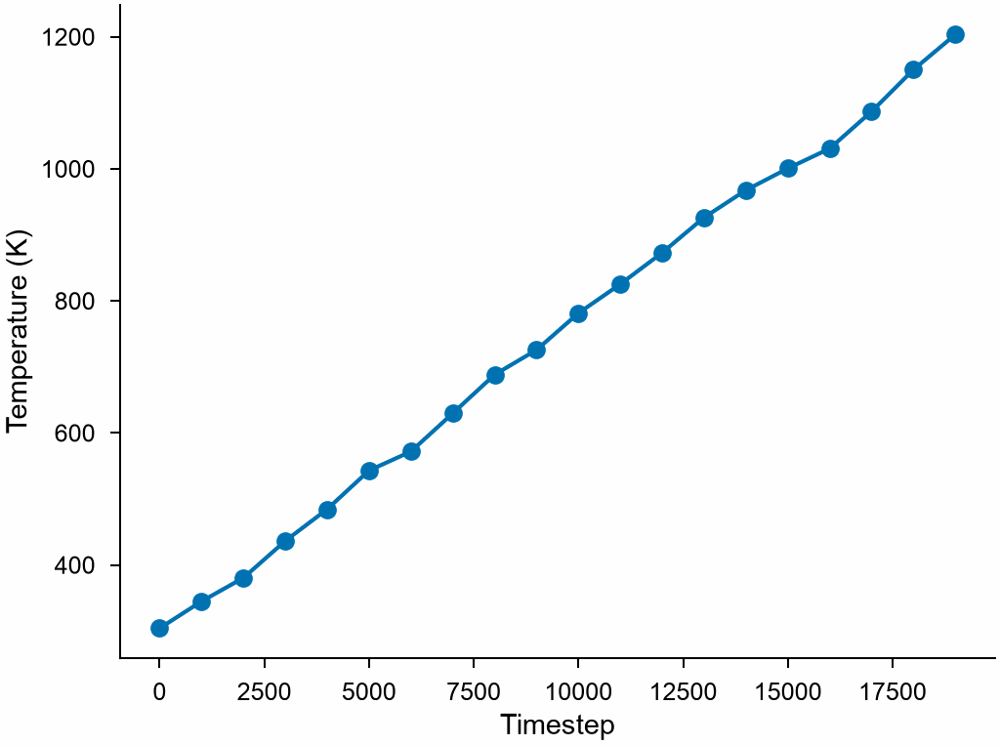

# Time series

`TimeSeries` gives a quantity in every frame of a trajectory, as OVITO's
time series: a column of the atoms reduced to one number in each frame, as
[`reduce`](reduce.md) does, or anything a function computes from a frame.

```python
import numpy as np

import mdapy as mp
from mdapy.analysis import TimeSeries
from mdapy.build import build_crystal

# copper heated from 300 K to 1200 K over 20 frames 1000 steps apart:
# velocities in Å/ps of the Maxwell-Boltzmann distribution of each temperature
copper = build_crystal("fcc", 3.615, elements="Cu", repeat=(8, 8, 8))
mass, kB, unit = 63.546, 8.617333e-5, 1.0364269e-4  # amu, eV/K, amu Ų/ps² per eV
rng = np.random.default_rng(3)
frames = []
for k, T in enumerate(np.linspace(300, 1200, 20)):
    sigma = np.sqrt(kB * T / mass / unit)
    v = rng.normal(0, sigma, (len(copper), 3))
    frames.append(copper.with_columns(velocities=v).with_info(timestep=1000 * k))


def temperature(frame):
    """The kinetic temperature in K of a frame."""
    v2 = (frame["velocities"] ** 2).sum(axis=1).mean()
    return mass * unit * v2 / (3 * kB)


spread = TimeSeries("velocities.x", "std").compute(frames)
heated = TimeSeries(temperature).compute(frames)
heated.timestep, heated.values  # (20,) each
```

The temperature of each frame:

```python
from mdapy.visualization import plot

with plot.style():
    fig, ax = plot.figure("single")
    ax.plot(heated.timestep, heated.values, "o-")
    ax.set_xlabel("Timestep")
    ax.set_ylabel("Temperature (K)")
    plot.save(fig, "images/time-series", formats=("png",))
```



*The kinetic temperature of the 2048 atoms follows the ramp from 300 K to
1200 K, within the spread of a sample of that size.*

## Parameters

`TimeSeries(quantity, operation="mean")`

| Name | Type | Default | Meaning |
|---|---|---|---|
| `quantity` | str or callable | | a column of numbers, a component such as `"positions.z"` or an expression over the columns, reduced by `operation` in each frame; or a function of a frame that gives a number, or an array of the same shape in every frame |
| `operation` | str | `"mean"` | for a column, one of the [operations of `reduce`](reduce.md#parameters) |

`compute(frames)` takes an iterable of systems, such as a
[`Trajectory`](../getting-started/trajectory.md) or a slice of one, read one
at a time; `trajectory[::10]` takes every tenth frame.

## Results

A `TimeSeriesResult`:

| Attribute | Type | Meaning |
|---|---|---|
| `frame` | (F,) int64 | the place of each frame among those given, from 0 |
| `values` | (F,) or (F, k) float64 | the quantity in each frame; one column per component or value |
| `timestep` | (F,) int64 or None | the timestep of each frame, where every frame has one in its information |
| `name` | str or None | the column; None for a function |

## Errors

The constructor raises `InvalidParameter` for a quantity that is neither a
column name nor a function, or an unknown operation; `compute` raises it
without frames, for a function whose result changes its shape, and as
`reduce` does.

## See also

- [Time averages](time-average.md): the mean over the frames.
- OVITO [Time series](https://docs.ovito.org/reference/pipelines/modifiers/time_series.html).
