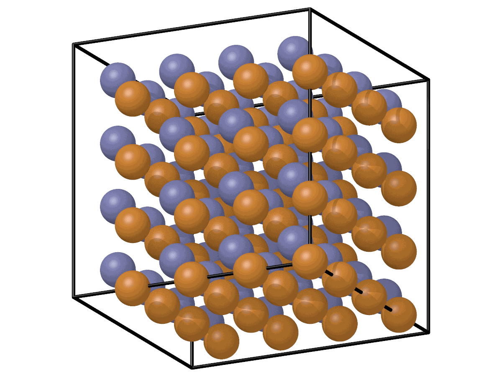
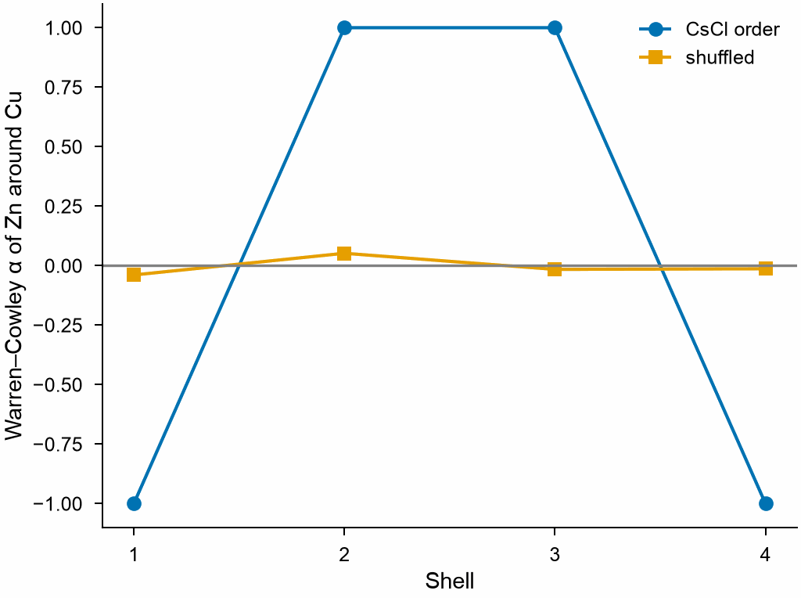

# Warren–Cowley parameters

`WarrenCowley` measures the chemical short-range order of an alloy: whether
the neighbors of each element are richer or poorer in another element than
the alloy as a whole, among the nearest neighbors or shell by shell.

```python
import numpy as np

import mdapy as mp
from mdapy.analysis import WarrenCowley

# a CsCl-ordered CuZn crystal of 4 x 4 x 4 cubic cells
a = 2.95
basis = np.array([[0, 0, 0], [0.5, 0.5, 0.5]])
cells = np.stack(np.meshgrid(*[np.arange(4)] * 3, indexing="ij"), -1).reshape(-1, 1, 3)
positions = ((cells + basis) * a).reshape(-1, 3)
system = mp.System(positions, mp.Box(4 * a), elements=["Cu", "Zn"] * 64)

order = WarrenCowley(num_neighbors=8).compute(system)
order["Cu", "Zn"]  # -1: every neighbor of Cu is Zn
order.alpha  # rows and columns by atomic number

# shells: the 8 nearest, then the 6 next; or between cutoffs
shells = WarrenCowley(num_neighbors=(8, 6)).compute(system)
shells["Cu", "Zn"]  # [-1, 1]: Zn around Cu, then Cu
shells["Cu", "Zn", 1]  # 1.0, the second shell only
shells.alpha.shape  # (2, 2, 2): shell, row, column
same = WarrenCowley(cutoff=(2.7, 3.3)).compute(system)
```

The ordered crystal against the same atoms with their elements shuffled,
over the first four shells of the bcc lattice:

```python
from mdapy.visualization import plot, render

render(system, "images/warren-cowley-b2.png", radius=0.8, view=[1, 0.5, 0.35])

rng = np.random.default_rng(1)
shuffled = system.with_columns(element=rng.permutation(system["element"]))
shells = (8, 6, 12, 24)
ordered = WarrenCowley(num_neighbors=shells).compute(system)
random = WarrenCowley(num_neighbors=shells).compute(shuffled)

with plot.style():
    fig, ax = plot.figure("single")
    k = np.arange(1, 5)
    ax.plot(k, ordered["Cu", "Zn"], "o-", label="CsCl order")
    ax.plot(k, random["Cu", "Zn"], "s-", label="shuffled")
    ax.axhline(0, color="0.5", linewidth=0.8)
    ax.set_xticks(k)
    ax.set_xlabel("Shell")
    ax.set_ylabel("Warren–Cowley α of Zn around Cu")
    ax.legend()
    plot.save(fig, "images/warren-cowley", formats=("png",))
```

{ width="38%" }
{ width="60%" }

*Left: CuZn in the CsCl order, Cu orange and Zn blue. Right: the order of Zn
around Cu shell by shell, −1 for a shell of Zn only and 1 for one of Cu
only; with the elements shuffled it stays near 0.*

## Parameters

| Name | Type | Default | Unit | Meaning |
|---|---|---|---|---|
| `cutoff` | float or sequence | `None` | Å | neighbors are closer than it; increasing cutoffs make shells, each from the cutoff before it to its own |
| `num_neighbors` | int or sequence | `None` | | instead of `cutoff`, the number of nearest neighbors; a sequence makes shells of so many nearest neighbors one after the other, such as (12, 6, 24) in fcc |

`compute(system, *, neighbors=None, progress=None, cancel=None)` takes the
arguments of [every analysis](overview.md#parameters); the system needs an
`element` column. A given neighbor list must reach the cutoff or hold the
`num_neighbors` nearest neighbors of every atom.

## Results

A `WarrenCowleyResult`:

| Attribute or method | Type | Meaning |
|---|---|---|
| `elements` | tuple of str | the elements, by atomic number |
| `alpha` | (n, n) float64 | $\alpha_{ab}$, row $a$ and column $b$; NaN for an element whose atoms have no neighbors; (shells, n, n) for shells |
| `result[a, b]` | float | one parameter; an array over the shells for shells |
| `result[a, b, shell]` | float | the parameter of one shell |

## Errors

The constructor raises `InvalidParameter` without exactly one of `cutoff`
and `num_neighbors`, for one that is not positive, cutoffs that do not
increase, or numbers of neighbors that are not integers; `compute` raises it
for a neighbor list that does not fit, and `MissingProperty` without an
`element` column; `result[a, b]` raises `InvalidParameter` for an element
not in the system, and `result[a, b, shell]` for parameters of one shell.

## Definition

$$
\alpha_{ab} = 1 - \frac{p(b \mid a)}{x_b},
$$

where $p(b \mid a)$ is the fraction of atoms of element $b$ among the
neighbors of all atoms of element $a$, and $x_b$ the fraction of $b$ in the
system; in a shell, the neighbors are those of the shell. It is 0 for a
random alloy, negative for pairs that attract each
other and positive for pairs that avoid each other; in the CsCl structure
with 8 neighbors, $\alpha_{ab} = -1$ between unlike and 1 between like
elements.

!!! quote "Please cite"
    [Cowley (1950)](../reference/references.md#cowley1950).
