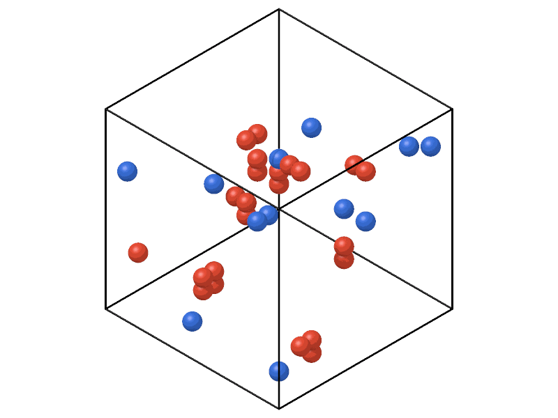

# Wigner–Seitz analysis

`WignerSeitz` finds vacancies and interstitials: each atom belongs to the
Wigner–Seitz cell of its nearest site of a reference lattice, and the
occupancy of the sites shows the defects.

```python
import numpy as np

import mdapy as mp
from mdapy.analysis import WignerSeitz

# perfect fcc copper of 4 x 4 x 4 cubic cells as the reference
a = 3.615
basis = np.array([[0, 0, 0], [0.5, 0.5, 0], [0.5, 0, 0.5], [0, 0.5, 0.5]])
cells = np.stack(np.meshgrid(*[np.arange(4)] * 3, indexing="ij"), -1).reshape(-1, 1, 3)
sites = ((cells + basis) * a).reshape(-1, 3)
reference = mp.System(sites, mp.Box(4 * a), elements="Cu")

# the crystal after a Frenkel pair: atom 0 moved to an octahedral site
moved = sites.copy()
moved[0] = [0.5 * a, 0.5 * a, 0.5 * a]
current = mp.System(moved, mp.Box(4 * a), elements="Cu")

analysis = WignerSeitz(reference)  # the reference sites are prepared once
result = analysis.compute(current)
result.vacancy_count, result.interstitial_count  # 1, 1
result.vacancies  # the empty site, 0
current = current.with_columns(result)  # columns site and occupancy
```

Twelve Frenkel pairs in a larger crystal, the vacancies and the doubly
occupied sites drawn alone:

```python
from mdapy.build import build_crystal
from mdapy.visualization import render

reference = build_crystal("fcc", a, elements="Cu", repeat=(8, 8, 8))
rng = np.random.default_rng(5)
moved = reference["positions"].copy()
chosen = rng.choice(len(reference), 12, replace=False)
moved[chosen] = (moved[chosen] + a * (rng.integers(0, 6, (12, 3)) + 0.5)) % (8 * a)
current = reference.with_columns(positions=moved)

result = WignerSeitz(reference).compute(current)
occupancy = current.with_columns(result)["occupancy"]
vacancies = reference["positions"][result.vacancies]
crowded = current["positions"][occupancy > 1]
defects = mp.System(np.vstack([vacancies, crowded]), reference.box)
colors = [[0.23, 0.44, 0.85]] * len(vacancies) + [[0.88, 0.29, 0.2]] * len(crowded)
render(
    defects,
    "images/wigner-seitz.png",
    color=np.array(colors),
    radius=1.2,
    width=800,
    height=600,
)
```



*Blue: the 12 empty sites. Red: the 24 atoms of the 12 sites that hold two,
each moved atom with the atom of the site it landed in.*

## Parameters

| Name | Type | Default | Unit | Meaning |
|---|---|---|---|---|
| `reference` | `System` | | | the reference sites, usually the perfect crystal |
| `affine` | bool | `False` | | map the atoms into the reference box by their fractional coordinates first, which removes a homogeneous deformation of the box |

`compute(system, *, progress=None, cancel=None)` takes the configuration to
analyse, in a box with the periodicity of the reference; its atoms need not
be those of the reference, nor as many.

## Results

A `WignerSeitzResult`:

| Attribute | Type | Meaning |
|---|---|---|
| `site` | (N,) `index_dtype` | the reference site of each atom; its column `site` |
| `occupancy` | (sites,) int64 | the number of atoms on each reference site; the column `occupancy` holds that of each atom's site |
| `vacancies` | int64 array | the sites without atoms |
| `interstitials` | int64 array | the sites with more than one atom |
| `vacancy_count` | int | the number of sites without atoms |
| `interstitial_count` | int | the number of atoms beyond one on each site |

The number of atoms less the number of sites is `interstitial_count` less
`vacancy_count`.

## Errors

The constructor raises `InvalidParameter` for a reference without atoms;
`compute` raises it for a system whose periodic directions differ from the
reference's.

## Definition

Each atom belongs to the reference site nearest to it, periodic images
included; of equally near sites, to the one of lower index. With `affine`,
the fractional coordinates of the atom in its own box are first taken as
fractional coordinates in the reference box. Without it, a box stretched by
10 % puts atoms near its far side on wrong sites.

## See also

- OVITO [Wigner–Seitz defect analysis](https://docs.ovito.org/reference/pipelines/modifiers/wigner_seitz_analysis.html).

!!! quote "Please cite"
    [Nordlund et al. (1998)](../reference/references.md#nordlund1998).
