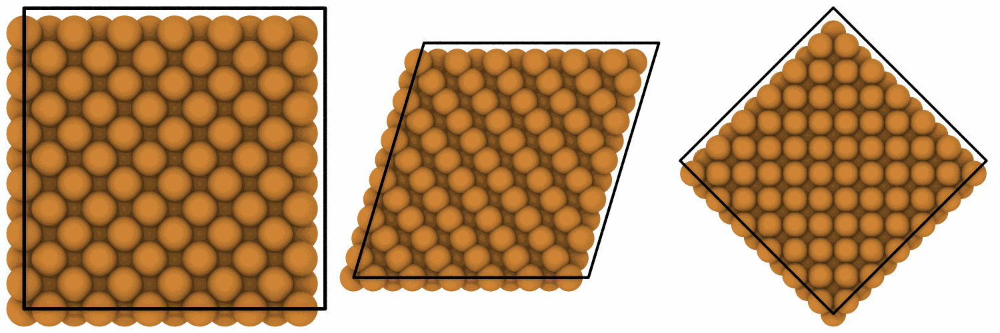

# Affine transformation

`mdapy.transform.affine` moves, rotates, shears or scales a system: its
atoms, the vectors they carry and its box, as OVITO's affine transformation
modifier does.

```python
import numpy as np

from mdapy.build import build_crystal
from mdapy.transform import affine

crystal = build_crystal("fcc", 3.615, elements="Cu", repeat=(6, 6, 6))
shear = [[1.0, 0.3, 0.0], [0.0, 1.0, 0.0], [0.0, 0.0, 1.0]]
sheared = affine(crystal, shear)  # x gains 0.3 y; the box shears with the atoms
angle = np.radians(45)
turn = [
    [np.cos(angle), -np.sin(angle), 0],
    [np.sin(angle), np.cos(angle), 0],
    [0, 0, 1],
]
turned = affine(crystal, turn, translation=(10.0, 0.0, 0.0))  # about z, then moved
top = crystal["positions"][:, 2] > 10
moved = affine(crystal, np.eye(3), (0.0, 0.0, 3.0), box=False, selection=top)
```

The crystal, sheared and turned:

```python
from mdapy.visualization import render, write_png

pictures = [
    render(system, width=500, height=500, view="top")
    for system in (crystal, sheared, turned)
]
write_png("images/affine.png", np.hstack(pictures))
```



*Copper seen along z: as built, sheared by 0.3 in x along y, and turned by
45° about z; the box follows the atoms.*

## Parameters

`affine(system, matrix, translation=(0, 0, 0), *, box=True, vectors=("velocities", "forces", "displacement"), selection=None)`

| Name | Type | Default | Unit | Meaning |
|---|---|---|---|---|
| `system` | `System` | | | the system to transform |
| `matrix` | (3, 3) | | | the linear part $M$, acting on Cartesian column vectors |
| `translation` | (3,) | zero | Å | the translation $\mathbf t$ |
| `box` | bool | `True` | | whether the box transforms too |
| `vectors` | sequence of str | `velocities`, `forces`, `displacement` | | the columns of vectors that turn with $M$, where the system has them |
| `selection` | (N,) bool | all atoms | | the atoms that move, with their vectors |

## Results

A new `System`:

- each position $\mathbf x$ of the atoms that move becomes
  $M\mathbf x + \mathbf t$;
- each vector $\mathbf v$ of the columns in `vectors` becomes $M\mathbf v$,
  without the translation;
- with `box`, the lattice vectors become $M\mathbf a$, $M\mathbf b$ and
  $M\mathbf c$ and the origin $M\mathbf o + \mathbf t$, whatever the
  selection, so the fractional coordinates of the atoms that move stay the
  same and their image flags still count the same lattice vectors;
- the other columns, the topology and `info` are kept.

The transformation of a box to a given shape, the atoms keeping their
fractional coordinates, is `system.with_box(box, scale_positions=True)`.

## Errors

`affine` raises
[`InvalidParameter`](../reference/api.md#mdapy.errors.InvalidParameter) for
a matrix that is not (3, 3) of finite numbers, a singular matrix while the
box transforms, a translation that is not three finite numbers, a selection
that is not one bool per atom, and a column of `vectors` that does not hold
three numbers per atom.

## See also

- OVITO's [affine transformation](https://www.ovito.org/manual/reference/pipelines/modifiers/affine_transformation.html).
- [Periodic copies and images](transform.md).
