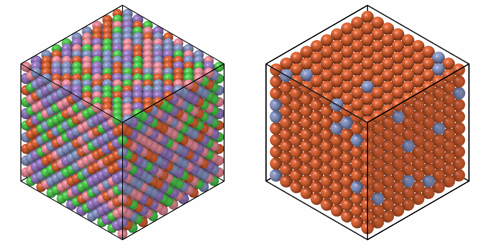

# Random alloys

`random_alloy` gives the atoms of a system elements drawn at random in
given fractions, with exact counts, for example a high-entropy alloy on a
crystal.

```python
from mdapy.build import build_crystal, random_alloy

sites = build_crystal("fcc", 3.6, repeat=(10, 10, 10))
cantor = random_alloy(sites, {"Co": 1, "Cr": 1, "Fe": 1, "Mn": 1, "Ni": 1}, seed=1)
steel = random_alloy(
    build_crystal("bcc", 2.87, repeat=(10, 10, 10)), {"Fe": 0.9, "Cr": 0.1}, seed=2
)
```

```python
import numpy as np

from mdapy.visualization import render, write_png

left = render(cantor, width=600, height=600)
right = render(steel, width=600, height=600)
write_png("images/alloys.png", np.hstack([left, right]))
```



*Left: the Cantor alloy CoCrFeMnNi on fcc sites, one fifth of each element.
Right: Fe-10Cr on bcc sites, chromium in grey-blue.*

## Parameters

`random_alloy(system, fractions, *, seed=None)`

| Name | Type | Default | Meaning |
|---|---|---|---|
| `system` | `System` | | the sites, such as a crystal from [`build_crystal`](crystals.md) |
| `fractions` | dict of str to float | | the fraction of each element, positive; they are normalized to sum to 1 |
| `seed` | int or `numpy.random.Generator` | `None` | the random order; the same seed gives the same alloy |

## Results

The system with a new `element` column and everything else unchanged. Each
element has its fraction of the atoms rounded down, and the atoms left over
go to the largest remainders, ties to the element named first: 500 atoms in
three equal fractions are 167, 167 and 166.

## Errors

`random_alloy` raises `InvalidParameter` without fractions, for an unknown
element or for a fraction that is not positive.
