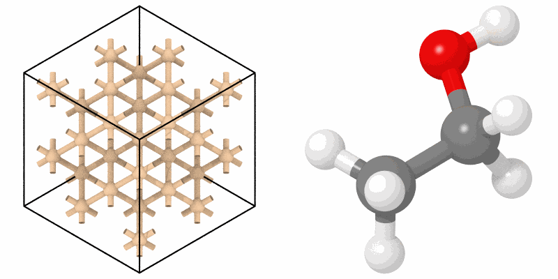

# Creating bonds

`create_bonds` puts bonds between near atoms into the topology of a system,
as OVITO's create bonds: between the atoms closer than a cutoff, or
covalent bonds from the radii of their elements. The bonds of a topology
are what the [bond length distribution](../analysis/bond-lengths.md)
measures, what a LAMMPS data file writes, and what `render(...,
bonds="topology")` draws.

```python
import numpy as np

import mdapy as mp
from mdapy import transform
from mdapy.build import build_crystal

silicon = transform.create_bonds(
    build_crystal("diamond", 5.431, elements="Si", repeat=(2, 2, 2)), 2.6
)
len(silicon.topology.bonds)  # 4 bonds of 2.35 Å for each atom, each pair once

ethanol = mp.System(
    [[0.0, 0.0, 0.0], [1.52, 0.0, 0.0], [2.0, 1.35, 0.0], [2.95, 1.30, 0.0],
     [-0.38, 1.02, 0.0], [-0.38, -0.51, 0.88], [-0.38, -0.51, -0.88],
     [1.90, -0.52, 0.89], [1.90, -0.52, -0.89]],
    mp.Box(20.0, pbc=False),
    elements=["C", "C", "O", "H", "H", "H", "H", "H", "H"],
)  # fmt: skip
ethanol = transform.create_bonds(ethanol, "covalent")  # 8 bonds
```

The bonds of the topology drawn:

```python
from mdapy.visualization import render, write_png

write_png(
    "images/bonds.png",
    np.hstack(
        [
            render(silicon, bonds="topology", radius=0.5, bond_radius=0.2,
                   view="iso", width=400, height=400),
            render(ethanol, bonds="topology", representation="ball_and_stick",
                   box=False, view=(0.35, 0.5, -1.0), style="shiny", samples=8,
                   width=400, height=400),
        ]
    ),
)  # fmt: skip
```



*Left: silicon bonded within 2.6 Å, the bonds across the periodic
boundaries drawn up to the box. Right: the covalent bonds of ethanol.*

## Parameters

`create_bonds(system, cutoff)`

| Name | Type | Unit | Meaning |
|---|---|---|---|
| `system` | System | | the atoms |
| `cutoff` | float or `"covalent"` | Å | bonds between atoms closer than this, also across periodic boundaries; or `"covalent"`, between atoms closer than 1.2 times the sum of their covalent radii, as [`covalent_bonds`](../visualization/rendering.md#molecules) finds them |

## Results

The system with these bonds in its topology, each pair once with the first
atom before the second; bonds it had are replaced, and its angles, dihedrals
and impropers kept.

## Errors

`InvalidParameter` for a cutoff that is neither positive nor `"covalent"`;
covalent bonds need an `element` column.

## See also

- [Topology](../getting-started/topology.md).
- OVITO [Create bonds](https://docs.ovito.org/reference/pipelines/modifiers/create_bonds.html).
