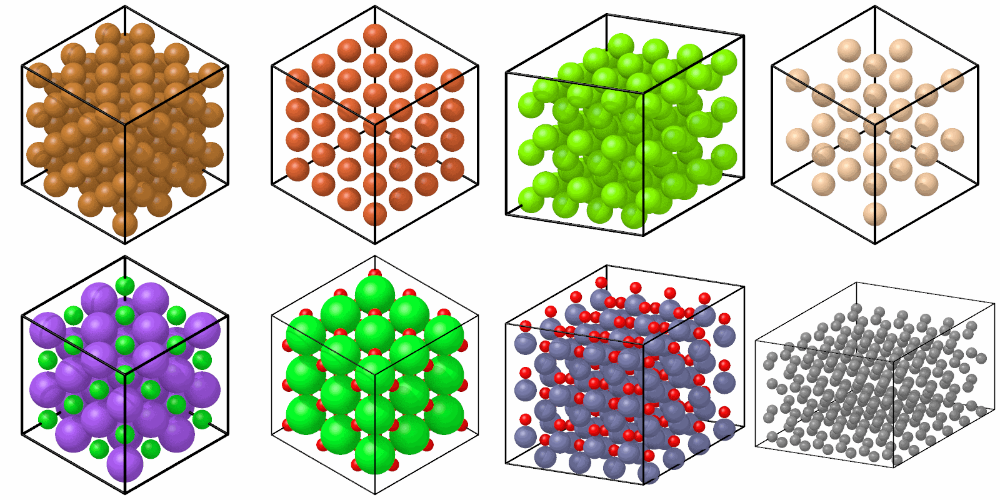

# Crystals

`build_crystal` makes a perfect crystal in a periodic box, of one element
or ordered on several sublattices, along any crystal directions.

```python
from mdapy.build import build_crystal

copper = build_crystal("fcc", 3.615, elements="Cu", repeat=(10, 10, 10))

# x along [110], y along [-112], z along [1-11]
oriented = build_crystal(
    "fcc", 3.615, elements="Cu", orientation=[(1, 1, 0), (-1, 1, 2), (1, -1, 1)]
)

salt = build_crystal("rocksalt", 5.64, elements=("Na", "Cl"), repeat=(4, 4, 4))

# hcp in an orthogonal box: x along [10-10], y along [-12-10], z along [0001]
magnesium = build_crystal(
    "hcp",
    3.21,
    c=5.21,
    elements="Mg",
    orientation=[(1, 0, -1, 0), (-1, 2, -1, 0), (0, 0, 0, 1)],
    repeat=(6, 10, 6),
)
```

Eight of the structures, drawn with the [renderer](../visualization/rendering.md):

```python
import numpy as np

from mdapy.visualization import element_radii, render, write_png

crystals = [
    build_crystal("fcc", 3.615, elements="Cu", repeat=(3, 3, 3)),
    build_crystal("bcc", 2.87, elements="Fe", repeat=(4, 4, 4)),
    build_crystal("hcp", 3.21, elements="Mg", repeat=(4, 4, 3)),
    build_crystal("diamond", 5.43, elements="Si", repeat=(2, 2, 2)),
    build_crystal("rocksalt", 5.64, elements=("Na", "Cl"), repeat=(2, 2, 2)),
    build_crystal("perovskite", 3.9, elements=("Sr", "Ti", "O"), repeat=(3, 3, 3)),
    build_crystal("wurtzite", 3.25, c=5.21, elements=("Zn", "O"), repeat=(4, 4, 3)),
    build_crystal("graphite", 2.46, c=6.7, elements="C", repeat=(6, 6, 2)),
]
pictures = [
    render(c, radius=0.75 * element_radii(c["element"]), width=400, height=400)
    for c in crystals
]
write_png(
    "images/crystals.png", np.vstack([np.hstack(pictures[:4]), np.hstack(pictures[4:])])
)
```



*Top: fcc copper, bcc iron, hcp magnesium and diamond silicon. Bottom: rocksalt
NaCl, perovskite SrTiO<sub>3</sub>, wurtzite ZnO and graphite. The spheres are
three quarters of the display radii, so that the inner atoms show.*

## Parameters

| Name | Type | Default | Unit | Meaning |
|---|---|---|---|---|
| `structure` | str | | | one of the structures below |
| `a` | float | | Å | the lattice constant |
| `c` | float | `None` | Å | the lattice constant $c$ of a hexagonal structure; by default the ideal $\sqrt{8/3}\,a$, and needed for graphite and graphene |
| `elements` | str or sequence of str | `"X"` | | the element of every atom, or one element for each sublattice, in the order of the table |
| `orientation` | three directions | `None` | | the crystal directions along the three box vectors; by default the cell of the table |
| `repeat` | three int | (1, 1, 1) | | the number of periods along each box vector |

| Structure | Cell | Atoms | Sublattices |
|---|---|---|---|
| `"sc"` | cubic | 1 | |
| `"bcc"` | cubic | 2 | corner, center: with two elements CsCl |
| `"fcc"` | cubic | 4 | the planes $z = 0$ and $z = a/2$: with two elements L1<sub>0</sub> |
| `"diamond"` | cubic | 8 | the two fcc lattices: with two elements zincblende |
| `"cscl"` | cubic | 2 | (Cs, Cl) |
| `"rocksalt"` | cubic | 8 | (Na, Cl) |
| `"zincblende"` | cubic | 8 | (Zn, S) |
| `"fluorite"` | cubic | 12 | (Ca, F) |
| `"l1_2"` | cubic | 4 | (Ni, Al) of Ni<sub>3</sub>Al |
| `"perovskite"` | cubic | 5 | (A, B, O) of ABO<sub>3</sub>, B at the corners |
| `"hcp"` | hexagonal | 2 | the two layers |
| `"wurtzite"` | hexagonal | 4 | (Zn, O) |
| `"lonsdaleite"` | hexagonal | 4 | |
| `"graphite"` | hexagonal | 4 | the two sites of each layer: with two elements like hexagonal BN |
| `"graphene"` | hexagonal | 2 | the two sites: with two elements hexagonal BN |

The cubic cell has the lattice vectors $a\,\mathbf x$, $a\,\mathbf y$ and
$a\,\mathbf z$; the hexagonal cell $\mathbf a_1 = a\,\mathbf x$,
$\mathbf a_2 = a(-\tfrac12\,\mathbf x + \tfrac{\sqrt3}{2}\,\mathbf y)$ and
$\mathbf c = c\,\mathbf z$, a box that is not orthogonal. A single element
fills every sublattice.

A direction of `orientation` is three integers $[hkl]$ in the cubic cell, or
$[uvw]$ or four integers $[hkil]$, with $h + k + i = 0$, in the hexagonal
cell, where $[hkil]$ is $[uvw] = [2h + k,\; h + 2k,\; l]$. Each is reduced
to coprime integers.

- In a cubic crystal the three directions must be orthogonal, and the box is
  orthogonal with the first direction along x, the second along y and the
  third along z. A left-handed set of directions gives the mirror image of
  the crystal, which is the same crystal.
- In a hexagonal crystal the directions need only be linearly independent:
  the first lies along x, the second in the xy plane, and the box is
  orthogonal only for orthogonal directions.

Along each direction the box takes the shortest lattice translation that
maps every atom onto an atom of the same element, for example
$\tfrac12[110]$ in fcc and $\tfrac12[111]$ in bcc of one element, but
$[111]$ in CsCl. The atoms are ordered by z, then y, then x: plane by
plane, and within a plane row by row, with the atoms of one plane or row
taken as such even where rounding makes their coordinates differ in the
last digits.

## Results

A [`System`](../getting-started/system.md) with an `element` column, in a
box periodic in every direction.

## Errors

`build_crystal` raises `InvalidParameter` for an unknown structure, a
lattice constant that is not positive, a `c` for a cubic structure or a
hexagonal structure without one, a number of elements that the structure
does not take or an unknown element, directions that are not three
directions of integers, zero, not orthogonal in a cubic or linearly
dependent in a hexagonal crystal, or with $h + k + i \ne 0$, and a `repeat`
that is not three positive integers.

## See also

- atomsk [`--create`](https://atomsk.univ-lille.fr/doc/en/mode_create.html),
  which makes the same crystals. For bcc of two elements it takes
  $\tfrac12[hkl]$ with $h$, $k$ and $l$ odd as a period, which does not
  keep the elements; `build_crystal` gives CsCl there as with `"cscl"`.
- LAMMPS [`lattice`](https://docs.lammps.org/lattice.html) with `orient`.
