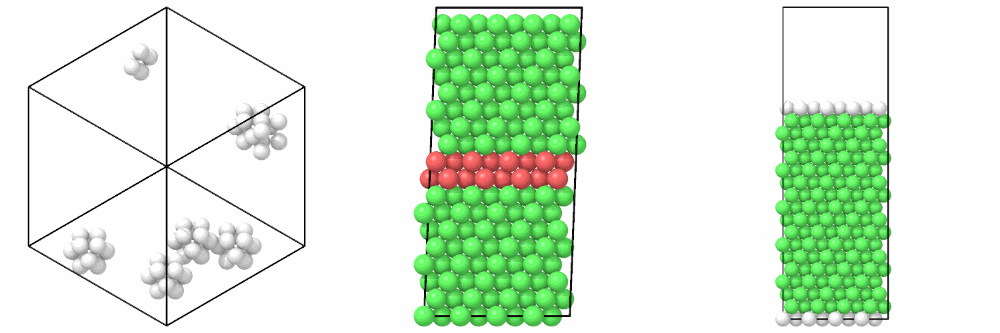

# Point defects, stacking faults and surfaces

`add_vacancies`, `add_interstitials` and `substitute` make point defects;
`slip` moves the atoms above a plane, for a stacking fault; `add_vacuum`
opens a box for a slab with two surfaces: the configurations of vacancy,
stacking fault and surface energies.

```python
import numpy as np

from mdapy.build import (
    add_interstitials,
    add_vacancies,
    add_vacuum,
    build_crystal,
    slip,
    substitute,
)

a = 3.615
copper = build_crystal("fcc", a, elements="Cu", repeat=(4, 4, 4))
vacancy = add_vacancies(copper, atoms=[0])
octahedral = add_interstitials(copper, "Cu", positions=[[a / 2, a / 2, a / 2]])
hydrogen = add_interstitials(copper, "H", 10, min_distance=1.5, seed=1)
nickel = substitute(copper, "Ni", 5, seed=2)

# an intrinsic stacking fault: slip by 1/6 [11-2] on a (111) plane
layers = build_crystal(
    "fcc",
    a,
    elements="Cu",
    orientation=[(1, 1, -2), (-1, 1, 0), (1, 1, 1)],
    repeat=(4, 6, 6),
)
fault = slip(layers, [a / np.sqrt(6), 0, 0])
slab = add_vacuum(layers, 15.0)  # two (111) surfaces
```

Seen by their structure:

```python
from mdapy.identify import CommonNeighborAnalysis
from mdapy.visualization import render, write_png

cna = CommonNeighborAnalysis()
vacancies = add_vacancies(
    build_crystal("fcc", a, elements="Cu", repeat=(8, 8, 8)), 6, seed=3
)
around = cna.compute(vacancies)
pictures = [
    render(vacancies, atoms=around.structure != 1, color=around, width=500, height=500),
    render(fault, color=cna.compute(fault), view="front", width=500, height=500),
    render(slab, color=cna.compute(slab), view="front", width=500, height=500),
]
write_png("images/defects.png", np.hstack(pictures))
```



*Left: six vacancies in copper, shown by the twelve neighbors each one leaves
without fcc order; the other atoms are hidden. Middle: the intrinsic stacking
fault, two (111) planes of hcp order (red) in fcc (green), seen along y.
Right: the slab, with its (111) surfaces (white) facing the vacuum.*

## Parameters

| Function | Parameters |
|---|---|
| `add_vacancies(system, count=None, *, atoms=None, seed=None)` | `count` atoms removed at random, or the `atoms` given as indices or a boolean mask |
| `substitute(system, element, count=None, *, atoms=None, seed=None)` | `count` atoms at random, or the `atoms` given, become `element` |
| `add_interstitials(system, element, count=None, *, positions=None, min_distance=1.0, seed=None, attempts=1000)` | atoms of `element` at the (M, 3) `positions` in Å, or `count` atoms at random positions, each at least `min_distance` Å from every atom; `attempts` random positions are tried for each |
| `slip(system, displacement, *, height=None, axis=2)` | the atoms above the plane at the fractional coordinate `height` (default 0.5) of the box vector `axis` move by `displacement` (Å, along the plane) |
| `add_vacuum(system, thickness, *, axis=2)` | the box vector `axis` grows by `thickness` Å |

`axis` is 0, 1, 2 or `"x"`, `"y"`, `"z"`. `seed` is an integer or a
`numpy.random.Generator`; the same seed gives the same choice.

## Results

Each returns a new [`System`](../getting-started/system.md):

- `add_vacancies` keeps the other atoms in their order.
- `substitute` keeps every atom; a system without elements gets `"X"`.
- `add_interstitials` puts the new atoms after the others; their other
  columns are those of the first atom, except `id`, which continues from the
  largest.
- `slip` moves the atoms; along a periodic axis the box vector moves with
  them, so that the box holds a single plane of slip, and not a second one
  where the box repeats.
- `add_vacuum` moves the atoms by whole box vectors so that none is cut by
  the boundary of that axis, and keeps the periodicity: with a periodic axis
  the slab has two surfaces facing a vacuum of `thickness`.

## Errors

They raise `InvalidParameter` for an unknown element, both or neither of a
count and atoms (or positions), a count out of range, repeated or invalid
indices, a mask of the wrong length, no place for an interstitial after
`attempts` tries, a displacement out of the plane, an unknown axis, or a
negative thickness or distance.

## See also

- [Surfaces and slip systems](slip-systems.md): the orientations of the
  common surfaces and slip systems, their energies and the shuffle and
  glide planes of diamond.
