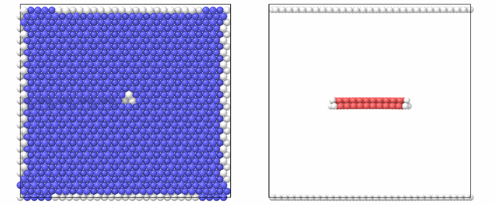
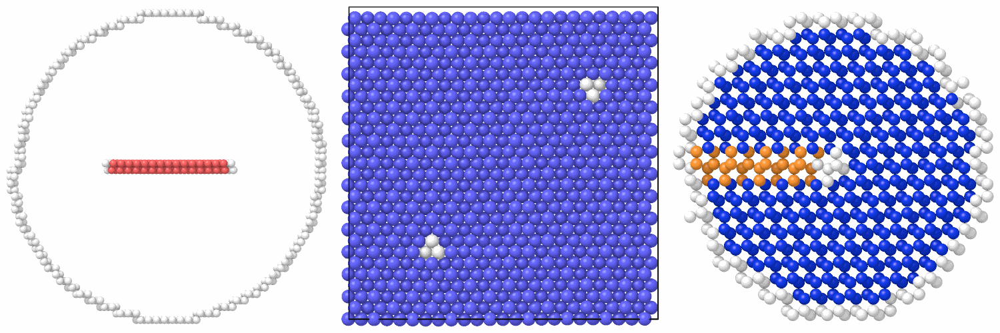

# Dislocations

`insert_dislocation` displaces the atoms of a system by the elastic field of
a straight dislocation, isotropic or anisotropic; `edge_dislocation` joins
two crystals with one period more below a line than above it.
`dislocation_cylinder` and `dislocation_quadrupole` build the two models of
atomistic studies of dislocation cores around the common dislocations of
bcc, fcc and diamond crystals, `DISLOCATIONS`, or your own: a cylinder with
a fixed outer shell, and a periodic quadrupole.

```python
import numpy as np

from mdapy.build import build_crystal, edge_dislocation, insert_dislocation

# a screw dislocation along [111] in iron
iron = build_crystal(
    "bcc",
    2.87,
    elements="Fe",
    orientation=[(1, 1, -2), (-1, 1, 0), (1, 1, 1)],
    repeat=(10, 16, 2),
)
center = iron.box.matrix.diagonal() / 2 + [0.1, 0.1, 0.0]
screw = insert_dislocation(iron, [0, 0, 2.87 * np.sqrt(3) / 2], line="z", center=center)

# an edge dislocation in copper: x along b = 1/2 [1-10], y along the line,
# z normal to the (111) glide plane
cell = build_crystal(
    "fcc", 3.615, elements="Cu", orientation=[(1, -1, 0), (1, 1, -2), (1, 1, 1)]
)
edge = edge_dislocation(cell, (30, 2, 12))
```

Relaxed with a potential, the edge dislocation splits:

```python
from mdapy.calculators import EAM
from mdapy.identify import CommonNeighborAnalysis
from mdapy.simulation import minimize
from mdapy.visualization import render, write_png

relaxed = minimize(edge, EAM.zhou(["Cu"]), max_force=1e-3, max_steps=3000).system

cna = CommonNeighborAnalysis()
core = cna.compute(relaxed)
size = {"width": 600, "height": 500}
along_screw = render(screw, color=cna.compute(screw), view="top", **size)
along_edge = render(relaxed, atoms=core.structure != 1, color=core, view="back", **size)
write_png("images/dislocations.png", np.hstack([along_screw, along_edge]))
```



*Left: the screw dislocation in iron seen along its line: bcc atoms (blue)
around the core (white); the faces of the box, where the cut ends, are not bcc
either. Right: the relaxed edge dislocation in copper seen along its line,
without the fcc atoms: two Shockley partials (white) around a ribbon of
stacking fault (red), between the free surfaces at the top and the bottom.*

## Anisotropic elasticity, cylinders and quadrupoles

With the elastic constants of the crystal, the displacements are those of
anisotropic elasticity. The models take the elastic constants of the cubic
cell, here those of the potentials, and relax with the atoms of the shell
fixed:

```python
from mdapy.build import DISLOCATIONS, dislocation_cylinder, dislocation_quadrupole
from mdapy.identify import DiamondStructure
from mdapy.lattice_dynamics import elastic_constants

zhou_cu, zhou_fe = EAM.zhou(["Cu"]), EAM.zhou(["Fe"])
cu = minimize(
    build_crystal("fcc", 3.615, elements="Cu", repeat=(3, 3, 3)), zhou_cu, cell="full"
).system
fe = minimize(
    build_crystal("bcc", 2.865, elements="Fe", repeat=(4, 4, 4)), zhou_fe, cell="full"
).system
a_cu, a_fe = cu.box.matrix[0, 0] / 3, fe.box.matrix[0, 0] / 4  # 3.615, 2.866 Å
c_cu = elastic_constants(cu, zhou_cu).constants  # GPa: C11 168.5, C12 121.6, C44 75.4
c_fe = elastic_constants(fe, zhou_fe).constants  # GPa: 229.6, 135.5, 116.7

# a screw dislocation of iron in anisotropic elasticity, in any system
anisotropic = insert_dislocation(
    iron,
    [0, 0, 2.87 * np.sqrt(3) / 2],
    center=center,
    elastic=c_fe,
    orientation=[(1, 1, -2), (-1, 1, 0), (1, 1, 1)],
)

# an edge dislocation of copper split into Shockley partials 20 Å apart, in
# a cylinder of radius 50 Å whose outer 6 Å are fixed
edge = dislocation_cylinder(
    "fcc edge", a_cu, c_cu, 50.0, elements="Cu", length=2, dissociation=20.0
)
edge = minimize(edge, zhou_cu, max_force=1e-3).system  # the shell stays put

# a periodic quadrupole of screw dislocations of iron
quadrupole = dislocation_quadrupole("bcc screw", a_fe, c_fe, (8, 14, 1), elements="Fe")
quadrupole = minimize(quadrupole, zhou_fe, max_force=1e-3).system

# a 30° partial of silicon, its stacking fault reaching out to -x
partial = dislocation_cylinder(
    "diamond 30 partial", 5.431, (165.6, 63.9, 79.5), 30.0, elements="Si", length=2
)

size = {"width": 500, "height": 500, "view": "top"}
fcc = cna.compute(edge)
pictures = [
    render(edge, atoms=fcc.structure != 1, color=fcc, box=False, **size),
    render(quadrupole, color=cna.compute(quadrupole), **size),
    render(partial, color=DiamondStructure().compute(partial), box=False, **size),
]
write_png("images/dislocation-models.png", np.hstack(pictures))
```



*Seen along the lines. Left: the relaxed edge dislocation of copper,
without the fcc atoms: two Shockley partials (white) around the ribbon of
stacking fault (red), and the free surface of the cylinder. Middle: the
quadrupole of screw dislocations of iron, relaxed, each core three columns
of atoms that are not bcc (white). Right: the 30° partial of silicon on the
glide set of {111} planes, its intrinsic stacking fault in hexagonal
diamond (orange).*

`DISLOCATIONS` holds these dislocations, each with x in its glide plane, y
normal to it and z along its line:

| Name | Burgers vector | x | y | z (line) | Partials |
|---|---|---|---|---|---|
| `"bcc screw"` | 1/2[111] | [11-2] | [-110] | [111] | |
| `"bcc edge"` | 1/2[111] | [111] | [-110] | [-1-12] | |
| `"bcc mixed"` | 1/2[111], 70.5° | [-1-1-2] | [-110] | [11-1] | |
| `"bcc <100> edge"` | [100] | [100] | [010] | [001] | |
| `"bcc <100>{110} edge"` | [100] | [100] | [011] | [0-11] | |
| `"fcc screw"` | 1/2[1-10] | [11-2] | [111] | [1-10] | 1/6[2-1-1] + 1/6[1-21] |
| `"fcc edge"` | 1/2[1-10] | [1-10] | [111] | [-1-12] | 1/6[2-1-1] + 1/6[1-21] |
| `"diamond screw"` | 1/2[1-10] | [11-2] | [111] | [1-10] | two 30° partials |
| `"diamond 60"` | 1/2[10-1] | [11-2] | [111] | [1-10] | 1/6[2-1-1] (30°) + 1/6[11-2] (90°) |
| `"diamond 30 partial"` | 1/6[1-21] | [11-2] | [111] | [1-10] | |
| `"diamond 90 partial"` | 1/6[11-2] | [11-2] | [111] | [1-10] | |

The dislocations of diamond lie on the glide set, between the planes of a
pair; the bcc screw dislocation in its easy core. A `Dislocation(structure,
orientation, burgers, partial=False, core=(0.5, 0.5))` of your own takes
any cubic structure, orientation and Burgers vector in the glide plane (in
units of the lattice constant, in the axes of the cubic cell); `core` puts
the line s rows of atoms along x from a row of the plane below it and t of
the way to the plane above.

## Parameters

`insert_dislocation(system, burgers, *, line=2, normal=1, center=None, poisson=1/3, elastic=None, orientation=None)`

| Name | Type | Default | Unit | Meaning |
|---|---|---|---|---|
| `burgers` | (3,) float | | Å | the Burgers vector, in the plane of cut: its part along `line` is screw, the rest edge |
| `line` | int or str | `"z"` | | the Cartesian axis along the dislocation line |
| `normal` | int or str | `"y"` | | the Cartesian axis normal to the plane of cut, other than `line` |
| `center` | (3,) float | center of the box | Å | a point of the line |
| `poisson` | float | 1/3 | | Poisson's ratio, for the edge part, in isotropic elasticity |
| `elastic` | (3,) or (6, 6) float | `None` | any | (C11, C12, C44) or the Voigt matrix of the elastic constants, in the axes of the cubic cell: anisotropic elasticity |
| `orientation` | three directions | the cubic axes | | the crystal directions along x, y and z, with `elastic` |

`dislocation_cylinder(dislocation, a, elastic, radius, *, elements="X", length=1, fixed=6.0, dissociation=0.0)`

| Name | Type | Default | Unit | Meaning |
|---|---|---|---|---|
| `dislocation` | str or `Dislocation` | | | a name of `DISLOCATIONS` or a dislocation of your own |
| `a` | float | | Å | the lattice constant |
| `elastic` | (3,) or (6, 6) float | | any | (C11, C12, C44) or the Voigt matrix, in the axes of the cubic cell |
| `radius` | float | | Å | the radius of the cylinder |
| `elements` | str or sequence | `"X"` | | as for `build_crystal` |
| `length` | int | 1 | | periods of the crystal along the line |
| `fixed` | float | 6 | Å | the thickness of the outer shell kept still, best at least the cutoff of the potential |
| `dissociation` | float | 0 | Å | the distance between the Shockley partials of an fcc or diamond dislocation, rounded to whole rows of atoms; 0 for a perfect one |

`dislocation_quadrupole(dislocation, a, elastic, repeat, *, elements="X", dissociation=0.0)`
takes the same `dislocation`, `a`, `elastic`, `elements` and
`dissociation`, and `repeat`, the periods of the oriented crystal along x,
y and z, at least 2 along x and y; a perfect dislocation, not a partial.

`edge_dislocation(cell, repeat)` takes an orthogonal periodic `cell` whose
period along x is the Burgers vector, and `repeat` = (nx, ny, nz): nx + 1
periods along x below the line and nx above, ny along y, nz along z, at
least 2.

## Results

`insert_dislocation` returns the same atoms, displaced, in the same box. The
displacements do not fit a box periodic across the line: the plane of cut
reaches one face of the box, where the crystal is no longer continuous.

`dislocation_cylinder` returns the cylinder along z, the line in the
middle of x and y, in a box periodic along z only, with a column `movable`
(N, 3) that is False for the atoms of the fixed shell, which `minimize`
keeps still. `dislocation_quadrupole` returns a fully periodic
crystal with a dislocation at a quarter of x and y and the opposite one half
a box away along both, so that each has four of the other sign around it;
its box is tilted by the plastic strain of the dipole, and with an edge part
a slab of atoms between their glide planes is taken away, as the
definition below tells.

`edge_dislocation` returns the lower crystal compressed and the upper one
stretched along x to nx + 1/2 periods, in a box periodic along x and y and
not along z; the line lies between them at the middle of x. Relaxed with a
potential, the dislocation takes its core; in fcc metals it splits into two
Shockley partials around a ribbon of stacking fault.

## Errors

`insert_dislocation` raises `InvalidParameter` for the same axis as line and
normal, a Burgers vector out of the plane of cut or not of three
components, a Poisson's ratio out of (−1, 0.5), elastic constants not of
(3,) or (6, 6) or not symmetric and positive definite, an orientation not
of three orthogonal directions, an unknown axis, or an atom on the line;
`edge_dislocation` for a cell that is not orthogonal and periodic, or a
`repeat` too small. `Dislocation` raises it for a structure that is not
cubic, an orientation that is not orthogonal and right-handed, and a
Burgers vector that is zero or out of the glide plane;
`dislocation_cylinder` and `dislocation_quadrupole` for an unknown name, a
radius that is not positive, a negative `fixed` or `dissociation`, a
`length` that is not a positive integer, a `repeat` below 2 along x or y,
a partial in a quadrupole, and a dissociation of a partial, of a
dislocation outside fcc and diamond, off a {111} plane or not made of two
Shockley partials.

## Definition

With $x_1$ along the edge part $b_e$ of the Burgers vector, $x_2$ along
`normal` and $x_3$ along `line`, measured from `center`, the screw part
$b_s$ displaces the atoms along the line and the edge part across it, as in
isotropic elasticity:

$$
u_3 = \frac{b_s}{2\pi} \operatorname{atan2}(x_2, x_1),
$$

$$
u_1 = \frac{b_e}{2\pi}\left[\arctan\frac{x_2}{x_1} + \frac{x_1 x_2}{2(1-\nu)(x_1^2 + x_2^2)}\right],
\qquad
u_2 = -\frac{b_e}{2\pi}\left[\frac{1-2\nu}{4(1-\nu)} \ln(x_1^2 + x_2^2) + \frac{x_1^2 - x_2^2}{4(1-\nu)(x_1^2+x_2^2)}\right],
$$

with $\nu$ Poisson's ratio. The cut of the screw part is the half plane
$x_1 < 0$; that of the edge part the half plane $x_1 > 0$, where the atoms
below the plane first move by $|b_e|/2$ along $x_1$ and those above it move
back by $|b_e|/2$ after the displacement, as atomsk does with `-dislocation
... edge`.

In anisotropic elasticity, with $C_{ijkl}$ the elastic constants in the
axes $x_1$, $x_2$, $x_3$ of the dislocation, the displacements are those of
Stroh,

$$
\mathbf u = \frac{1}{\pi} \operatorname{Im} \sum_{\alpha=1}^{3}
\mathbf a_\alpha \ln(x_1 + p_\alpha x_2)\, \mathbf l_\alpha \cdot \mathbf b ,
$$

with $p_\alpha$ the three roots of positive imaginary part of
$\det[Q + p(R + R^\mathsf T) + p^2 T] = 0$, $Q_{ik} = C_{i1k1}$,
$R_{ik} = C_{i1k2}$, $T_{ik} = C_{i2k2}$, and $(\mathbf a_\alpha,
\mathbf l_\alpha)$ the eigenvectors of the sextic problem scaled to
$2\, \mathbf a_\alpha \cdot \mathbf l_\alpha = 1$. The cut is the half
plane $x_1 < 0$ for every part; crossing it from below to above, the
displacement grows by $\mathbf b$. With the line along z and the cut
normal to y, these are the displacements of atomsk with an elastic tensor.
When the roots come closer than $10^{-4}$, the crystal is isotropic about
the line as far as it matters, and the isotropic displacements above take
their place, with Poisson's ratio of the Voigt average.

In the models a dislocation splits into Shockley partials $\mathbf b =
\mathbf b_1 + \mathbf b_2$ on its {111} glide plane, $\mathbf b_2$ on
the +x side; their cuts make the crystal above the plane between them move
by $\mathbf b_2$, which must be an intrinsic stacking fault: the
projection on the plane of a nearest neighbor above it. Each line sits
between two planes of atoms and between rows of atoms along x, the
displacements taken at the positions of the perfect crystal.

In the quadrupole the cut runs from the first dislocation along its glide
plane to halfway, across the planes between them, and along the glide
plane of the second to it. Across the planes, an edge part $b_x$ would
open a gap or crowd the atoms; the second dislocation is taken above or
below the first so that it crowds them, and the slab of atoms of width
$|b_x|$ beside the cut is taken away. The displacements of the dipole and
its images within 10 periods of the box both ways are summed; the sum is
periodic only up to a linear term, which is set so that the displacements
change by $\Delta_k$ from one periodic image to the next, the box vectors
$\mathbf c_k$ ($k = 1, 2$) becoming $\mathbf c_k + \Delta_k$:

$$
\Delta_k = -\frac{1}{L_x L_y} \sum_{\text{cuts}} \mathbf b_s
\,(\hat{\mathbf z} \times \mathbf d_s) \cdot \mathbf c_k ,
$$

with $\mathbf d_s$ each piece of the cut and $\mathbf b_s$ the Burgers
vector of the lines before it: the plastic strain of the dipole, which
leaves no mean stress in the crystal.

!!! quote "Please cite"
    [Hirth and Lothe (1982)](../reference/references.md#hirth1982); with
    elastic constants [Stroh (1958)](../reference/references.md#stroh1958);
    for the quadrupole [Bulatov and Cai (2006)](../reference/references.md#bulatov2006).

## See also

- atomsk [`-dislocation`](https://atomsk.univ-lille.fr/doc/en/option_disloc.html),
  whose isotropic screw and edge dislocations, and dislocations with an
  elastic tensor along z cut normal to y, `insert_dislocation` gives to
  rounding.
- [matscipy](https://github.com/libAtoms/matscipy), whose dislocation module
  builds the same models.
- [Surfaces and slip systems](slip-systems.md) for the slip systems of
  these dislocations, and [Defect energies](../simulation/defect-energies.md)
  for their stacking faults.
