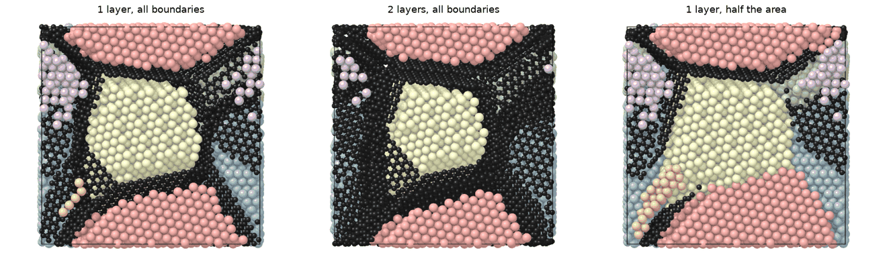

# Graphene on grain boundaries

`mdapy.build.add_graphene(polycrystal, *, layers=1, coverage=1.0,
clearance=3.0, bond=1.42, spacing=3.35, seed=None)` puts graphene on the
grain boundaries of a polycrystal from
[`build_polycrystal`](polycrystals.md): one or more layers on each face
between two grains, or on a fraction of them.

```python
from mdapy.build import add_graphene, build_crystal, build_polycrystal

copper = build_polycrystal(build_crystal("fcc", 3.615, elements="Cu"), 60.0, 6, seed=1)
composite = add_graphene(copper, layers=2, coverage=0.6, seed=2)
composite.table["element"].value_counts()  # Cu and C
```



*A copper polycrystal of six grains, cut in half, with graphene (dark): one
layer on every boundary, two layers, and one layer on half the area of the
boundaries.*

| Name | Type | Default | Unit | Meaning |
|---|---|---|---|---|
| `polycrystal` | `System` | | | a polycrystal from `build_polycrystal`, with `info["seeds"]` and a `grain` column |
| `layers` | int | 1 | | the number of graphene layers on each face, AB stacked and centered on it |
| `coverage` | float | 1 | | the fraction of the area of the boundaries covered, from 0 to 1 |
| `clearance` | float | 3.0 | Å | atoms of the polycrystal closer than this to a carbon atom are removed, about the distance of graphene from copper |
| `bond` | float | 1.42 | Å | the carbon–carbon bond of graphene |
| `spacing` | float | 3.35 | Å | the distance between graphene layers |
| `seed` | int or `Generator` | | | seed of the faces chosen and of the orientations of the graphene |

Each face between two grains, the face of their Voronoi cells, is covered
once by a flat piece of graphene, rotated at random about the normal of
the face, shifted at random within it, and cut to the face; where two
faces meet, a layer off the middle ends where the planes halfway between
them cross, so that the layers of the two faces meet there. With
`coverage` below 1, whole faces are covered in a random order until that
fraction of the boundary area is. Where faces meet, the carbon atoms of a
later face closer than 0.85 bond lengths to those of an earlier one are
left out: the pieces join with their edges, without bonds made across.

## Results

The atoms of the polycrystal left, then the carbon atoms, whose `grain` is
−1; the box and `info` of the polycrystal. With no face covered, the
polycrystal itself.

## Errors

`add_graphene` raises `MissingProperty` for a system without
`info["seeds"]` or a `grain` column, and `InvalidParameter` for fewer than
one layer, a coverage outside 0 to 1, and lengths that are not positive.
