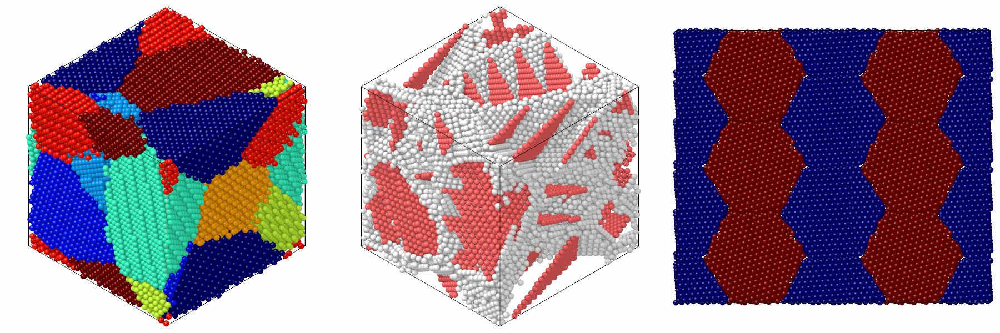

# Polycrystals and twins

`build_polycrystal` fills a periodic box with grains, each the crystal of a
unit cell, rotated, filling the Voronoi cell of its seed; `twin_lamellae`
makes a crystal of twin lamellae, which as the unit gives twinned grains.

```python
import numpy as np

import mdapy as mp
from mdapy.build import build_crystal, build_polycrystal, twin_lamellae

copper = build_crystal("fcc", 3.615, elements="Cu")
grains = build_polycrystal(copper, mp.Box(80.0), 8, seed=1)
grains.table["grain"]  # the grain of each atom

# twinned grains: lamellae of six (111) planes
layers = build_crystal(
    "fcc", 3.615, elements="Cu", orientation=[(1, 1, -2), (-1, 1, 0), (1, 1, 1)]
)
twinned = build_polycrystal(twin_lamellae(layers, 6), mp.Box(80.0), 8, seed=1)

# columnar grains along [111], seeds on a hexagonal lattice
a = 40.0
seeds = [[0.0, 0.0, 0.0], [a * np.sqrt(3) / 2, a / 2, 0.0]]
columns = build_polycrystal(layers, mp.Box([a * np.sqrt(3), a, 1.0]), seeds, seed=2)
```

Colored by grain, by structure and seen along the columns:

```python
from mdapy.identify import CommonNeighborAnalysis
from mdapy.transform import replicate
from mdapy.visualization import render, write_png

size = {"width": 600, "height": 600}
boundaries = CommonNeighborAnalysis().compute(twinned)
by_grain = render(grains, color="grain", colormap="jet", **size)
twins = render(twinned, atoms=boundaries.structure != 1, color=boundaries, **size)
tiled = replicate(columns, (2, 3, 1))
from_above = render(tiled, color="grain", colormap="jet", view="top", **size)
write_png("images/polycrystals.png", np.hstack([by_grain, twins, from_above]))
```



*Left: the eight grains. Middle: the twinned grains without their fcc atoms,
which leaves the grain boundaries (white) and the twin boundaries (red, hcp
by [common neighbor analysis](../analysis/cna.md)). Right: the columnar
grains seen from above, repeated twice along x and three times along y to show
the hexagonal pattern.*

## Parameters

`build_polycrystal(unit, box, grains, *, orientations=None, min_distance=None, seed=None)`

| Name | Type | Default | Unit | Meaning |
|---|---|---|---|---|
| `unit` | `System` | | | the crystal of every grain in a periodic box: a unit cell or any periodic arrangement |
| `box` | `Box` or (3, 3) | | Å | the box of the polycrystal, periodic in every direction |
| `grains` | int or (G, 3) | | Å | the number of grains with seeds at random, or the positions of the seeds |
| `orientations` | (G, 3, 3) | random | | the rotation of each grain, from the axes of `unit` to those of the box |
| `min_distance` | float | 0.7 × nearest distance of `unit` | Å | of two atoms closer than this, the later is removed |
| `seed` | int or `numpy.random.Generator` | `None` | | the random seeds and orientations |

Along an axis where the box is no longer than the box of `unit`, the
polycrystal is columnar: the seeds lie in one plane, every grain spans the
axis, the box takes the length of `unit` along it, and the grains turn about
it only. Both boxes must then be orthogonal. `random_rotations(count,
seed=None)` gives rotations uniformly over all orientations.

`twin_lamellae(cell, layers)` takes a periodic crystal whose third box
vector is along z and whose atoms lie on equally spaced planes normal to z,
such as fcc with z along [111], and the number of planes of each lamella,
at least 2.

## Results

`build_polycrystal` returns the atoms with a `grain` column, numbered as the
seeds, wrapped into the box, and the (G, 3) positions of the seeds in
`info["seeds"]`, from which [`add_graphene`](graphene.md) finds the grain
boundaries. The first atom of `unit` sits on the seed of each grain. Grains that meet their own periodic image meet a copy shifted
by a box vector, generally not a lattice vector of the rotated crystal, so a
boundary forms there too.

`twin_lamellae` returns two lamellae, 2 × `layers` planes, in the box of
`cell` along x and y; every lamella is the mirror image of the next across
the plane between them, which is a coherent twin boundary of fcc, and the
box repeats them along z.

## Errors

`build_polycrystal` raises `InvalidParameter` for a unit or box that is not
periodic, a number of grains below one, seeds not of shape (G, 3),
orientations of another shape or not rotations, rotations of a columnar
polycrystal not about its axis, a box no longer than the unit along two
axes, a box that is not orthogonal when columnar, or a negative minimum
distance. `twin_lamellae` raises it for a cell that is not periodic, whose
third vector is not along z or first two not in the xy plane, whose atoms
are not on equally spaced planes, or for fewer than two layers.

## See also

- [Graphene on grain boundaries](graphene.md).

- atomsk [`--polycrystal`](https://atomsk.univ-lille.fr/doc/en/mode_polycrystal.html).
