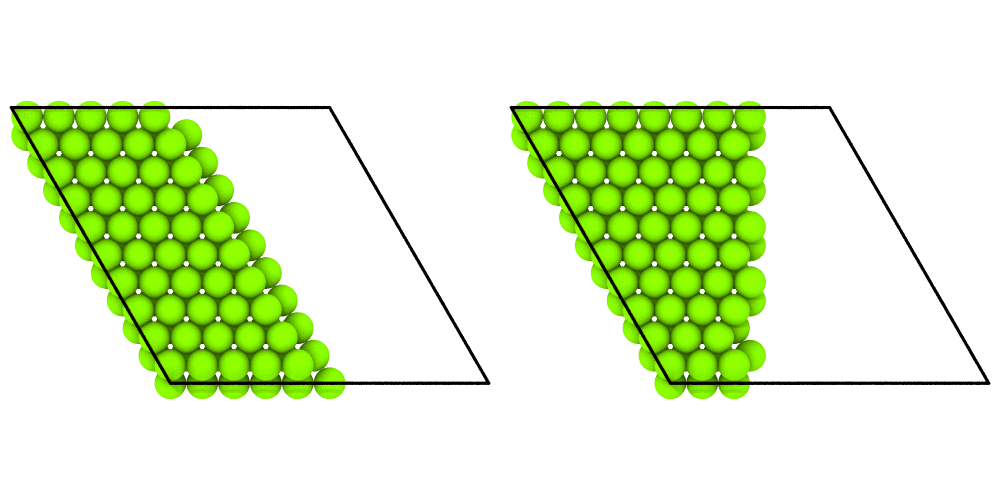

# Slices

`mdapy.transform.slice` keeps the atoms on one side of a plane, or those in a
slab about it, as the Slice modifier of OVITO: a cut through a polycrystal,
half of a cylinder, a thin layer to draw. The plane is any: its normal is
any vector, or Miller indices in the vectors of the box. `slice_mask` gives
the same choice as a mask, without a new system.

```python
from mdapy.build import build_crystal, build_polycrystal
from mdapy.transform import slice

crystal = build_crystal("fcc", 3.615, elements="Cu", repeat=(10, 10, 10))
lower = slice(crystal, "z", 18.0)  # the atoms with z ≤ 18 Å
upper = slice(crystal, "z", 18.0, invert=True)  # the others
# a slab 6 Å thick normal to [111], through the middle of the box
slab = slice(crystal, (1, 1, 1), 31.3, width=6.0)
# the same plane through a point instead of at a distance from the origin
middle = crystal.box.origin + crystal.box.matrix.sum(axis=0) / 2
same = slice(crystal, (1, 1, 1), through=middle, width=6.0)
# or by its Miller indices in the vectors of the box, 1.5 interplanar
# spacings of the box from its origin: the middle again
also = slice(crystal, (1, 1, 1), 1.5, width=6.0, miller=True)
len(slab), len(same), len(also)  # 886 atoms each
```

A mask instead of a new system, to count, draw or combine, and a plane
that acts on some atoms only:

```python
from mdapy.transform import slice_mask

kept = slice_mask(crystal, "z", 18.0)  # (N,) bool: the atoms slice keeps
int(kept.sum())  # 2000; ~kept are those OVITO's select mode selects
copper = crystal["element"] == "Cu"
lower_copper = slice(crystal, "z", 18.0, atoms=copper)  # the others all stay
```

A slab through a polycrystal, its atoms colored by their structure:

```python
from mdapy.identify import CommonNeighborAnalysis
from mdapy.visualization import atom_colors, render

unit = build_crystal("fcc", 3.615, elements="Cu")
grains = build_polycrystal(unit, (80, 80, 80), 8, seed=3)
# the colors of the structures of the whole polycrystal, kept as a column
colors = atom_colors(grains, CommonNeighborAnalysis().compute(grains))
grains = grains.with_columns(rgb=colors)
middle = slice(grains, "z", 40.0, width=6.0)
render(
    middle, "images/slice.png", color=middle["rgb"], view="top", width=600, height=600
)
```


*A slab 6 Å thick through the middle of a copper polycrystal seen from
above: the grains in fcc green, the grain boundaries white. The structures
come from the whole polycrystal, kept as a column of colors; found in the
slab alone, its two faces would not be fcc.*

## Parameters

`slice(system, normal, distance=0.0, *, width=0.0, invert=False, miller=False, through=None, atoms=None)`,
and `slice_mask` with the same arguments

| Name | Type | Default | Unit | Meaning |
|---|---|---|---|---|
| `normal` | (3,) float or str | | | the normal of the plane in Cartesian coordinates, of any length, or an axis `"x"`, `"y"`, `"z"`; with `miller`, the Miller indices $hkl$ of the plane in the vectors of the box, not necessarily whole |
| `distance` | float | 0 | Å, or $d_{hkl}$ | the plane holds the points $\mathbf x$ with $\hat{\mathbf n} \cdot \mathbf x$ = `distance`; with `miller`, it lies `distance` interplanar spacings $d_{hkl}$ of the box from the origin of the box |
| `width` | float | 0 | Å | keep the atoms closer to the plane than `width / 2` instead; 0 keeps those on the side the normal points away from |
| `invert` | bool | `False` | | keep the other atoms |
| `miller` | bool | `False` | | `normal` holds Miller indices |
| `through` | (3,) float | `None` | Å | a point the plane passes through, instead of `distance` |
| `atoms` | mask or indices | all | | the atoms the plane acts on; the others are kept |

The atoms are taken where they are, inside the box or not; their periodic
images do not count.

### Miller indices

With `miller=True` the three numbers are the Miller indices $(hkl)$ of a
plane in the vectors $\mathbf a$, $\mathbf b$, $\mathbf c$ of the box, and
`distance` picks one of the parallel planes: the plane holds the points
whose fractional coordinates $\mathbf f$ in the box satisfy

$$
h f_1 + k f_2 + l f_3 = \text{distance} .
$$

`(0, 0, 1)` at 0.5 cuts the box halfway along $\mathbf c$, and `(1, 1, 1)`
at 1.5 passes through its middle, whatever the shape of the box: the
distance counts interplanar spacings $d_{hkl}$ of the box from its origin,
and $(h + k + l) / 2$ is the middle.

In a box of orthogonal vectors of equal length the plane $(hkl)$ is normal
to the Cartesian vector $(h, k, l)$, and both ways give the same plane. In
any other box they do not: in the hexagonal box of an hcp crystal,
$\mathbf b$ at 120° to $\mathbf a$, the plane $(100)$ of the box, a
prismatic plane of the crystal, runs along $\mathbf b$, while the Cartesian
normal $(1, 0, 0)$ cuts across it:

```python
import numpy as np
from mdapy.visualization import render, write_png

mg = build_crystal("hcp", 3.21, elements="Mg", repeat=(10, 10, 4))
# the plane (1 0 0) of the box, halfway along a: f1 = 0.5
prism = slice(mg, (1, 0, 0), 0.5, miller=True)
# the Cartesian normal (1, 0, 0) through the middle of the box: x = 8.0 Å
middle = mg.box.origin + mg.box.matrix.sum(axis=0) / 2
across = slice(mg, (1, 0, 0), through=middle)
len(prism), len(across)  # 440 and 436 atoms
pictures = [render(s, view="top", width=500, height=500) for s in (prism, across)]
write_png("images/slice_miller.png", np.hstack(pictures))
```



*Magnesium in its hexagonal box, seen from above. Left: the plane $(100)$
of the box halfway along $\mathbf a$ keeps half of the box, cut along
$\mathbf b$. Right: the Cartesian normal $(1, 0, 0)$ through the middle
cuts across $\mathbf b$.*

The indices and the spacing are those of the box, as in OVITO, not those
of the crystal. They point along the crystal's directions when the box is
whole unit cells along its vectors, as `build_crystal` makes it, but
$d_{hkl}$ is then $n$ times the crystal's for $n$ cells: in the copper box
of the first example, $d_{111}$ = 20.9 Å, ten times the 2.09 Å between its
(111) layers of atoms. A crystal turned by `orientation` has other box
vectors: cut it by a Cartesian normal.

## Results

`slice` returns a new system of the atoms kept, in their order, with all
their columns, in the same box; `slice_mask` the (N,) bool mask of those
atoms, which `system.filter(mask)` turns into the same system. The atoms
outside the mask are those OVITO's Slice selects in its select mode.

## Errors

`slice` and `slice_mask` raise `InvalidParameter` for a normal that is
zero, not of three numbers or an unknown axis, Miller indices given as an
axis, a negative width, a point not of three numbers, both a distance and a
point, and atoms that are not a mask or indices of the system.

## Definition

An atom at $\mathbf x$ lies at the signed distance

$$
s = \hat{\mathbf n} \cdot \mathbf x - d
$$

from the plane, $\hat{\mathbf n}$ the unit normal and $d$ the distance;
with Miller indices $hkl$ in the box of origin $\mathbf o$ and fractional
coordinates $\mathbf f$, $\mathbf g = h\,\mathbf a^* + k\,\mathbf b^* +
l\,\mathbf c^*$ of the reciprocal vectors of the box,

$$
s = (\mathbf g \cdot (\mathbf x - \mathbf o) - d)\, d_{hkl}
= (hkl \cdot \mathbf f - d)\, d_{hkl},
\qquad d_{hkl} = 1 / |\mathbf g| ;
$$

through a point $\mathbf p$, $s = \hat{\mathbf n} \cdot (\mathbf x -
\mathbf p)$, or $\mathbf g \cdot (\mathbf x - \mathbf p)\, d_{hkl}$. The
atoms with $s \le 0$ are kept, or with $|s| \le w/2$ for a width $w > 0$.

## See also

- OVITO [Slice](https://docs.ovito.org/reference/pipelines/modifiers/slice.html),
  whose atoms `slice` keeps, also with Miller indices, with its select mode
  (`slice_mask`) and on the selected atoms only (`atoms`).
- [Selecting atoms](../getting-started/selecting.md) with conditions such as
  `"positions.z < 18"`.
