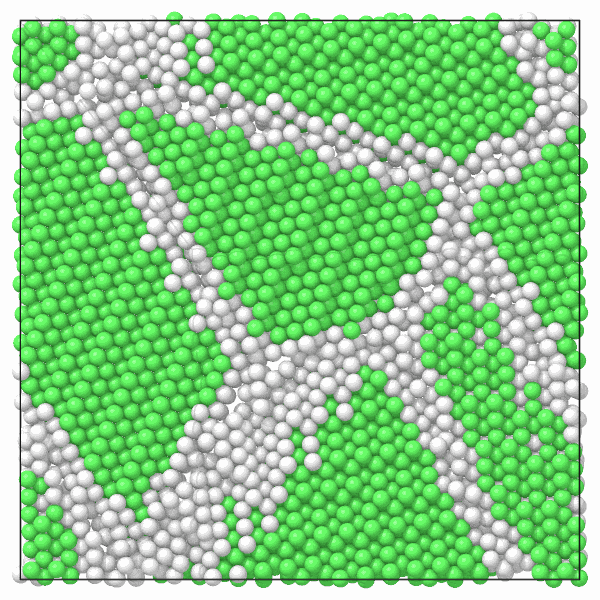

# Slices

`mdapy.transform.slice` keeps the atoms on one side of a plane, or those in a
slab about it, as the Slice modifier of OVITO: a cut through a polycrystal,
half of a cylinder, a thin layer to draw.

```python
from mdapy.build import build_crystal, build_polycrystal
from mdapy.transform import slice

crystal = build_crystal("fcc", 3.615, elements="Cu", repeat=(10, 10, 10))
lower = slice(crystal, "z", 18.0)  # the atoms with z ≤ 18 Å
upper = slice(crystal, "z", 18.0, invert=True)  # the others
# a slab 6 Å thick normal to [111], through the middle of the box
slab = slice(crystal, (1, 1, 1), 31.3, width=6.0)
```

A slab through a polycrystal, its atoms colored by their structure:

```python
from mdapy.identify import CommonNeighborAnalysis
from mdapy.visualization import atom_colors, render

unit = build_crystal("fcc", 3.615, elements="Cu")
grains = build_polycrystal(unit, (80, 80, 80), 8, seed=3)
# the colors of the structures of the whole polycrystal, kept as a column
colors = atom_colors(grains, CommonNeighborAnalysis().compute(grains))
grains = grains.with_columns(rgb=colors)
middle = slice(grains, "z", 40.0, width=6.0)
render(
    middle, "images/slice.png", color=middle["rgb"], view="top", width=600, height=600
)
```



*A slab 6 Å thick through the middle of a copper polycrystal seen from
above: the grains in fcc green, the grain boundaries white. The structures
come from the whole polycrystal, kept as a column of colors; found in the
slab alone, its two faces would not be fcc.*

## Parameters

`slice(system, normal, distance=0.0, *, width=0.0, invert=False)`

| Name | Type | Default | Unit | Meaning |
|---|---|---|---|---|
| `normal` | (3,) float or str | | | the normal of the plane in Cartesian coordinates, of any length, or an axis `"x"`, `"y"`, `"z"` |
| `distance` | float | 0 | Å | the plane holds the points $\mathbf x$ with $\hat{\mathbf n} \cdot \mathbf x$ = `distance` |
| `width` | float | 0 | Å | keep the atoms closer to the plane than `width / 2` instead; 0 keeps those on the side the normal points away from |
| `invert` | bool | `False` | | keep the other atoms |

## Results

A new system of the atoms kept, in their order, with all their columns, in
the same box.

## Errors

`slice` raises `InvalidParameter` for a normal that is zero, not of three
numbers or an unknown axis, and a negative width.

## See also

- OVITO [Slice](https://docs.ovito.org/reference/pipelines/modifiers/slice.html),
  whose atoms `slice` keeps.
- [Selecting atoms](../getting-started/selecting.md) with conditions such as
  `"positions.z < 18"`.
