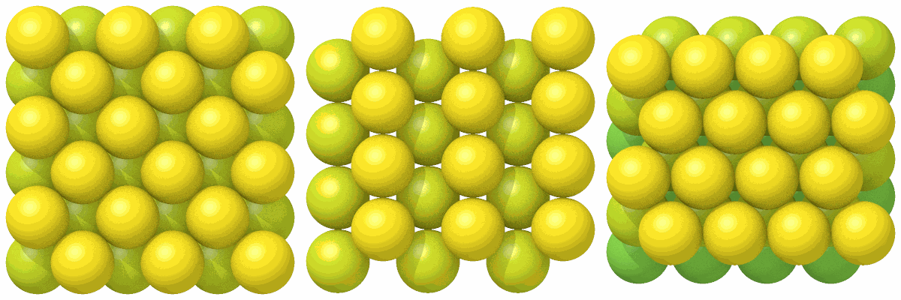
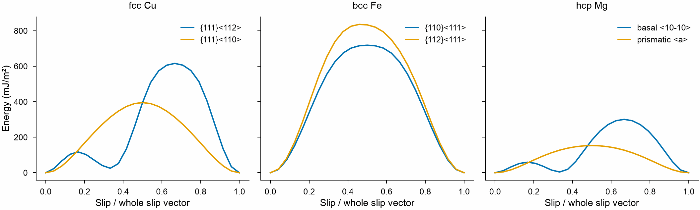
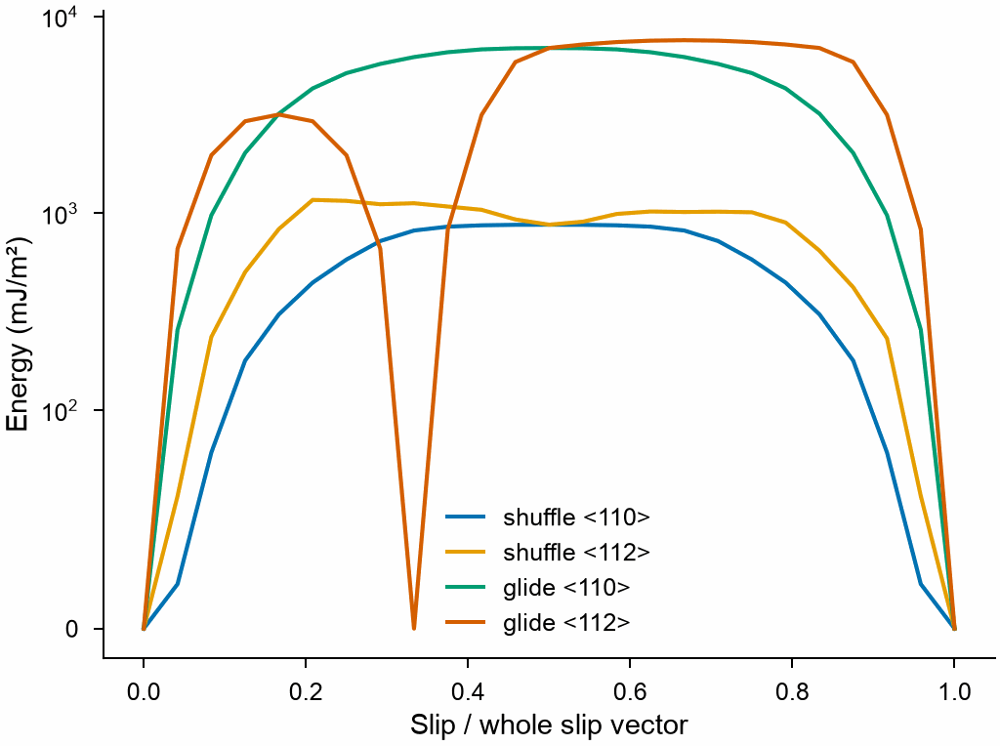

# Surfaces and slip systems

A surface or a slip plane is the xy plane of a crystal built with
[`orientation`](crystals.md#parameters): z along the normal of the plane
and, for slip, x along the slip direction. A slab of the crystal then has
two such surfaces, and `stacking_fault_energy` slips the upper half along x.
The tables below give the orientations of the common surfaces and slip
systems, each a right-handed triple ($\mathbf z = \mathbf x \times \mathbf y$).

```python
from mdapy.build import build_crystal
from mdapy.calculators import EAM
from mdapy.simulation import stacking_fault_energy, surface_energy

copper = EAM.zhou(["Cu"])
# the (111) plane of fcc copper, x along the partial slip direction [11-2]
orientation = [(1, 1, -2), (-1, 1, 0), (1, 1, 1)]
cell = build_crystal("fcc", 3.615, elements="Cu", orientation=orientation)
period = cell.box.matrix[0, 0]  # the whole slip vector along x: a sqrt(6) / 2

crystal = build_crystal(
    "fcc", 3.615, elements="Cu", orientation=orientation, repeat=(1, 4, 5)
)
surface_energy(crystal, copper).energy  # J/m², the (111) surface
curve = stacking_fault_energy(crystal, copper, [period, 0, 0], points=25)
curve.energy[8]  # J/m², the intrinsic stacking fault at a third: 1/6 [11-2]
```

The box along x is the shortest period of the crystal in that direction, so
the slip vector of a whole period, from one perfect stacking to the next, is
the length of the box of one cell, `cell.box.matrix[0, 0]`. Repeat the cell
across the plane until the surfaces or the faults no longer feel each other,
about 20 Å; along the plane one period is enough for a flat fault and
surface.

## Common surfaces

| Crystal | Surface | x | y | z |
|---|---|---|---|---|
| fcc, diamond | (100) | [100] | [010] | [001] |
| fcc, diamond | (110) | [001] | [1-10] | [110] |
| fcc, diamond | (111) | [1-10] | [11-2] | [111] |
| bcc | (100) | [100] | [010] | [001] |
| bcc | (110) | [001] | [1-10] | [110] |
| bcc | (112) | [11-1] | [-110] | [112] |
| hcp | basal (0001) | [10-10] | [-12-10] | [0001] |
| hcp | prismatic (10-10) | [-12-10] | [0001] | [10-10] |

The hexagonal directions are four Miller–Bravais indices. The surface
energies of copper and iron with the EAM potentials of Zhou et al., and
each surface seen from above:

```python
import numpy as np

from mdapy.visualization import render, write_png

iron = EAM.zhou(["Fe"])
surfaces = {
    ("fcc", "(100)"): [(1, 0, 0), (0, 1, 0), (0, 0, 1)],
    ("fcc", "(110)"): [(0, 0, 1), (1, -1, 0), (1, 1, 0)],
    ("fcc", "(111)"): [(1, -1, 0), (1, 1, -2), (1, 1, 1)],
    ("bcc", "(100)"): [(1, 0, 0), (0, 1, 0), (0, 0, 1)],
    ("bcc", "(110)"): [(0, 0, 1), (1, -1, 0), (1, 1, 0)],
    ("bcc", "(112)"): [(1, 1, -1), (-1, 1, 0), (1, 1, 2)],
}
energies, pictures = {}, []
for (kind, plane), orientation in surfaces.items():
    element, a, potential = (
        ("Cu", 3.615, copper) if kind == "fcc" else ("Fe", 2.865, iron)
    )
    cell = build_crystal(kind, a, elements=element, orientation=orientation)
    # at least 8 x 8 Å across and 24 Å thick
    repeat = np.ceil([8, 8, 24] / cell.box.matrix.diagonal()).astype(int)
    crystal = build_crystal(
        kind, a, elements=element, orientation=orientation, repeat=repeat
    )
    energies[kind, plane] = surface_energy(crystal, potential).energy
    if kind == "fcc":
        top = crystal["positions.z"]
        pictures.append(
            render(crystal, color=top, view="top", box=False, width=400, height=400)
        )
energies  # J/m²: fcc (111) 1.50 < (100) 1.56 < (110) 1.74; bcc (110) 1.43 < (100), (112) 1.69
write_png("images/surfaces.png", np.hstack(pictures))
```



*The (100), (110) and (111) surfaces of fcc copper seen from above, each atom
colored by its height, the top layer yellow: a square, a rectangular and a
triangular lattice. The closest packed (111) surface has the lowest energy.*

## Common slip systems

| Crystal | Slip system | x (slip) | y | z (normal) | Whole slip vector |
|---|---|---|---|---|---|
| fcc | {111}<110>, full dislocations | [1-10] | [11-2] | [111] | $a/\sqrt2$ |
| fcc | {111}<112>, Shockley partials | [11-2] | [-110] | [111] | $a\sqrt6/2$, the partial $a/\sqrt6$ at a third |
| bcc | {110}<111> | [111] | [11-2] | [-110] | $a\sqrt3/2$ |
| bcc | {112}<111> | [111] | [1-10] | [11-2] | $a\sqrt3/2$; the two senses differ, one is the twinning sense |
| hcp | basal (0001)<10-10>, partials | [10-10] | [-12-10] | [0001] | $\sqrt3 a$, the partial at a third |
| hcp | prismatic {10-10}<11-20> | [-12-10] | [0001] | [10-10] | $a$ |
| diamond | {111}<110>, shuffle or glide set | [1-10] | [11-2] | [111] | $a/\sqrt2$ |
| diamond | {111}<112>, glide set | [11-2] | [-110] | [111] | $a\sqrt6/2$ |

The generalized stacking fault energy of each, with the EAM potentials of
Zhou et al. (magnesium: $a$ = 3.20 Å, $c$ = 5.20 Å, the minimum of its
energy):

```python
from mdapy.visualization import plot

magnesium = EAM.zhou(["Mg"])
systems = {
    "fcc Cu": {
        "{111}<112>": [(1, 1, -2), (-1, 1, 0), (1, 1, 1)],
        "{111}<110>": [(1, -1, 0), (1, 1, -2), (1, 1, 1)],
    },
    "bcc Fe": {
        "{110}<111>": [(1, 1, 1), (1, 1, -2), (-1, 1, 0)],
        "{112}<111>": [(1, 1, 1), (1, -1, 0), (1, 1, -2)],
    },
    "hcp Mg": {
        "basal <10-10>": [(1, 0, -1, 0), (-1, 2, -1, 0), (0, 0, 0, 1)],
        "prismatic <a>": [(-1, 2, -1, 0), (0, 0, 0, 1), (1, 0, -1, 0)],
    },
}
crystals = {
    "fcc Cu": ("fcc", 3.615, {}, "Cu", copper),
    "bcc Fe": ("bcc", 2.865, {}, "Fe", iron),
    "hcp Mg": ("hcp", 3.20, {"c": 5.20}, "Mg", magnesium),
}
with plot.style():
    fig, axes = plot.figure("double", 55, ncols=3, sharey=True)
    for ax, (name, paths) in zip(axes, systems.items()):
        kind, a, extra, element, potential = crystals[name]
        for label, orientation in paths.items():
            cell = build_crystal(
                kind, a, elements=element, orientation=orientation, **extra
            )
            period = cell.box.matrix[0, 0]
            layers = int(np.ceil(30 / cell.box.matrix[2, 2]))
            crystal = build_crystal(
                kind,
                a,
                elements=element,
                orientation=orientation,
                repeat=(1, 4, layers),
                **extra,
            )
            curve = stacking_fault_energy(crystal, potential, [period, 0, 0], points=25)
            ax.plot(curve.fraction, 1000 * curve.energy, label=label)
        ax.set_title(name)
        ax.set_xlabel("Slip / whole slip vector")
        ax.legend(frameon=False)
    axes[0].set_ylabel("Energy (mJ/m²)")
    plot.save(fig, "images/slip-systems", formats=("png",))
```



*Left: in copper the partial path has the intrinsic stacking fault, a local
minimum at a third, and a lower barrier than the whole <110> vector, which
is why the dislocations of fcc metals split. Middle: in iron the {112}
curve is not symmetric about one half: slipping one way, the twinning
sense, costs less than the other. Right: in magnesium the basal plane has its fault
at a third; the prismatic plane slips over a single barrier.*

## Shuffle and glide planes of diamond

The (111) planes of diamond and silicon come in pairs: the gap within a
pair is a third of the gap between pairs. A fault between two pairs, the
shuffle set, cuts one bond per atom; one within a pair, the glide set,
cuts three. `height` puts the fault at a fractional height of the box: the
middle of a wide or of a narrow gap between the planes of atoms. Silicon
with the Stillinger–Weber potential of LAMMPS:

<!-- skip-test -->
```python
from mdapy.calculators import LAMMPS

silicon = LAMMPS("pair_style sw\npair_coeff * * Si.sw Si", elements=["Si"])
a = 5.431
partial = [(1, 1, -2), (-1, 1, 0), (1, 1, 1)]  # x along <112>, y along <110>
crystal = build_crystal(
    "diamond", a, elements="Si", orientation=partial, repeat=(1, 2, 4)
)

# the gaps between the planes of atoms, and the middle of a wide and of a narrow one
side = crystal.box.matrix[2, 2]
planes = np.unique(np.round(crystal["positions.z"] % side, 4))
gaps = np.diff(np.append(planes, planes[0] + side))
middles = (planes + gaps / 2) / side
shuffle = middles[gaps > gaps.mean()][
    np.argmin(np.abs(middles[gaps > gaps.mean()] - 0.5))
]
glide = middles[gaps < gaps.mean()][
    np.argmin(np.abs(middles[gaps < gaps.mean()] - 0.5))
]

with plot.style():
    fig, ax = plot.figure("single")
    for name, height in [("shuffle", shuffle), ("glide", glide)]:
        for path, vector in [
            ("<110>", [0, a / np.sqrt(2), 0]),
            ("<112>", [a * np.sqrt(6) / 2, 0, 0]),
        ]:
            curve = stacking_fault_energy(
                crystal, silicon, vector, points=25, height=height
            )
            ax.plot(curve.fraction, 1000 * curve.energy, label=f"{name} {path}")
    ax.set_yscale("symlog", linthresh=100)
    ax.set_xlabel("Slip / whole slip vector")
    ax.set_ylabel("Energy (mJ/m²)")
    ax.legend(frameon=False)
    plot.save(fig, "images/shuffle-glide", formats=("png",))
```



*The shuffle set slips along <110> over about 0.9 J/m², the glide set over
nearly 7 J/m²; along <112> the glide set has its intrinsic stacking fault
at a third, at no energy with this potential, which has no interaction
beyond the nearest neighbors. Partial dislocations of silicon move on the
glide set, whole ones on the shuffle set.*

## See also

- [Crystals](crystals.md) for `orientation`, [Point defects, stacking
  faults and surfaces](defects.md) for `slip` and `add_vacuum`, and
  [Defect energies](../simulation/defect-energies.md) for
  `surface_energy` and `stacking_fault_energy`.
- [Dislocations](dislocations.md) built on these slip systems.
